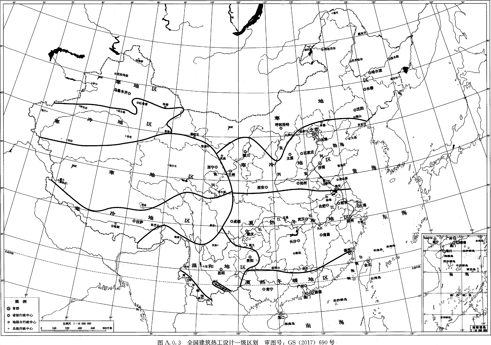
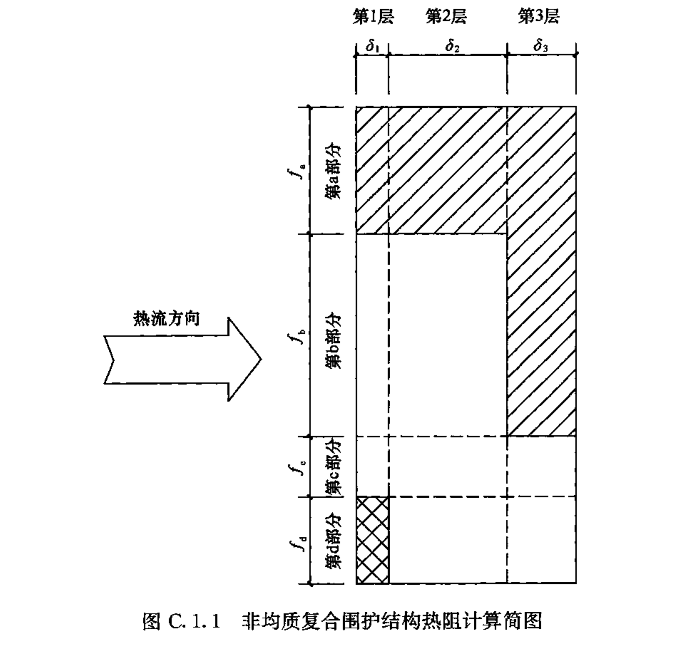
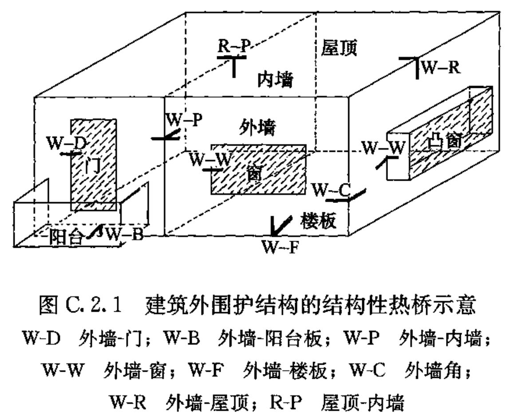
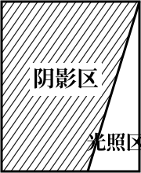
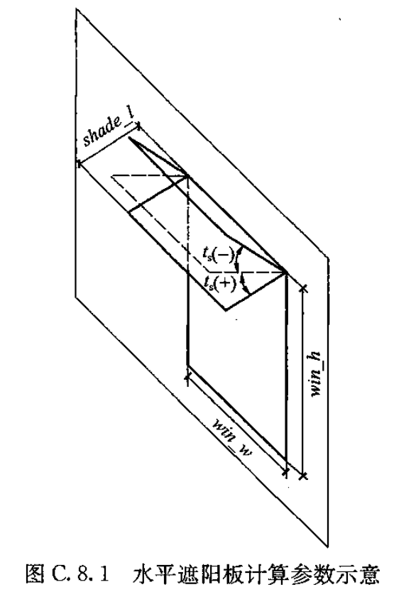
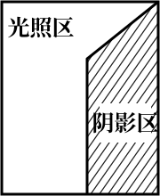
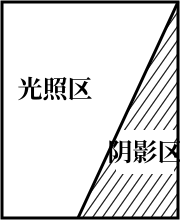
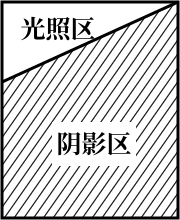
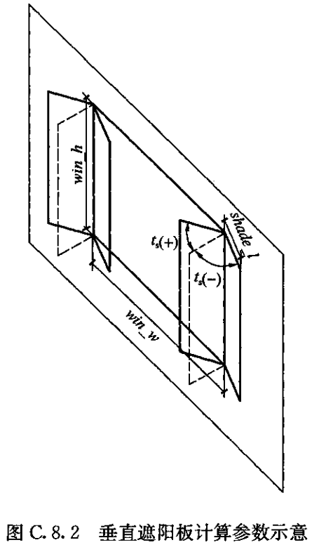
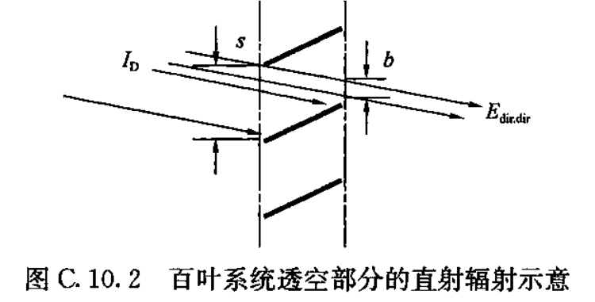

# 中华人民共和国国家标准

# 民用建筑热工设计规范

## Code for thermal design of civil building

## 标准信息

- 标准编号：GB 50176-2016
- 发布时间：2016年8月18日
- 实施时间：2017年4月1日
- 类型：中华人民共和国国家标准
- 主题：建筑

## 中华人民共和国住房和城乡建设部公告（第1263号）

### 住房城乡建设部关于发布国家标准《民用建筑热工设计规范》的公告

现批准《民用建筑热工设计规范》为国家标准，编号为GB 50176-2016，自2017年4月1日起实施。其中，第4.2.11、6.1.1、6.2.1、7.1.2条为强制性条文，必须严格执行。原《民用建筑热工设计规范》GB 50176-93同时废止。

本规范由我部标准定额研究所组织中国建筑工业出版社出版发行。

中华人民共和国住房和城乡建设部  
2016年8月18日  

## 前言

根据住房和城乡建设部《关于印发〈2009年工程建设标准规范制订、修订计划〉的通知》（建标〔2009〕88号）的要求，标准编制组经广泛调查研究，认真总结实践经验，参考有关国际标准和国外先进标准，并在广泛征求意见的基础上，修订了本规范。

本规范的主要技术内容是：1. 总则；2. 术语和符号；3. 热工计算基本参数和方法；4. 建筑热工设计原则；5. 围护结构保温设计；6. 围护结构隔热设计；7. 围护结构防潮设计；8. 自然通风设计；9. 建筑遮阳设计。

本规范修订的主要技术内容是：1. 细化了热工设计分区；2. 细分了保温、隔热设计要求；3. 修改了热桥、隔热计算方法；4. 增加了透光围护结构、自然通风、遮阳设计的内容；5. 补充了热工设计计算参数。

本规范中以黑体字标志的条文为强制性条文，必须严格执行。

## 1 总则

#### 1.0.1

为使民用建筑热工设计与地区气候相适应，保证室内基本的热环境要求，符合国家节能减排的方针，制定本规范。

#### 1.0.2

本规范适用于新建、扩建和改建民用建筑的热工设计。
本规范不适用于室内温湿度有特殊要求和特殊用途的建筑，以及简易的临时性建筑。

#### 1.0.3

民用建筑的热工设计，除应符合本规范的规定外，尚应符合国家现行有关标准的规定。

## 2 术语和符号

### 2.1 术语

#### 2.1.1 建筑热工（building thermal engineering）

研究建筑室外气候通过建筑围护结构对室内热环境的影响、室内外热湿作用对围护结构的影响，通过建筑设计改善室内热环境方法的学科。

#### 2.1.2 围护结构（building envelope）

分隔建筑室内与室外，以及建筑内部使用空间的建筑部件。

#### 2.1.3 热桥（thermal bridge）

围护结构中热流强度显著增大的部位。

#### 2.1.4 围护结构单元（building envelope unit）

围护结构的典型组成部分，由围护结构平壁及其周边梁、柱等节点共同组成。

#### 2.1.5 导热系数（thermal conductivity, heat conduction coefficient）

在稳态条件和单位温差作用下，通过单位厚度、单位面积匀质材料的热流量。

#### 2.1.6 蓄热系数（coefficient of heat accumulation）

当某一足够厚度的匀质材料层一侧受到谐波热作用时，通过表面的热流波幅与表面温度波幅的比值。

#### 2.1.7 热阻（thermal resistance）

表征围护结构本身或其中某层材料阻抗传热能力的物理量。

#### 2.1.8 传热阻（heat transfer resistance）

表征围护结构本身加上两侧空气边界层作为一个整体的阻抗传热能力的物理量。

#### 2.1.9 传热系数（heat transfer coefficient）

在稳态条件下，围护结构两侧空气为单位温差时，单位时间内通过单位面积传递的热量。传热系数与传热阻互为倒数。

#### 2.1.10 线传热系数（linear heat transfer coefficient）

当围护结构两侧空气温度为单位温差时，通过单位长度热桥部位的附加传热量。

#### 2.1.11 导温系数（thermal diffusivity）

材料的导热系数与其比热容和密度乘积的比值，表征物体在加热或冷却时，各部分温度趋于一致的能力，也称热扩散系数。

#### 2.1.12 热惰性（thermal inertia）

受到波动热作用时，材料层抵抗温度波动的能力，用热惰性指标（$D$）来描述。

#### 2.1.13 表面换热系数（surface coefficient of heat transfer）

围护结构表面和与之接触的空气之间通过对流和辐射换热，在单位温差作用下，单位时间内通过单位面积的热量。

#### 2.1.14 表面换热阻（surface resistance of heat transfer）

物体表面层在对流换热和辐射换热过程中的热阻，是表面换热系数的倒数。

#### 2.1.15 太阳辐射吸收系数（solar radiation absorptivity factor）

表面吸收的太阳辐射热与投射到其表面的太阳辐射热之比。

#### 2.1.16 温度波幅（temperature amplitude）

当温度呈周期性波动时，最高值与平均值之差。

#### 2.1.17 衰减倍数（damping factor）

围护结构内侧空气温度稳定，外侧受室外综合温度或室外空气温度周期性变化的作用，室外综合温度或室外空气温度波幅与围护结构内表面温度波幅的比值。

#### 2.1.18 延迟时间（time lag）

围护结构内侧空气温度稳定，外侧受室外综合温度或室外空气温度周期性变化的作用，其内表面温度最高值（或最低值）出现时间与室外综合温度或室外空气温度最高值（或最低值）出现时间的差值。

#### 2.1.19 露点温度（dew-point temperature）

在大气压力一定、含湿量不变的条件下，未饱和空气因冷却而到达饱和时的温度。

#### 2.1.20 冷凝（condensation）

围护结构内部存在空气或空气渗透过围护结构，当围护结构内部的温度达到或低于空气的露点温度时，空气中的水蒸气析出形成凝结水的现象。

#### 2.1.21 结露（dewing）

围护结构表面温度低于附近空气露点温度时，空气中的水蒸气在围护结构表面析出形成凝结水的现象。

#### 2.1.22 水蒸气分压（partial vapor pressure, partial pressure of water vapor）

在一定温度下，湿空气中水蒸气部分所产生的压强。

#### 2.1.23 蒸汽渗透系数（coefficient of vapor permeability）

单位厚度的物体，在两侧单位水蒸气分压差作用下，单位时间内通过单位面积渗透的水蒸气量。

#### 2.1.24 蒸汽渗透阻（vapor resistivity）

一定厚度的物体，在两侧单位水蒸气分压差作用下，通过单位面积渗透单位质量水蒸气所需要的时间。

#### 2.1.25 辐射温差比（the ratio of vertical solar radiation and indoor outdoor temperature difference）

累年1月南向垂直面太阳平均辐照度与1月室内外温差的比值。

#### 2.1.26 建筑遮阳（shading）

在建筑门窗洞口室外侧与门窗洞口一体化设计的遮挡太阳辐射的构件。

#### 2.1.27 水平遮阳（overhang shading）

位于建筑门窗洞口上部，水平伸出的板状建筑遮阳构件。

#### 2.1.28 垂直遮阳（flank shading）

位于建筑门窗洞口两侧，垂直伸出的板状建筑遮阳构件。

#### 2.1.29 组合遮阳（combined shading）

在门窗洞口的上部设水平遮阳、两侧设垂直遮阳的组合式建筑遮阳构件。

#### 2.1.30 挡板遮阳（front shading）

在门窗洞口前方设置的与门窗洞口面平行的板状建筑遮阳构件。

#### 2.1.31 百叶遮阳（blade shading）

由若干相同形状和材质的板条，按一定间距平行排列而成面状的百叶系统，并将其与门窗洞口面平行设在门窗洞口外侧的建筑遮阳构件。

#### 2.1.32 建筑遮阳系数（shading coefficient of building element）

在照射时间内，同一窗口（或透光围护结构部件外表面）在有建筑外遮阳和没有建筑外遮阳的两种情况下，接收到的两个不同太阳辐射量的比值。

#### 2.1.33 透光围护结构遮阳系数（shading coefficient of transparent envelope）

在照射时间内，透过透光围护结构部件（如：窗户）直接进入室内的太阳辐射量与透光围护结构外表面（如：窗户）接收到的太阳辐射量的比值。

#### 2.1.34 透光围护结构太阳得热系数（solar heat gain coefficient, SHGC, of transparent envelope）

在照射时间内，通过透光围护结构部件（如：窗户）的太阳辐射室内得热量与透光围护结构外表面（如：窗户）接收到的太阳辐射量的比值。

#### 2.1.35 内遮阳系数（shading coefficient of curtain）

在照射时间内，透射过内遮阳的太阳辐射量和内遮阳接收到的太阳辐射量的比值。

#### 2.1.36 综合遮阳系数（general shading coefficient）

建筑遮阳系数和透光围护结构遮阳系数的乘积。

---
注：以上内容为基于PDF页图的人工视觉转写，后续条文将按同一方式继续补全。

### 2.2 符号

#### 2.2.1 通用符号

- $A$——面积；
- $C$——宽度；
- $c$——比热容；
- $\mathrm{CDD}_{26}$——以26℃为基准的空调度日数；
- $d_{\leq 5}$——日平均温度≤5℃的天数；
- $d_{\geq 25}$——日平均温度≥25℃的天数；
- $f_i$——复合围护结构中，第i部分面积占总面积的百分比；
- $h$——高度；
- $\mathrm{HDD}_{18}$——以18℃为基准的采暖度日数；
- $l$——长度；
- $s$——间距；
- $T$——波动周期；
- $t_{\min,\mathrm{m}}$——最冷月平均温度；
- $t_{\max,\mathrm{m}}$——最热月平均温度；
- $\pi$——圆周率；
- $\rho$——密度；
- $\rho_0$——干密度；
- $\delta$——材料层的厚度。

#### 2.2.2 传热计算

- $a$——保温材料导热系数的修正系数；
- $D$——热惰性指标；
- $\bar{D}$——非匀质复合围护结构的热惰性指标；
- $D_{\mathrm{roof}}$——屋面构造层的热惰性指标；
- $D_{\mathrm{soil}}$——种植屋面绿化构造层的热惰性指标；
- $g$——门窗、幕墙中透光部分的太阳辐射总透射比；
- $I$——太阳辐射照度；
- $\bar{I}$——太阳辐射照度平均值；
- $\mathrm{IRT}$——辐射温差比；
- $K$——传热系数；
- $K_{\mathrm{m}}$——平均传热系数；
- $K_x^*$——不同朝向外墙的非平衡传热系数，脚注x用s、n、e、w表示南、北、东、西朝向；
- $Q^{2D}$——二维传热计算得到的传热量；
- $R$——热阻；
- $\bar{R}$——非匀质复合围护结构的热阻；
- $R_0$——传热阻；
- $R_{\mathrm{i}}$——内表面换热阻；
- $R_{\mathrm{e}}$——外表面换热阻；
- $R_{\min\cdot \mathrm{x}}$——满足允许温差要求的非透光围护结构热阻最小值，脚注$x$用$w$、$r$、$g$、$b$表示墙体、屋面、地面、地下室墙；
- $R_{\mathrm{green}}$——种植屋面植被层的附加热阻；
- $R_{\mathrm{roof}}$——屋面构造层的热阻；
- $R_{\mathrm{soil}}$——种植屋面绿化构造层的热阻；
- $S$——蓄热系数；
- $\mathrm{SHGC}$——透光围护结构太阳得热系数；
- $t_{\mathrm{d}}$——空气露点温度；
- $t_{\mathrm{e}}$——室外空气温度；
- $\bar{t}_{\mathrm{e}}$——采暖期室外平均温度；
- $t_{\mathrm{e}\cdot \min}$——累年最低日平均温度；
- $t_{\mathrm{e}\cdot \max}$——累年日平均温度最高日的最高温度；
- $t_{\mathrm{i}}$——室内空气温度；
- $t_{\mathrm{se}}$——室外综合温度；
- $\bar{t}_{\mathrm{se}\cdot x}$——不同朝向外墙的采暖期平均室外综合温度，脚注$x$用$s$、$n$、$e$、$w$表示南、北、东、西朝向；
- $t_{\mathrm{w}}$——采暖室外计算温度；
- $\Delta t_{\mathrm{x}}$——非透光围护结构内表面温度与室内空气温度的温差，脚注$x$用$w$、$r$、$g$、$b$表示墙体、屋面、地面、地下室墙；
- $\alpha_{\mathrm{e}}$——外表面换热系数；
- $\alpha_{\mathrm{i}}$——内表面换热系数；
- $\varepsilon_1$——热阻最小值的密度修正系数；
- $\varepsilon_2$——热阻最小值的温差修正系数；
- $\theta_{\mathrm{e}}$——地面、地下室外墙与土体接触面的温度；
- $\theta_{\mathrm{i}}$——围护结构内表面温度；
- $\theta_{\mathrm{i}\cdot \max}$——围护结构内表面最高温度；
- $\theta_{\mathrm{i}\cdot x}$——非透光围护结构内表面温度，脚注$x$用$w$、$r$、$g$、$b$表示墙体、屋面、地面、地下室墙；
- $\lambda$——导热系数；
- $\lambda_{\mathrm{c}}$——保温材料导热系数计算值；
- $\Theta_{\mathrm{e}}$——室外温度波幅；
- $\Theta_{\mathrm{i}}$——围护结构内表面温度波幅；
- $\nu$——衰减倍数；
- $\xi$——延迟时间；
- $\xi_{\mathrm{e}}$——室外温度达到最大值的时间；
- $\xi_{\mathrm{i}}$——围护结构内表面温度达到最大值的时间；
- $\rho_{\mathrm{s}}$——太阳辐射吸收系数；
- $\psi$——线传热系数。

#### 2.2.3 传湿计算

- $H$——蒸汽渗透阻；
- $H_0$——围护结构总蒸汽渗透阻；
- $H_{0 \cdot \mathrm{i}}$——冷凝计算界面内侧所需的蒸汽渗透阻；
- $H_{0 \cdot \mathrm{e}}$——冷凝计算界面至围护结构外表面之间的蒸汽渗透阻；
- $H_{0 \cdot \mathrm{c}}$——顶棚部分的蒸汽渗透阻；
- $P_{\mathrm{m}}$——围护结构内任一层内界面的水蒸气分压；
- $P_{\mathrm{i}}$——室内空气的水蒸气分压；
- $P_{\mathrm{e}}$——室外空气的水蒸气分压；
- $P_{\mathrm{s}}$——饱和水蒸气分压；
- $P_{\mathrm{s} \cdot \mathrm{c}}$——冷凝计算界面处与界面温度对应的饱和水蒸气分压；
- $R_{\mathrm{c} \cdot \mathrm{i}}$——冷凝计算界面至围护结构内表面之间的热阻；
- $Z$——采暖期天数；
- $[\Delta w]$——保温材料重量湿度的允许增量；
- $\theta_{\mathrm{c}}$——冷凝计算界面温度；
- $\mu$——蒸汽渗透系数；
- $\bar{\varphi}_{\mathrm{e}}$——计算采暖期室外平均相对湿度。

#### 2.2.4 建筑遮阳系数计算

- $b$——直射辐射方向百叶的间隙；
- $E_{{\mathrm{b}},i}$——百叶板条第$i$段内表面受到的散射辐射；
- $E_{\mathrm{b},o}$——从百叶系统反射出来的散射辐射；
- $E_{\mathrm{dif},dif}$——透过百叶系统的散射辐射；
- $E_{\mathrm{dir},dif}$——透过百叶系统的直射辐射的散射辐射；
- $E_{\mathrm{dir},dir}$——直接透过百叶系统的直射辐射；
- $E_{{\mathrm{f}},i}$——百叶板条第$i$段外表面受到的散射辐射；
- $E_{{\mathrm{f}},k+1}$——通过百叶系统透射过去的散射辐射；
- $E_{\mathrm{f},o}$——入射到百叶系统的散射辐射；
- $E_{\tau}$——通过百叶遮阳系统后的太阳辐射；
- $F_{p\to q}$——表面p到表面q的角系数；
- $h_{\mathrm{s}}$——太阳高度角；
- $I_0$——门窗洞口（透光围护结构部件外表面）朝向的太阳总辐射；
- $I_{\mathrm{D}}$——门窗洞口朝向的太阳直射辐射；
- $I_{\mathrm{d}}$——水平面的太阳散射辐射；
- $\mathrm{SC}_s$——建筑遮阳系数；
- $t_{\mathrm{s}}$——遮阳板倾斜角；
- $\mathrm{shade}_l$——遮阳板挑出长度；
- $\mathrm{win}_h$——窗口高度；
- $\mathrm{win}_w$——窗口宽度；
- $X_{\mathrm{D}}$——遮阳构件的直射辐射透射比；
- $X_{\mathrm{d}}$——遮阳构件的散射辐射透射比；
- $\alpha$——门、窗口的垂直视角；
- $\beta$——门、窗口的水平视角；
- $\varepsilon$——壁面太阳方位角；
- $\eta$——挡板的轮廓透光比；
- $\eta^*$——挡板材料的透射比；
- $\rho_{\mathrm{dif},dif}$——百叶系统对散射辐射的反射比；
- $\rho_{\mathrm{dir},dif}$——百叶板条对直射辐射的散射透射反射比；
- $\rho_{\mathrm{dir},dir}$——百叶系统镂空部分对直射辐射的反射比；
- $\rho_{{\mathrm{f}},i}$——百叶板条第$i$段外表面的太阳辐射反射比；
- $\rho_{{\mathrm{b}},i}$——百叶板条第$i$段内表面的太阳辐射反射比；
- $\tau_{\mathrm{dif},dif}$——百叶系统对散射辐射的透射比；
- $\tau_{\mathrm{dir},dif}$——百叶板条对直射辐射的散射透射透射比；
- $\tau_{\mathrm{dir},dir}$——百叶板条对直射辐射的直接透射比；
- $\tau_{{\mathrm{f}},i}$——百叶板第$i$段外表面的太阳辐射透射比；
- $\tau_{{\mathrm{b}},i}$——百叶板第$i$段内表面的太阳辐射透射比。

## 3 热工计算基本参数和方法

### 3.1 室外气象参数

#### 3.1.1

最冷、最热月平均温度的确定应符合下列规定：

1. 最冷月平均温度$t_{\min,\mathrm{m}}$应为累年一月平均温度的平均值；
2. 最热月平均温度$t_{\max,\mathrm{m}}$应为累年七月平均温度的平均值。

#### 3.1.2

采暖、空调度日数的确定应符合下列规定：

1. 采暖度日数$\mathrm{HDD}_{18}$应为历年采暖度日数的平均值；
2. 空调度日数$\mathrm{CDD}_{26}$应为历年空调度日数的平均值。

#### 3.1.3

全国主要城市室外气象参数应按本规范附录A的规定选用。

### 3.2 室外计算参数

#### 3.2.1

冬季室外计算参数的确定应符合下列规定：

1. 采暖室外计算温度$t_{\mathrm{w}}$应为累年年平均不保证5d的日平均温度；
2. 累年最低日平均温度$t_{\mathrm{e}\cdot \min}$应为历年最低日平均温度中的最小值。

#### 3.2.2

冬季室外热工计算温度$t_{\mathrm{e}}$应按围护结构的热惰性指标$D$值的不同，依据表3.2.2的规定取值。

**表 3.2.2 冬季室外热工计算温度**

<table border="1">
    <thead>
        <tr>
            <th>围护结构热惰性</th>
            <th>计算温度（℃）</th>
        </tr>
    </thead>
    <tbody>
        <tr><td>$6.0\leq D$</td><td>$t_{\mathrm{e}}=t_{\mathrm{w}}$</td></tr>
        <tr><td>$4.1\leq D<6.0$</td><td>$t_{\mathrm{e}}=0.6\,t_{\mathrm{w}}+0.4\,t_{\mathrm{e}\cdot \min}$</td></tr>
        <tr><td>$1.6\leq D<4.1$</td><td>$t_{\mathrm{e}}=0.3\,t_{\mathrm{w}}+0.7\,t_{\mathrm{e}\cdot \min}$</td></tr>
        <tr><td>$D<1.6$</td><td>$t_{\mathrm{e}}=t_{\mathrm{e}\cdot \min}$</td></tr>
    </tbody>
</table>

#### 3.2.3

夏季室外计算参数的确定应符合下列规定：

1. 夏季室外计算温度逐时值应为历年最高日平均温度中的最大值所在日的室外温度逐时值；
2. 夏季各朝向室外太阳辐射逐时值应为与温度逐时值同一天的各朝向太阳辐射逐时值。

#### 3.2.4

全国主要城市室外计算参数应按本规范附录A的规定选用。

### 3.3 室内计算参数

#### 3.3.1

冬季室内热工计算参数应按下列规定取值：

1. 温度：采暖房间应取18℃，非采暖房间应取12℃；
2. 相对湿度：一般房间应取30%~60%。

#### 3.3.2

夏季室内热工计算参数应按下列规定取值：

1. 非空调房间：空气温度平均值应取室外空气温度平均值+1.5K，温度波幅应取室外空气温度波幅-1.5K，并将其逐时化；
2. 空调房间：空气温度应取26℃；
3. 相对湿度应取60%。

### 3.4 基本计算方法

#### 3.4.1

单一匀质材料层的热阻应按下式计算：

$$
R=\frac{\delta}{\lambda}
$$

（3.4.1）

式中：
- $R$——材料层的热阻（m²·K/W）；
- $\delta$——材料层的厚度（m）；
- $\lambda$——材料的导热系数[W/(m·K)]，应按本规范附录B表B.1的规定取值。

#### 3.4.2

多层匀质材料层组成的围护结构平壁的热阻应按下式计算：

$$
R=R_1+R_2+\cdots+R_n
$$

（3.4.2）

式中：
- $R_1,R_2,\ldots,R_n$——各层材料的热阻（m²·K/W），其中，实体材料层的热阻应按本规范第3.4.1条的规定计算，封闭空气间层热阻应按本规范附录表B.3的规定取值。

#### 3.4.3

由两种以上材料组成的、一（二）向非均质复合围护结构的热阻$\bar{R}$应按本规范附录第C.1节的规定计算。

#### 3.4.4

围护结构平壁的传热阻应按下式计算：

$$
R_0=R_{\mathrm{i}}+R+R_{\mathrm{e}}
$$

（3.4.4）

式中：
- $R_0$——围护结构的传热阻（m²·K/W）；
- $R_{\mathrm{i}}$——内表面换热阻（m²·K/W），应按本规范附录B第B.4节的规定取值；
- $R_{\mathrm{e}}$——外表面换热阻（m²·K/W），应按本规范附录B第B.4节的规定取值；
- $R$——围护结构平壁的热阻（m²·K/W），应根据不同构造按本规范第3.4.1~3.4.3条的规定计算。

#### 3.4.5

围护结构平壁的传热系数应按下式计算：

$$
K=\frac{1}{R_0}
$$

（3.4.5）

式中：
- $K$——围护结构平壁的传热系数[W/(m²·K)]；
- $R_0$——围护结构的传热阻（m²·K/W），应按本规范第3.4.4条的规定计算。

#### 3.4.6

围护结构单元的平均传热系数应考虑热桥的影响，并应按下式计算：

$$
K_{\mathrm{m}}=K+\frac{\sum \psi_j l_j}{A}
$$

（3.4.6）

式中：
- $K_{\mathrm{m}}$——围护结构单元的平均传热系数[W/(m²·K)]；
- $K$——围护结构平壁的传热系数[W/(m²·K)]，应按本规范第3.4.5条的规定计算；
- $\psi_j$——围护结构上的第j个结构性热桥的线传热系数[W/(m·K)]，应按本规范第C.2节的规定计算；
- $l_j$——围护结构第j个结构性热桥的计算长度（m）；
- $A$——围护结构的面积（m²）。

#### 3.4.7

材料的蓄热系数应按下式计算：

$$
S=\sqrt{\frac{2\pi\lambda c\rho}{3.6T}}
$$

（3.4.7）

式中：
- $S$——材料的蓄热系数[W/(m²·K)]，应按本规范附录B表B.1的规定取值；
- $\lambda$——材料的导热系数[W/(m·K)]；
- $c$——材料的比热容[kJ/(kg·K)]，应按本规范附录B表B.1的规定取值；
- $\rho$——材料的密度(kg/m³)；
- $T$——温度波动周期(h)，一般取$T=24h$；
- $\pi$——圆周率，取$\pi=3.14$。

#### 3.4.8

单一匀质材料层的热惰性指标应按下式计算：

$$
D=R\cdot S
$$

（3.4.8）

式中：
- $D$——材料层的热惰性指标，无量纲；
- $R$——材料层的热阻（m²·K/W），应按本规范第3.4.1条的规定计算；
- $S$——材料层的蓄热系数[W/(m²·K)]，应按本规范第3.4.7条的规定计算。

#### 3.4.9

多层匀质材料层组成的围护结构平壁的热惰性指标应按下式计算：

$$
D=D_1+D_2+\cdots+D_n
$$

（3.4.9）

式中：
- $D_1,D_2,\ldots,D_n$——各层材料的热惰性指标，无量纲，其中，实体材料层的热惰性指标应按本规范第3.4.8条的规定计算，封闭空气层的热惰性指标应为零。

#### 3.4.10

计算由两种以上材料组成的、一（二）向非均质复合围护结构的热惰性指标$\bar{D}$值时，应先将非均质复合围护结构沿平行于热流方向按不同构造划分成若干块，再按下式计算：

$$
\bar{D}=\frac{D_1A_1+D_2A_2+\cdots+D_nA_n}{A_1+A_2+\cdots+A_n}
$$

（3.4.10）

式中：
- $\bar{D}$——非匀质复合围护结构的热惰性指标，无量纲；
- $A_1,A_2,\ldots,A_n$——平行于热流方向的各块平壁的面积（m²）；
- $D_1,D_2,\ldots,D_n$——平行于热流方向的各块平壁的热惰性指标，无量纲，应根据不同构造按本规范第3.4.8~3.4.9条的规定计算。

#### 3.4.11

室外综合温度应按下式计算：

$$
t_{\mathrm{se}}=t_{\mathrm{e}}+\frac{\rho_{\mathrm{s}} I}{\alpha_{\mathrm{e}}}
$$

（3.4.11）

式中：
- $t_{\mathrm{se}}$——室外综合温度（℃）；
- $t_{\mathrm{e}}$——室外空气温度（℃）；
- $I$——投射到围护结构外表面的太阳辐射照度（W/m²）；
- $\rho_{\mathrm{s}}$——外表面的太阳辐射吸收系数，无量纲，应按本规范附录B表B.5的规定取值；
- $\alpha_{\mathrm{e}}$——外表面换热系数[W/(m²·K)]，应按本规范附录B第B.4节的规定取值。

#### 3.4.12

围护结构的衰减倍数应按下式计算：

$$
\nu=\frac{\Theta_{\mathrm{e}}}{\Theta_{\mathrm{i}}}
$$

（3.4.12）

式中：
- $\nu$——围护结构的衰减倍数，无量纲；
- $\Theta_{\mathrm{e}}$——室外综合温度或空气温度波幅（K）；
- $\Theta_{\mathrm{i}}$——室外综合温度或空气温度影响下的围护结构内表面温度波幅（K），应采用围护结构周期传热计算软件计算。

#### 3.4.13

围护结构的延迟时间应按下式计算：

$$
\xi=\xi_{\mathrm{i}}-\xi_{\mathrm{e}}
$$

（3.4.13）

式中：
- $\xi$——围护结构的延迟时间（h）；
- $\xi_{\mathrm{e}}$——室外综合温度或空气温度达到最大值的时间（h）；
- $\xi_{\mathrm{i}}$——室外综合温度或空气温度影响下的围护结构内表面温度达到最大值的时间（h），应采用围护结构周期传热计算软件计算。

#### 3.4.14

单一匀质材料层的蒸汽渗透阻应按下式计算：

$$
H=\frac{\delta}{\mu}
$$

（3.4.14）

式中：
- $H$——材料层的蒸汽渗透阻（m²·h·Pa/g），常用薄片材料和涂层的蒸汽渗透阻应按本规范附录表B.6的规定选用；
- $\delta$——材料层的厚度（m）；
- $\mu$——材料的蒸汽渗透系数[g/(m·h·Pa)]，应按本规范附录B表B.1的规定取值。

#### 3.4.15

多层匀质材料层组成的围护结构的蒸汽渗透阻应按下式计算：

$$
H=H_1+H_2+\cdots+H_n
$$

（3.4.15）

式中：
- $H_1,H_2,\ldots,H_n$——各层材料的蒸汽渗透阻（m²·h·Pa/g），其中，实体材料层的蒸汽渗透阻应按本规范第3.4.14条的规定计算或选用，封闭空气层的蒸汽渗透阻应为零。

#### 3.4.16

冬季围护结构平壁的内表面温度应按下式计算：

$$
\theta_{\mathrm{i}}=t_{\mathrm{i}}-\frac{R_{\mathrm{i}}}{R_0}(t_{\mathrm{i}}-t_{\mathrm{e}})
$$

（3.4.16）

式中：
- $\theta_{\mathrm{i}}$——围护结构平壁的内表面温度（℃）；
- $R_0$——围护结构平壁的传热阻（m²·K/W）；
- $R_{\mathrm{i}}$——内表面换热阻（m²·K/W）；
- $t_{\mathrm{i}}$——室内计算温度（℃）；
- $t_{\mathrm{e}}$——室外计算温度（℃）。

#### 3.4.17

夏季围护结构平壁的内表面温度应按本规范附录C第C.3节的规定计算。

## 4 建筑热工设计原则

### 4.1 热工设计分区

#### 4.1.1

建筑热工设计区划分为两级。建筑热工设计一级区划指标及设计原则应符合表4.1.1的规定，建筑热工设计一级区划可参考本规范附录A图A.0.3。

**表4.1.1 建筑热工设计一级区划指标及设计原则**

<table border="1">
    <thead>
        <tr>
            <th rowspan="2">一级区划名称</th>
            <th colspan="2">区划指标</th>
            <th rowspan="2">设计原则</th>
        </tr>
        <tr>
            <th>主要指标</th>
            <th>辅助指标</th>
        </tr>
    </thead>
    <tbody>
        <tr><td>严寒地区（1）</td><td>$t_{\min\cdot \mathrm{m}}\leq -10$℃</td><td>$145\leq d_{\leq 5}$</td><td>必须充分满足冬季保温要求，一般可以不考虑夏季防热</td></tr>
        <tr><td>寒冷地区（2）</td><td>$-10&lt;t_{\min\cdot \mathrm{m}}\leq 0$℃</td><td>$90\leq d_{\leq 5}&lt;145$</td><td>应满足冬季保温要求，部分地区兼顾夏季防热</td></tr>
        <tr><td>夏热冬冷地区（3）</td><td>$0&lt;t_{\min\cdot \mathrm{m}}\leq 10$℃ $25&lt;t_{\max\cdot \mathrm{m}}\leq 30$℃</td><td>$0\leq d_{\leq 5}&lt;90$ $40\leq d_{\geq 25}&lt;110$</td><td>必须满足夏季防热要求，适当兼顾冬季保温</td></tr>
        <tr><td>夏热冬暖地区（4）</td><td>$10&lt;t_{\min\cdot \mathrm{m}}$℃ $25&lt;t_{\max\cdot \mathrm{m}}\leq 29$℃</td><td>$100\leq d_{\geq 25}&lt;200$</td><td>必须充分满足夏季防热要求，一般可不考虑冬季保温</td></tr>
        <tr><td>温和地区（5）</td><td>$0&lt;t_{\min\cdot \mathrm{m}}\leq 13$℃ $18&lt;t_{\max\cdot \mathrm{m}}\leq 25$℃</td><td>$0\leq d_{\leq 5}&lt;90$</td><td>部分地区应考虑冬季保温，一般可不考虑夏季防热</td></tr>
    </tbody>
</table>

#### 4.1.2

建筑热工设计二级区划指标及设计要求应符合表4.1.2的规定，全国主要城市的二级区属应符合本规范附录A表A.0.1的规定。

**表4.1.2 建筑热工设计二级区划指标及设计要求**

<table border="1">
    <thead>
        <tr><th>二级区划名称</th><th>区划指标</th><th>设计要求</th></tr>
    </thead>
    <tbody>
        <tr><td>严寒A区（1A）</td><td>$6000\leq \mathrm{HDD}_{18}$</td><td>冬季保温要求极高，必须满足保温设计要求，不考虑防热设计</td></tr>
        <tr><td>严寒B区（1B）</td><td>$5000\leq \mathrm{HDD}_{18}&lt;6000$</td><td>冬季保温要求非常高，必须满足保温设计要求，不考虑防热设计</td></tr>
        <tr><td>严寒C区（1C）</td><td>$3800\leq \mathrm{HDD}_{18}&lt;5000$</td><td>必须满足保温设计要求，可不考虑防热设计</td></tr>
        <tr><td>寒冷A区（2A）</td><td>$2000\leq \mathrm{HDD}_{18}&lt;3800$，$\mathrm{CDD}_{26}\leq 90$</td><td>应满足保温设计要求，可不考虑防热设计</td></tr>
        <tr><td>寒冷B区（2B）</td><td>$2000\leq \mathrm{HDD}_{18}&lt;3800$，$\mathrm{CDD}_{26}&gt;90$</td><td>应满足保温设计要求，宜满足隔热设计要求，兼顾自然通风、遮阳设计</td></tr>
        <tr><td>夏热冬冷A区（3A）</td><td>$1200\leq \mathrm{HDD}_{18}&lt;2000$</td><td>应满足保温、隔热设计要求，重视自然通风、遮阳设计</td></tr>
        <tr><td>夏热冬冷B区（3B）</td><td>$700\leq \mathrm{HDD}_{18}&lt;1200$</td><td>应满足隔热、保温设计要求，强调自然通风、遮阳设计</td></tr>
        <tr><td>夏热冬暖A区（4A）</td><td>$500\leq \mathrm{HDD}_{18}&lt;700$</td><td>应满足隔热设计要求，宜满足保温设计要求，强调自然通风、遮阳设计</td></tr>
        <tr><td>夏热冬暖B区（4B）</td><td>$\mathrm{HDD}_{18}&lt;500$</td><td>应满足隔热设计要求，可不考虑保温设计，强调自然通风、遮阳设计</td></tr>
        <tr><td>温和A区（5A）</td><td>$\mathrm{CDD}_{26}&lt;10$，$700\leq \mathrm{HDD}_{18}&lt;2000$</td><td>应满足冬季保温设计要求，可不考虑防热设计</td></tr>
        <tr><td>温和B区（5B）</td><td>$\mathrm{CDD}_{26}&lt;10$，$\mathrm{HDD}_{18}&lt;700$</td><td>宜满足冬季保温设计要求，可不考虑防热设计</td></tr>
    </tbody>
</table>

#### 4.1.3

本规范附录A表A.0.1中未涉及的目标城镇，可根据本规范附录A表A.0.2的规定确定参考城镇，目标城镇的建筑热工设计二级分区区属和室外气象参数可按参考城镇选取。当参考其他城镇的区属和气象参数时，设计中应注明被参考城镇的名称。

### 4.2 保温设计

#### 4.2.1

建筑外围护结构应具有抵御冬季室外气温作用和气温波动的能力，非透光外围护结构内表面温度与室内空气温度的差值应控制在本规范允许的范围内。

#### 4.2.2

严寒、寒冷地区建筑设计必须满足冬季保温要求，夏热冬冷地区、温和A区建筑设计应满足冬季保温要求，夏热冬暖A区、温和B区宜满足冬季保温要求。

#### 4.2.3

建筑物的总平面布置、平面和立面设计、门窗洞口设置应考虑冬季利用日照并避开冬季主导风向。

#### 4.2.4

建筑物宜朝向南北或接近朝向南北，体形设计应减少外表面积，平、立面的凹凸不宜过多。

#### 4.2.5

严寒地区和寒冷地区的建筑不应设开敞式楼梯间和开敞式外廊，夏热冬冷A区不宜设开敞式楼梯间和开敞式外廊。

#### 4.2.6

严寒地区建筑出入口应设门斗或热风幕等避风设施，寒冷地区建筑出入口宜设门斗或热风幕等避风设施。

#### 4.2.7

外墙、屋面、直接接触室外空气的楼板、分隔采暖房间与非采暖房间的内围护结构等非透光围护结构应按本规范第5.1节和第5.2节的要求进行保温设计。

#### 4.2.8

外窗、透光幕墙、采光顶等透光外围护结构的面积不宜过大，应降低透光围护结构的传热系数值、提高透光部分的遮阳系数值，减少周边缝隙的长度，且应按本规范第5.3节的要求进行保温设计。

#### 4.2.9

建筑的地面、地下室外墙应按本规范第5.4节和第5.5节的要求进行保温验算。

#### 4.2.10

围护结构的保温形式应根据建筑所在地的气候条件、结构形式、采暖运行方式、外饰面层等因素选择，并应按本规范第7章的要求进行防潮设计。

#### 4.2.11

**围护结构中的热桥部位应进行表面结露验算，并应采取保温措施，确保热桥内表面温度高于房间空气露点温度。**

#### 4.2.12

围护结构热桥部位的表面结露验算应符合本规范第7.2节的规定。

#### 4.2.13

建筑及建筑构件应采取密闭措施，保证建筑气密性要求。

#### 4.2.14

日照充足地区宜在建筑南向设置阳光间，阳光间与房间之间的围护结构应具有一定的保温能力。

#### 4.2.15

对于南向辐射温差比（$\mathrm{IRT}$）大于等于4 W/(m²·K)，且1月南向垂直面冬季太阳辐射强度大于等于60 W/m²的地区，可按本规范附录C第C.4节的规定采用“非平衡保温”方法进行围护结构保温设计。

### 4.3 防热设计

#### 4.3.1

建筑外围护结构应具有抵御夏季室外气温和太阳辐射综合热作用的能力。自然通风房间的非透光围护结构内表面温度与室外累年日平均温度最高日的最高温度的差值，以及空调房间非透光围护结构内表面温度与室内空气温度的差值应控制在本规范允许的范围内。

#### 4.3.2

夏热冬暖和夏热冬冷地区建筑设计必须满足夏季防热要求，寒冷B区建筑设计宜考虑夏季防热要求。

#### 4.3.3

建筑物防热应综合采取有利于防热的建筑总平面布置与形体设计、自然通风、建筑遮阳、围护结构隔热和散热、环境绿化、被动蒸发、淋水降温等措施。

#### 4.3.4

建筑朝向宜采用南北向或接近南北向，建筑平面、立面设计和门窗设置应有利于自然通风，避免主要房间受东、西向的日晒。

#### 4.3.5

非透光围护结构（外墙、屋面）应按本规范第6.1节和第6.2节的要求进行隔热设计。

#### 4.3.6

建筑围护结构外表面宜采用浅色饰面材料，屋面宜采用绿化、涂刷隔热涂料、遮阳等隔热措施。

#### 4.3.7

透光围护结构（外窗、透光幕墙、采光顶）隔热设计应符合本规范第6.3节的要求。

#### 4.3.8

建筑设计应综合考虑外廊、阳台、挑檐等的遮阳作用。建筑物的向阳面，东、西向外窗（透光幕墙），应采取有效的遮阳措施。

#### 4.3.9

房间天窗和采光顶应设置建筑遮阳，并宜采取通风和淋水降温措施。

#### 4.3.10

夏热冬冷、夏热冬暖和其他夏季炎热的地区，一般房间宜设置电扇调风改善热环境。

### 4.4 防潮设计

#### 4.4.1

建筑构造设计应防止水蒸气渗透进入围护结构内部，围护结构内部不应产生冷凝。

#### 4.4.2

围护结构内部冷凝验算应符合本规范第7.1节的要求。

#### 4.4.3

建筑设计时，应充分考虑建筑运行时的各种工况，采取有效措施确保建筑外围护结构内表面温度不低于室内空气露点温度。

#### 4.4.4

建筑围护结构的内表面结露验算应符合本规范第7.2节的要求。

#### 4.4.5

围护结构防潮设计应遵循下列基本原则：

1. 室内空气湿度不宜过高；
2. 地面、外墙表面温度不宜过低；
3. 可在围护结构的高温侧设隔汽层；
4. 可采用具有吸湿、解湿等调节空气湿度功能的围护结构材料；
5. 应合理设置保温层，防止围护结构内部冷凝；
6. 与室外雨水或土壤接触的围护结构应设置防水（潮）层。

#### 4.4.6

夏热冬冷长江中、下游地区、夏热冬暖沿海地区建筑的通风口、外窗应可以开启和关闭。室外或与室外连通的空间，其顶棚、墙面、地面应采取防止返潮的措施或采用易于清洗的材料。

## 5 围护结构保温设计

### 5.1 墙体

#### 5.1.1

墙体的内表面温度与室内空气温度的温差$\Delta t_{\mathrm{w}}$应符合表5.1.1的规定。

**表5.1.1 墙体的内表面温度与室内空气温度温差的限值**

<table border="1">
    <thead>
        <tr><th>房间设计要求</th><th>防结露</th><th>基本热舒适</th></tr>
    </thead>
    <tbody>
        <tr><td>允许温差$\Delta t_{\mathrm{w}}$（K）</td><td>$\leq t_{\mathrm{i}}-t_{\mathrm{d}}$</td><td>$\leq 3$</td></tr>
    </tbody>
</table>

注：$\Delta t_{\mathrm{w}}=t_{\mathrm{i}}-\theta_{\mathrm{i}\cdot \mathrm{w}}$。

#### 5.1.2

未考虑密度和温差修正的墙体内表面温度可按下式计算：

$$
\theta_{\mathrm{i}\cdot \mathrm{w}}=t_{\mathrm{i}}-\frac{R_{\mathrm{i}}}{R_{0\cdot \mathrm{w}}}(t_{\mathrm{i}}-t_{\mathrm{e}})\qquad (5.1.2)
$$

式中：$\theta_{\mathrm{i}\cdot \mathrm{w}}$——墙体内表面温度（℃）；

$t_{\mathrm{i}}$——室内计算温度（℃），应按本规范第3.3.1条的规定取值；

$t_{\mathrm{e}}$——室外计算温度（℃），应按本规范第3.2.2条的规定取值；

$R_{\mathrm{i}}$——内表面换热阻（m²·K/W），应按本规范附录B第B.4节的规定取值；

$R_{0\cdot \mathrm{w}}$——墙体传热阻（m²·K/W）。

#### 5.1.3

不同地区，符合本规范第5.1.1条要求的墙体热阻最小值$R_{\min\cdot \mathrm{w}}$应按下式计算或按本规范附录D表D.1的规定选用。

$$
R_{\min\cdot \mathrm{w}}=\frac{(t_{\mathrm{i}}-t_{\mathrm{e}})}{\Delta t_{\mathrm{w}}}R_{\mathrm{i}}-(R_{\mathrm{i}}+R_{\mathrm{e}})\qquad (5.1.3)
$$

其中：$R_{\min\cdot \mathrm{w}}$——满足$\Delta t_{\mathrm{w}}$要求的墙体热阻最小值（m²·K/W）；

$R_{\mathrm{e}}$——外表面换热阻（m²·K/W），应按本规范附录B第B.4节的规定取值。

#### 5.1.4

不同材料和建筑不同部位的墙体热阻最小值应按下式进行修正计算：

$$
R_{\mathrm{w}}=\varepsilon_1\varepsilon_2R_{\min\cdot \mathrm{w}}\qquad (5.1.4)
$$

其中：$R_{\mathrm{w}}$——修正后的墙体热阻最小值（m²·K/W）；

$\varepsilon_1$——热阻最小值的密度修正系数，可按本规范表5.1.4-1选用；

$\varepsilon_2$——热阻最小值的温差修正系数，可按本规范表5.1.4-2选用。

**表5.1.4-1 热阻最小值的密度修正系数$\varepsilon_1$**

<table border="1">
    <tbody>
        <tr><th>密度（kg/m³）</th><td>$\rho\geq 1200$</td><td>$1200&gt;\rho\geq 800$</td><td>$800&gt;\rho\geq 500$</td><td>$500&gt;\rho$</td></tr>
        <tr><th>修正系数$\varepsilon_1$</th><td>1.0</td><td>1.2</td><td>1.3</td><td>1.4</td></tr>
    </tbody>
</table>

注：$\rho$为围护结构的密度。

**表5.1.4-2 热阻最小值的温差修正系数$\varepsilon_2$**

<table border="1">
    <thead>
        <tr><th>部位</th><th>修正系数$\varepsilon_2$</th></tr>
    </thead>
    <tbody>
        <tr><td>与室外空气直接接触的围护结构</td><td>1.0</td></tr>
        <tr><td>与有外窗的不采暖房间相邻的围护结构</td><td>0.8</td></tr>
        <tr><td>与无外窗的不采暖房间相邻的围护结构</td><td>0.5</td></tr>
    </tbody>
</table>

#### 5.1.5

提高墙体热阻值可采取下列措施：

1. 采用轻质高效保温材料与砖、混凝土、钢筋混凝土、砌块等主墙体材料组成复合保温墙体构造；
2. 采用低导热系数的新型墙体材料；
3. 采用带有封闭空气间层的复合墙体构造设计。

#### 5.1.6

外墙宜采用热惰性大的材料和构造，提高墙体热稳定性可采取下列措施：

1. 采用内侧为重质材料的复合保温墙体；
2. 采用蓄热性能好的墙体材料或相变材料复合在墙体内侧。

### 5.2 楼、屋面

#### 5.2.1

楼、屋面的内表面温度与室内空气温度的温差$\Delta t_{\mathrm{r}}$应符合表5.2.1的规定。

**表5.2.1 楼、屋面的内表面温度与室内空气温度温差的限值**

<table border="1">
    <thead>
        <tr><th>房间设计要求</th><th>防结露</th><th>基本热舒适</th></tr>
    </thead>
    <tbody>
        <tr><td>允许温差$\Delta t_{\mathrm{r}}$（K）</td><td>$\leq t_{\mathrm{i}}-t_{\mathrm{d}}$</td><td>$\leq 4$</td></tr>
    </tbody>
</table>

注：$\Delta t_{\mathrm{r}}=t_{\mathrm{i}}-\theta_{\mathrm{i}\cdot \mathrm{r}}$。

#### 5.2.2

未考虑密度和温度修正的楼、屋面内表面温度可按下式计算：

$$
\theta_{\mathrm{i}\cdot \mathrm{r}}=t_{\mathrm{i}}-\frac{R_{\mathrm{i}}}{R_{0\cdot \mathrm{r}}}(t_{\mathrm{i}}-t_{\mathrm{e}})\qquad (5.2.2)
$$

式中：$\theta_{\mathrm{i}\cdot \mathrm{r}}$——楼、屋面内表面温度（℃）；

$R_{0\cdot \mathrm{r}}$——楼、屋面传热阻（m²·K/W）。

#### 5.2.3

不同地区，符合本规范第5.2.1条要求的楼、屋面热阻最小值$R_{\min\cdot \mathrm{r}}$应按下式计算或按本规范附录D表D.1的规定选用。

$$
R_{\min\cdot \mathrm{r}}=\frac{(t_{\mathrm{i}}-t_{\mathrm{e}})}{\Delta t_{\mathrm{r}}}R_{\mathrm{i}}-(R_{\mathrm{i}}+R_{\mathrm{e}})\qquad (5.2.3)
$$

其中：$R_{\min\cdot \mathrm{r}}$——满足$\Delta t_{\mathrm{r}}$要求的楼、屋面热阻最小值（m²·K/W）。

#### 5.2.4

不同材料和建筑不同部位的楼、屋面热阻最小值应按下式进行修正计算：

$$
R_{\mathrm{r}}=\varepsilon_1\varepsilon_2R_{\min\cdot \mathrm{r}}\qquad (5.2.4)
$$

其中：$R_{\mathrm{r}}$——修正后的楼、屋面热阻最小值（m²·K/W）；

$\varepsilon_1$——热阻最小值的密度修正系数，可按本规范表5.1.4-1选用；

$\varepsilon_2$——热阻最小值的温差修正系数，可按本规范表5.1.4-2选用。

#### 5.2.5

屋面保温设计应符合下列规定：

1. 屋面保温材料应选择密度小、导热系数小的材料；
2. 屋面保温材料应严格控制吸水率。

### 5.3 门窗、幕墙、采光顶

#### 5.3.1

各个热工气候区建筑内对热环境有要求的房间，其外门窗、透光幕墙、采光顶的传热系数宜符合表5.3.1的规定，并应按表5.3.1的要求进行冬季的抗结露验算。严寒地区、寒冷A区、温和地区门窗、透光幕墙、采光顶的冬季综合遮阳系数不宜小于0.37。

**表5.3.1 建筑外门窗、透光幕墙、采光顶传热系数的限值和抗结露验算要求**

<table border="1">
    <thead>
        <tr><th>气候区</th><th>$K$ [W/(m²·K)]</th><th>抗结露验算要求</th></tr>
    </thead>
    <tbody>
        <tr><td>严寒A区</td><td>$\leq 2.0$</td><td>验算</td></tr>
        <tr><td>严寒B区</td><td>$\leq 2.2$</td><td>验算</td></tr>
        <tr><td>严寒C区</td><td>$\leq 2.5$</td><td>验算</td></tr>
        <tr><td>寒冷A区</td><td>$\leq 3.0$</td><td>验算</td></tr>
        <tr><td>寒冷B区</td><td>$\leq 3.0$</td><td>验算</td></tr>
        <tr><td>夏热冬冷A区</td><td>$\leq 3.5$</td><td>验算</td></tr>
        <tr><td>夏热冬冷B区</td><td>$\leq 4.0$</td><td>不验算</td></tr>
        <tr><td>夏热冬暖地区</td><td>—</td><td>不验算</td></tr>
        <tr><td>温和A区</td><td>$\leq 3.5$</td><td>验算</td></tr>
        <tr><td>温和B区</td><td>—</td><td>不验算</td></tr>
    </tbody>
</table>

#### 5.3.2

门窗、透光幕墙的传热系数应按本规范附录C第C.5节的规定进行计算，抗结露验算应按本规范附录C第C.6节的规定计算。

#### 5.3.3

严寒地区、寒冷地区建筑应采用木窗、塑料窗、铝木复合门窗、铝塑复合门窗、钢塑复合门窗和断热铝合金门窗等保温性能好的门窗。严寒地区建筑采用断热金属门窗时宜采用双层窗。夏热冬冷地区、温和A区建筑宜采用保温性能好的门窗。

#### 5.3.4

严寒地区、寒冷地区、夏热冬冷地区、温和A区的玻璃幕墙应采用有断热构造的玻璃幕墙系统；非透光的玻璃幕墙部分、金属幕墙、石材幕墙和其他人造板材幕墙等幕墙面板背后应采用高效保温材料保温。幕墙与围护结构平壁间（除结构连接部位外）不应形成热桥，并宜对跨越室内外的金属构件或连接部位采取隔断热桥措施。

#### 5.3.5

有保温要求的门窗、玻璃幕墙、采光顶采用的玻璃系统应为中空玻璃、Low-E中空玻璃、充惰性气体Low-E中空玻璃等保温性能良好的玻璃，保温要求高时还可采用三玻两腔、真空玻璃等。传热系数较低的中空玻璃宜采用“暖边”中空玻璃间隔条。

#### 5.3.6

严寒地区、寒冷地区、夏热冬冷地区、温和A区的门窗、透光幕墙、采光顶周边与墙体、屋面板或其他围护结构连接处应采取保温、密封构造；当采用非防潮型保温材料填塞时，缝隙应采用密封材料或密封胶密封。其他地区应采取密封构造。

#### 5.3.7

严寒地区、寒冷地区可采用空气内循环的双层幕墙，夏热冬冷地区不宜采用双层幕墙。

### 5.4 地面

#### 5.4.1

建筑中与土体接触的地面内表面温度与室内空气温度的温差$\Delta t_{\mathrm{g}}$应符合表5.4.1的规定。

**表5.4.1 地面的内表面温度与室内空气温度温差的限值**

<table border="1">
    <thead>
        <tr><th>房间设计要求</th><th>防结露</th><th>基本热舒适</th></tr>
    </thead>
    <tbody>
        <tr><td>允许温差$\Delta t_{\mathrm{g}}$（K）</td><td>$\leq t_{\mathrm{i}}-t_{\mathrm{d}}$</td><td>$\leq 2$</td></tr>
    </tbody>
</table>

注：$\Delta t_{\mathrm{g}}=t_{\mathrm{i}}-\theta_{\mathrm{i}\cdot \mathrm{g}}$。

#### 5.4.2

地面内表面温度可按下式计算：

$$
\theta_{\mathrm{i}\cdot \mathrm{g}}=\frac{t_{\mathrm{i}}\cdot R_{\mathrm{g}}+\theta_{\mathrm{e}}\cdot R_{\mathrm{i}}}{R_{\mathrm{g}}+R_{\mathrm{i}}}\qquad (5.4.2)
$$

式中：$\theta_{\mathrm{i}\cdot \mathrm{g}}$——地面内表面温度（℃）；

$R_{\mathrm{g}}$——地面热阻（m²·K/W）；

$\theta_{\mathrm{e}}$——地面层与土体接触面的温度（℃），应取本规范附录A表A.0.1中的最冷月平均温度。

#### 5.4.3

不同地区，符合本规范第5.4.1条要求的地面层热阻最小值$R_{\min\cdot \mathrm{g}}$可按下式计算或按本规范附录D表D.2的规定选用。

$$
R_{\min\cdot \mathrm{g}}=\frac{(\theta_{\mathrm{i}\cdot \mathrm{g}}-\theta_{\mathrm{e}})}{\Delta t_{\mathrm{g}}}R_{\mathrm{i}}\qquad (5.4.3)
$$

式中：$R_{\min\cdot \mathrm{g}}$——满足$\Delta t_{\mathrm{g}}$要求的地面热阻最小值（m²·K/W）。

#### 5.4.4

地面层热阻的计算只计入结构层、保温层和面层。

#### 5.4.5

地面保温材料应选用吸水率小、抗压强度高、不易变形的材料。

### 5.5 地下室

#### 5.5.1

距地面小于0.5m的地下室外墙保温设计要求同外墙；距地面超过0.5m、与土体接触的地下室外墙内表面温度与室内空气温度的温差$\Delta t_{\mathrm{b}}$应符合表5.5.1的规定。

**表5.5.1 地下室外墙的内表面温度与室内空气温度温差的限值**

<table border="1">
    <thead>
        <tr><th>房间设计要求</th><th>防结露</th><th>基本热舒适</th></tr>
    </thead>
    <tbody>
        <tr><td>允许温差$\Delta t_{\mathrm{b}}$（K）</td><td>$\leq t_{\mathrm{i}}-t_{\mathrm{d}}$</td><td>$\leq 4$</td></tr>
    </tbody>
</table>

注：$\Delta t_{\mathrm{b}}=t_{\mathrm{i}}-\theta_{\mathrm{i}\cdot \mathrm{b}}$。

#### 5.5.2

地下室外墙内表面温度可按下式计算：

$$
\theta_{\mathrm{i}\cdot \mathrm{b}}=\frac{t_{\mathrm{i}}\cdot R_{\mathrm{b}}+\theta_{\mathrm{e}}\cdot R_{\mathrm{i}}}{R_{\mathrm{b}}+R_{\mathrm{i}}}\qquad (5.5.2)
$$

式中：$\theta_{\mathrm{i}\cdot \mathrm{b}}$——地下室外墙内表面温度（℃）；

$R_{\mathrm{b}}$——地下室外墙热阻（m²·K/W）；

$\theta_{\mathrm{e}}$——地下室外墙与土体接触面的温度（℃），应取本规范附录A表A.0.1中的最冷月平均温度。

#### 5.5.3

不同地区，符合本规范第5.5.1条要求的地下室外墙热阻最小值$R_{\min\cdot \mathrm{b}}$可按下式计算或按本规范附录D表D.2的规定选用。

$$
R_{\min\cdot \mathrm{b}}=\frac{(\theta_{\mathrm{i}\cdot \mathrm{b}}-\theta_{\mathrm{e}})}{\Delta t_{\mathrm{b}}}R_{\mathrm{i}}\qquad (5.5.3)
$$

式中：$R_{\min\cdot \mathrm{b}}$——满足$\Delta t_{\mathrm{b}}$要求的地下室外墙热阻最小值。

#### 5.5.4

地下室外墙热阻的计算只计入结构层、保温层和面层。

## 6 围护结构隔热设计

### 6.1 外墙

#### 6.1.1

**在给定两侧空气温度及变化规律的情况下，外墙内表面最高温度应符合表6.1.1的规定。**

**表6.1.1 在给定两侧空气温度及变化规律的情况下，外墙内表面最高温度限值**

<table border="1">
    <thead>
        <tr>
            <th rowspan="2">房间类型</th>
            <th rowspan="2">自然通风房间</th>
            <th colspan="2">空调房间</th>
        </tr>
        <tr><th>重质围护结构（$D\geq 2.5$）</th><th>轻质围护结构（$D&lt;2.5$）</th></tr>
    </thead>
    <tbody>
        <tr><td>内表面最高温度$\theta_{\mathrm{i}\cdot \max}$</td><td>$\leq t_{\mathrm{e}\cdot \max}$</td><td>$\leq t_{\mathrm{i}}+2$</td><td>$\leq t_{\mathrm{i}}+3$</td></tr>
    </tbody>
</table>

#### 6.1.2

外墙内表面最高温度$\theta_{\mathrm{i}\cdot \max}$应按本规范附录C第C.3节的规定计算。

#### 6.1.3

外墙隔热可采用下列措施：

1. 宜采用浅色外饰面。
2. 可采用通风墙、干挂通风幕墙等。
3. 设置封闭空气间层时，可在空气间层平行墙面的两个表面涂刷热反射涂料、贴热反射膜或铝箔。当采用单面热反射隔热措施时，热反射隔热层应设置在空气温度较高一侧。
4. 采用复合墙体构造时，墙体外侧宜采用轻质材料，内侧宜采用重质材料。
5. 可采用墙面垂直绿化及淋水被动蒸发墙面等。
6. 宜提高围护结构的热惰性指标$D$值。
7. 西向墙体可采用高蓄热材料与低热传导材料组合的复合墙体构造。

### 6.2 屋面

#### 6.2.1

**在给定两侧空气温度及变化规律的情况下，屋面内表面最高温度应符合表6.2.1的规定。**

**表6.2.1 在给定两侧空气温度及变化规律的情况下，屋面内表面最高温度限值**

<table border="1">
    <thead>
        <tr>
            <th rowspan="2">房间类型</th>
            <th rowspan="2">自然通风房间</th>
            <th colspan="2">空调房间</th>
        </tr>
        <tr><th>重质围护结构（$D\geq 2.5$）</th><th>轻质围护结构（$D&lt;2.5$）</th></tr>
    </thead>
    <tbody>
        <tr><td>内表面最高温度$\theta_{\mathrm{i}\cdot \max}$</td><td>$\leq t_{\mathrm{e}\cdot \max}$</td><td>$\leq t_{\mathrm{i}}+2.5$</td><td>$\leq t_{\mathrm{i}}+3.5$</td></tr>
    </tbody>
</table>

#### 6.2.2

屋面内表面最高温度$\theta_{\mathrm{i}\cdot \max}$应按本规范附录C第C.3节的规定计算。

#### 6.2.3

屋面隔热可采用下列措施：

1. 宜采用浅色外饰面。
2. 宜采用通风隔热屋面。通风屋面的风道长度不宜大于10m，通风间层高度应大于0.3m，屋面基层应做保温隔热层，檐口处宜采用导风构造，通风平屋面风道口与女儿墙的距离不应小于0.6m。
3. 可采用有热反射材料层（热反射涂料、热反射膜、铝箔等）的空气间层隔热屋面。单面设置热反射材料的空气间层，热反射材料应设置在温度较高的一侧。
4. 可采用蓄水屋面。水面宜有水浮莲等浮生植物或白色漂浮物。水深宜为0.15m～0.2m。
5. 宜采用种植屋面。种植屋面的保温隔热层应选用密度小、压缩强度大、导热系数小、吸水率低的保温隔热材料。
6. 可采用淋水被动蒸发屋面。
7. 宜采用带老虎窗的通气阁楼坡屋面。
8. 采用带通风空气层的金属夹芯隔热屋面时，空气层厚度不宜小于0.1m。

#### 6.2.4

种植屋面的布置应使屋面热应力均匀、减少热桥，未覆土部分的屋面应采取保温隔热措施使其热阻与覆土部分接近。

#### 6.2.5

种植屋面的热阻和热惰性指标可按下列公式计算：

$$
R=\frac{1}{A}\sum_i R_{\mathrm{green},i}A_i+\sum_j R_{\mathrm{soil},j}+\sum_k R_{\mathrm{roof},k}\qquad (6.2.5-1)
$$

$$
D=\sum_j D_{\mathrm{soil},j}+\sum_k D_{\mathrm{roof},k}\qquad (6.2.5-2)
$$

式中：$R$——种植屋面热阻（m²·K/W）；

$A$——种植屋面的面积（m²）；

$R_{\mathrm{green},i}$——种植屋面各种绿化植被层的附加热阻（m²·K/W），应按本规范附录B表B.7.1的规定取值；

$A_i$——种植屋面各种绿化植被层在屋面上的覆盖面积（m²）；

$R_{\mathrm{soil},j}$——绿化构造层各层热阻（m²·K/W），其中：种植材料层的导热系数应按本规范附录B表B.7.2-1取值计算，排（蓄）水层的热阻（导热系数）应按本规范附录B表B.7.2-2取值计算；

$R_{\mathrm{roof},k}$——屋面构造层各层热阻（m²·K/W）；

$D$——种植屋面热惰性指标，无量纲；

$D_{\mathrm{soil},j}$——绿化构造层各层热惰性指标，无量纲，其中：种植材料层的蓄热系数应按本规范附录表B.7.2-1取值计算，排（蓄）水层的蓄热系数应按本规范附录表B.7.2-2取值计算；

$D_{\mathrm{roof},k}$——屋面构造层各层热惰性指标，无量纲。

### 6.3 门窗、幕墙、采光顶

#### 6.3.1

透光围护结构太阳得热系数与夏季建筑遮阳系数的乘积宜小于表6.3.1规定的限值。

**表6.3.1 透光围护结构太阳得热系数与夏季建筑遮阳系数乘积的限值**

<table border="1">
    <thead>
        <tr><th rowspan="2">气候区</th><th colspan="4">朝向</th></tr>
        <tr><th>南</th><th>北</th><th>东、西</th><th>水平</th></tr>
    </thead>
    <tbody>
        <tr><td>寒冷B区</td><td>—</td><td>—</td><td>0.55</td><td>0.45</td></tr>
        <tr><td>夏热冬冷A区</td><td>0.55</td><td>—</td><td>0.50</td><td>0.40</td></tr>
        <tr><td>夏热冬冷B区</td><td>0.50</td><td>—</td><td>0.45</td><td>0.35</td></tr>
        <tr><td>夏热冬暖A区</td><td>0.50</td><td>—</td><td>0.40</td><td>0.30</td></tr>
        <tr><td>夏热冬暖B区</td><td>0.45</td><td>0.55</td><td>0.40</td><td>0.30</td></tr>
    </tbody>
</table>

#### 6.3.2

透光围护结构的太阳得热系数应按本规范附录C第C.7节的规定计算；建筑遮阳系数应按本规范第9.1节的规定计算。

#### 6.3.3

对遮阳要求高的门窗、玻璃幕墙、采光顶隔热宜采用着色玻璃、遮阳型单片Low-E玻璃、着色中空玻璃、热反射中空玻璃、遮阳型Low-E中空玻璃等遮阳型的玻璃系统。

#### 6.3.4

向阳面的窗、玻璃门、玻璃幕墙、采光顶应设置固定遮阳或活动遮阳。固定遮阳设计可考虑阳台、走廊、雨棚等建筑构件的遮阳作用，设计时应进行夏季太阳直射轨迹分析，根据分析结果确定固定遮阳的形状和安装位置。活动遮阳宜设置在室外侧。

#### 6.3.5

对于非透光的建筑幕墙，应在幕墙面板的背后设置保温材料，保温材料层的热阻应满足墙体的保温要求，且不应小于1.0(m²·K)/W。

## 7 围护结构防潮设计

### 7.1 内部冷凝验算

#### 7.1.1

采暖建筑中，对外侧有防水卷材或其他密闭防水层的屋面、保温层外侧有密实保护层或保温层的蒸汽渗透系数较小的多层外墙，当内侧结构层的蒸汽渗透系数较大时，应进行屋面、外墙的内部冷凝验算。

#### 7.1.2

**采暖期间，围护结构中保温材料因内部冷凝受潮而增加的重量湿度允许增量，应符合表7.1.2的规定。**

**表7.1.2 采暖期间，围护结构中保温材料因内部冷凝受潮而增加的重量湿度允许增量**

<table border="1">
    <thead>
        <tr><th>保温材料</th><th>重量湿度的允许增量[$\Delta w$]（%）</th></tr>
    </thead>
    <tbody>
        <tr><td>多孔混凝土（泡沫混凝土、加气混凝土等） （$\rho_0=500\sim700$ kg/m³）</td><td>4</td></tr>
        <tr><td>水泥膨胀珍珠岩和水泥膨胀蛭石等 （$\rho_0=300\sim500$ kg/m³）</td><td>6</td></tr>
        <tr><td>沥青膨胀珍珠岩和沥青膨胀蛭石等 （$\rho_0=300\sim400$ kg/m³）</td><td>7</td></tr>
        <tr><td>矿渣和炉渣填料</td><td>2</td></tr>
        <tr><td>水泥纤维板</td><td>5</td></tr>
        <tr><td>矿棉、岩棉、玻璃棉及制品（板或毡）</td><td>5</td></tr>
        <tr><td>模塑聚苯乙烯泡沫塑料（EPS）</td><td>15</td></tr>
        <tr><td>挤塑聚苯乙烯泡沫塑料（XPS）</td><td>10</td></tr>
        <tr><td>硬质聚氨酯泡沫塑料（PUR）</td><td>10</td></tr>
        <tr><td>酚醛泡沫塑料（PF）</td><td>10</td></tr>
        <tr><td>玻化微珠保温浆料（自然干燥后）</td><td>5</td></tr>
        <tr><td>胶粉聚苯颗粒保温浆料（自然干燥后）</td><td>5</td></tr>
        <tr><td>复合硅酸盐保温板</td><td>5</td></tr>
    </tbody>
</table>

#### 7.1.3

围护结构内任一层内界面的水蒸气分压分布曲线不应与该界面饱和水蒸气分压曲线相交。围护结构内任一层内界面饱和水蒸气分压$P_s$，应按本规范表B.8的规定确定。任一层内界面的水蒸气分压$P_m$应按下式计算：

$$
P_m=P_i-\frac{\sum_{j=1}^{m-1}H_j}{H_0}(P_i-P_e)\qquad (7.1.3)
$$

式中：$P_m$——任一层内界面的水蒸气分压（Pa）；

$P_i$——室内空气水蒸气分压（Pa），应按本规范第3.3.1条规定的室内温度和相对湿度计算确定；

$H_0$——围护结构的总蒸汽渗透阻（m²·h·Pa/g），应按本规范第3.4.15条的规定计算；

$\sum_{j=1}^{m-1}H_j$——从室内一侧算起，由第一层到第$m-1$层的蒸汽渗透阻之和（m²·h·Pa/g）；

$P_e$——室外空气水蒸气分压（Pa），应按本规范附录表A.0.1中的采暖期室外平均温度和平均相对湿度确定。

#### 7.1.4

当围护结构内部可能发生冷凝时，冷凝计算界面内侧所需的蒸汽渗透阻应按下式计算：

$$
H_{0\cdot i}=\frac{P_i-P_{s\cdot c}}{\frac{10\rho_0\delta_i[\Delta w]}{24Z}+\frac{P_{s\cdot c}-P_e}{H_{0\cdot e}}}\qquad (7.1.4)
$$

式中：$H_{0\cdot i}$——冷凝计算界面内侧所需的蒸汽渗透阻（m²·h·Pa/g）；

$H_{0\cdot e}$——冷凝计算界面至围护结构外表面之间的蒸汽渗透阻（m²·h·Pa/g）；

$\rho_0$——保温材料的干密度（kg/m³）；

$\delta_i$——保温材料厚度（m）；

$[\Delta w]$——保温材料重量湿度的允许增量（%），应按本规范表7.1.2的规定取值；

$Z$——采暖期天数，应按本规范附录A表A.0.1的规定取值；

$P_{s\cdot c}$——冷凝计算界面处与界面温度$\theta_{\mathrm{c}}$对应的饱和水蒸气分压（Pa）。

#### 7.1.5

围护结构冷凝计算界面温度应按下式计算：

$$
\theta_{\mathrm{c}}=t_{\mathrm{i}}-\frac{t_{\mathrm{i}}-\overline{t_{\mathrm{e}}}}{R_0}(R_{\mathrm{i}}+R_{\mathrm{c}\cdot \mathrm{i}})\qquad (7.1.5)
$$

式中：$\theta_{\mathrm{c}}$——冷凝计算界面温度（℃）；

$t_{\mathrm{i}}$——室内计算温度（℃），应按本规范第3.3.1条的规定取值；

$\overline{t_{\mathrm{e}}}$——采暖期室外平均温度（℃），应按本规范附录表A.0.1的规定取值；

$R_{\mathrm{i}}$——内表面换热阻（m²·K/W），应按本规范附录第B.4节的规定取值；

$R_{\mathrm{c}\cdot \mathrm{i}}$——冷凝计算界面至围护结构内表面之间的热阻（m²·K/W）；

$R_0$——围护结构传热阻（m²·K/W）。

#### 7.1.6

围护结构冷凝计算界面的位置，应取保温层与外侧密实材料层的交界处（图7.1.6）。

**图7.1.6 冷凝计算界面**

#### 7.1.7

对于不设通风口的坡屋面，其顶棚部分的蒸汽渗透阻应符合下式要求：

$$
H_{0\cdot c}>1.2(P_i-P_e)\qquad (7.1.7)
$$

式中：$H_{0\cdot c}$——顶棚部分的蒸汽渗透阻（m²·h·Pa/g）。

### 7.2 表面结露验算

#### 7.2.1

冬季室外计算温度$t_{\mathrm{e}}$低于0.9℃时，应对围护结构进行内表面结露验算。

#### 7.2.2

围护结构平壁部分的内表面温度应按本规范第3.4.16条计算。热桥部分的内表面温度应采用符合本规范附录第C.2.4条规定的软件计算，或通过其他符合本规范附录第C.2.5条规定的二维或三维稳态传热软件计算得到。

#### 7.2.3

当围护结构内表面温度低于空气露点温度时，应采取保温措施，并应重新复核围护结构内表面温度。

#### 7.2.4

进行民用建筑的外围护结构热工设计时，热桥处理可遵循下列原则：

1. 提高热桥部位的热阻；
2. 确保热桥和平壁的保温材料连续；
3. 切断热流通路；
4. 减少热桥中低热阻部分的面积；
5. 降低热桥部位内外表面层材料的导温系数。

### 7.3 防潮技术措施

#### 7.3.1

采用松散多孔保温材料的多层复合围护结构，应在水蒸气分压高的一侧设置隔汽层。对于有采暖、空调功能的建筑，应按采暖建筑围护结构设置隔汽层。

#### 7.3.2

外侧有密实保护层或防水层的多层复合围护结构，经内部冷凝受潮验算而必需设置隔汽层时，应严格控制保温层的施工湿度。对于卷材防水屋面或松散多孔保温材料的金属夹芯围护结构，应有与室外空气相通的排湿措施。

#### 7.3.3

外侧有卷材或其他密闭防水层，内侧为钢筋混凝土屋面板的屋面结构，经内部冷凝受潮验算不需设隔汽层时，应确保屋面板及其接缝的密实性，并应达到所需的蒸汽渗透阻。

#### 7.3.4

室内地面和地下室外墙防潮宜采用下列措施：

1. 建筑室内一层地表面宜高于室外地坪0.6m以上；
2. 采用架空通风地板时，通风口应设置活动的遮挡板，使其在冬季能方便关闭，遮挡板的热阻应满足冬季保温的要求；
3. 地面和地下室外墙宜设保温层；
4. 地面面层材料可采用蓄热系数小的材料，减少表面温度与空气温度的差值；
5. 地面面层可采用带有微孔的面层材料；
6. 面层宜采用导热系数小的材料，使地表面温度易于紧随空气温度变化；
7. 面层材料宜有较强的吸湿、解湿特性，具有对表面水分湿调节作用。

#### 7.3.5

严寒地区、寒冷地区非透光建筑幕墙面板背后的保温材料应采取隔汽措施，隔汽层应布置在保温材料的高温侧（室内侧），隔汽密封空间的周边密封应严密。夏热冬冷地区、温和A区的建筑幕墙宜设计隔汽层。

#### 7.3.6

在建筑围护结构的低温侧设置空气间层，保温材料层与空气层的界面宜采取防水、透气的挡风防潮措施，防止水蒸气在围护结构内部凝结。

## 8 自然通风设计

### 8.1 一般规定

#### 8.1.1

民用建筑应优先采用自然通风去除室内热量。

#### 8.1.2

建筑的平、立、剖面设计，空间组织和门窗洞口的设置应有利于组织室内自然通风。

#### 8.1.3

受建筑平面布置的影响，室内无法形成流畅的通风路径时，宜设置辅助通风装置。

#### 8.1.4

室内的管路、设备等不应妨碍建筑的自然通风。

### 8.2 技术措施

#### 8.2.1

建筑的总平面布置宜符合下列规定：

1. 建筑宜朝向夏季、过渡季节主导风向；
2. 建筑朝向与主导风向的夹角：条形建筑不宜大于30°，点式建筑宜在30°~60°之间；
3. 建筑之间不宜相互遮挡，在主导风向上游的建筑底层宜架空。

#### 8.2.2

采用自然通风的建筑，进深应符合下列规定：

1. 未设置通风系统的居住建筑，户型进深不应超过12m；
2. 公共建筑进深不宜超过40m，进深超过40m时应设置通风中庭或天井。

#### 8.2.3

通风中庭或天井宜设置在发热量大、人流量大的部位，在空间上应与外窗、外门以及主要功能空间相连通。通风中庭或天井的上部应设置启闭方便的排风窗（口）。

#### 8.2.4

进、排风口的设置应充分利用空气的风压和热压以促进空气流动，设计应符合下列规定：

1. 进风口的洞口平面与主导风向间的夹角不应小于45°。无法满足时，宜设置引风装置。
2. 进、排风口的平面布置应避免出现通风短路。
3. 宜按照建筑室内发热量确定进风口总面积，排风口总面积不应小于进风口总面积。
4. 室内发热量大，或产生废气、异味的房间，应布置在自然通风路径的下游。应将这类房间的外窗作为自然通风的排风口。
5. 可利用天井作为排风口和竖向排风风道。
6. 进、排风口应能方便地开启和关闭，并应在关闭时具有良好的气密性。

#### 8.2.5

当房间采用单侧通风时，应采取下列措施增强自然通风效果：

1. 通风窗与夏季或过渡季节典型风向之间的夹角应控制在45°~60°之间；
2. 宜增加可开启外窗窗扇的高度；
3. 迎风面应有凹凸变化，尽量增大凹口深度；
4. 可在迎风面设置凹阳台。

#### 8.2.6

室内通风路径的设计应遵循布置均匀、阻力小的原则，应符合下列规定：

1. 可将室内开敞空间、走道、室内房间的门窗、多层的共享空间或者中庭作为室内通风路径。在室内空间设计时宜组织好上述空间，使室内通风路径布置均匀，避免出现通风死角。
2. 宜将人流密度大或发热量大的场所布置在主通风路径上；将人流密度大的场所布置在主通风路径的上游，将人流密度小但发热量大的场所布置在主通风路径的下游。
3. 室内通风路径的总截面积应大于排风口面积。

## 9 建筑遮阳设计

### 9.1 建筑遮阳系数的确定

#### 9.1.1

水平遮阳和垂直遮阳的建筑遮阳系数应按下列公式计算：

$$
\mathrm{SC}_s=(I_D\cdot X_D+0.5I_d\cdot X_d)/I_0\qquad (9.1.1-1)
$$

$$
I_0=I_D+0.5I_d\qquad (9.1.1-2)
$$

式中：$\mathrm{SC}_s$——建筑遮阳的遮阳系数，无量纲；

$I_D$——门窗洞口朝向的太阳直射辐射（W/m²），应按门窗洞口朝向和当地的太阳直射辐射照度计算；

$X_D$——遮阳构件的直射辐射透射比，无量纲，应按本规范附录C第C.8节的规定计算；

$I_d$——水平面的太阳散射辐射（W/m²）；

$X_d$——遮阳构件的散射辐射透射比，无量纲，应按本规范附录C第C.9节的规定计算；

$I_0$——门窗洞口朝向的太阳总辐射（W/m²）。

#### 9.1.2

组合遮阳的遮阳系数应为同时刻的水平遮阳与垂直遮阳建筑遮阳系数的乘积。

#### 9.1.3

挡板遮阳的建筑遮阳系数应按下式计算：

$$
\mathrm{SC}_s=1-(1-\eta)(1-\eta^*)\qquad (9.1.3)
$$

式中：$\eta$——挡板的轮廓透光比，无量纲，应为门窗洞口面积扣除挡板轮廓在门窗洞口上阴影面积后的剩余面积与门窗洞口面积的比值；

$\eta^*$——挡板材料的透射比，无量纲，应按表9.1.3的规定确定。

**表9.1.3 挡板材料的透射比**

<table border="1">
    <thead>
        <tr><th>遮阳板使用的材料</th><th>规格</th><th>$\eta^*$</th></tr>
    </thead>
    <tbody>
        <tr><td>织物面料</td><td></td><td>0.5或按实测太阳光透射比</td></tr>
        <tr><td>玻璃钢板</td><td></td><td>0.5或按实测太阳光透射比</td></tr>
        <tr><td rowspan="2">玻璃、有机玻璃类板</td><td>0&lt;太阳光透射比≤0.6</td><td>0.5</td></tr>
        <tr><td>0.6&lt;太阳光透射比≤0.9</td><td>0.8</td></tr>
        <tr><td rowspan="4">金属穿孔板</td><td>0&lt;穿孔率≤0.2</td><td>0.15</td></tr>
        <tr><td>0.2&lt;穿孔率≤0.4</td><td>0.3</td></tr>
        <tr><td>0.4&lt;穿孔率≤0.6</td><td>0.5</td></tr>
        <tr><td>0.6&lt;穿孔率≤0.8</td><td>0.7</td></tr>
        <tr><td>混凝土、陶土釉彩窗外花格</td><td></td><td>0.6或按实际镂空比例及厚度</td></tr>
        <tr><td>木质、金属窗外花格</td><td></td><td>0.7或按实际镂空比例及厚度</td></tr>
        <tr><td>木质、竹质窗外帘</td><td></td><td>0.4或按实际镂空比例</td></tr>
    </tbody>
</table>

#### 9.1.4

百叶遮阳的建筑遮阳系数应按下式计算：

$$
\mathrm{SC}_s=E_\tau/I_0\qquad (9.1.4)
$$

式中：$E_\tau$——通过百叶系统后的太阳辐射（W/m²），应按本规范附录C第C.10节的规定计算。

#### 9.1.5

活动外遮阳全部收起时的遮阳系数可取1.0，全部放下时应按不同的遮阳形式进行计算。

### 9.2 建筑遮阳措施

#### 9.2.1

北回归线以南地区，各朝向门窗洞口均宜设计建筑遮阳；北回归线以北的夏热冬暖、夏热冬冷地区，除北向外的门窗洞口宜设计建筑遮阳；寒冷B区东、西向和水平朝向门窗洞口宜设计建筑遮阳；严寒地区、寒冷A区、温和地区建筑可不考虑建筑遮阳。

#### 9.2.2

建筑门窗洞口的遮阳宜优先选用活动式建筑遮阳。

#### 9.2.3

当采用固定式建筑遮阳时，南向宜采用水平遮阳；东北、西北及北回归线以南地区的北向宜采用垂直遮阳；东南、西南朝向窗口宜采用组合遮阳；东、西朝向窗口宜采用挡板遮阳。

#### 9.2.4

当为冬季有采暖需求房间的门窗设计建筑遮阳时，应采用活动式建筑遮阳、活动式中间遮阳，或采用遮阳系数冬季大、夏季小的固定式建筑遮阳。

#### 9.2.5

建筑遮阳应与建筑立面、门窗洞口构造一体化设计。

## 附录A 热工设计区属及室外气象参数

### A.0.1

全国主要城镇热工设计区属及建筑热工设计用室外气象参数应按表A.0.1选用。

**表A.0.1 全国主要城镇热工设计区属及建筑热工设计用室外气象参数**

<table border="1">
    <thead>
        <tr><th>城镇</th><th>省份</th><th>气候区属</th><th>东经（°）</th><th>北纬（°）</th><th>海拔（m）</th><th>最冷月平均温度$t_{\min\cdot \mathrm{m}}$（℃）</th><th>最热月平均温度$t_{\max\cdot \mathrm{m}}$（℃）</th><th>采暖度日数$\mathrm{HDD}_{18}$（℃·d）</th><th>空调度日数$\mathrm{CDD}_{26}$（℃·d）</th><th>采暖室外计算温度$t_{\mathrm{w}}$（℃）</th><th>累年最低日平均温度$t_{\mathrm{e}\cdot \min}$（℃）</th><th>计算采暖期天数$Z$（d）</th><th>计算采暖期室外平均温度$\overline{t_{\mathrm{e}}}$（℃）</th><th>计算采暖期室外平均相对湿度$\overline{\varphi}_{\mathrm{e}}$（%）</th></tr>
    </thead>
    <tbody>
        <tr><td>北京</td><td>北京</td><td>2B</td><td>116.28</td><td>39.93</td><td>55</td><td>-2.9</td><td>27.1</td><td>2699</td><td>94</td><td>-7.0</td><td>-11.8</td><td>114</td><td>0.1</td><td>43</td></tr>
        <tr><td>天津</td><td>天津</td><td>2B</td><td>117.17</td><td>39.10</td><td>5</td><td>-3.5</td><td>27.0</td><td>2743</td><td>92</td><td>-7.0</td><td>-12.1</td><td>118</td><td>-0.2</td><td>59</td></tr>
        <tr><td>上海</td><td>上海</td><td>3A</td><td>121.43</td><td>31.17</td><td>3</td><td>4.9</td><td>28.5</td><td>1540</td><td>199</td><td>0.5</td><td>-3.0</td><td>25</td><td>4.4</td><td>73</td></tr>
        <tr><td>重庆</td><td>重庆</td><td>3B</td><td>106.47</td><td>29.58</td><td>259</td><td>8.1</td><td>28.4</td><td>1089</td><td>217</td><td>5.5</td><td>2.9</td><td>-</td><td>-</td><td>-</td></tr>
        <tr><td>奉节</td><td>重庆</td><td>3A</td><td>109.53</td><td>31.02</td><td>300</td><td>6.0</td><td>26.9</td><td>1457</td><td>126</td><td>3.1</td><td>0.1</td><td>-</td><td>-</td><td>-</td></tr>
        <tr><td>梁平</td><td>重庆</td><td>3A</td><td>107.80</td><td>30.68</td><td>455</td><td>6.0</td><td>26.9</td><td>1435</td><td>102</td><td>3.6</td><td>1.3</td><td>-</td><td>-</td><td>-</td></tr>
        <tr><td>酉阳</td><td>重庆</td><td>3A</td><td>108.77</td><td>28.83</td><td>664</td><td>4.7</td><td>25.2</td><td>1731</td><td>22</td><td>0.9</td><td>-2.7</td><td>34</td><td>4.4</td><td>76</td></tr>
        <tr><td>哈尔滨</td><td>黑龙江</td><td>1B</td><td>126.77</td><td>45.75</td><td>143</td><td>-16.9</td><td>23.8</td><td>5032</td><td>14</td><td>-22.4</td><td>-30.9</td><td>167</td><td>-8.5</td><td>62</td></tr>
        <tr><td>漠河</td><td>黑龙江</td><td>1A</td><td>122.52</td><td>52.13</td><td>433</td><td>-28.4</td><td>18.6</td><td>7994</td><td>0</td><td>-36.3</td><td>-41.9</td><td>225</td><td>-14.7</td><td>67</td></tr>
        <tr><td>呼玛</td><td>黑龙江</td><td>1A</td><td>126.65</td><td>51.72</td><td>179</td><td>-24.3</td><td>21.5</td><td>6805</td><td>4</td><td>-32.6</td><td>-38.1</td><td>202</td><td>-12.9</td><td>64</td></tr>
        <tr><td>黑河</td><td>黑龙江</td><td>1A</td><td>127.45</td><td>50.25</td><td>166</td><td>-21.9</td><td>21.6</td><td>6310</td><td>4</td><td>-28.9</td><td>-37.3</td><td>193</td><td>-11.6</td><td>60</td></tr>
        <tr><td>嫩江</td><td>黑龙江</td><td>1A</td><td>125.23</td><td>49.17</td><td>243</td><td>-23.0</td><td>21.7</td><td>6352</td><td>5</td><td>-30.1</td><td>-35.5</td><td>193</td><td>-11.9</td><td>63</td></tr>
        <tr><td>孙吴</td><td>黑龙江</td><td>1A</td><td>127.35</td><td>49.43</td><td>235</td><td>-22.8</td><td>21.0</td><td>6517</td><td>2</td><td>-29.2</td><td>-34.4</td><td>201</td><td>-11.5</td><td>68</td></tr>
        <tr><td>克山</td><td>黑龙江</td><td>1B</td><td>125.88</td><td>48.05</td><td>237</td><td>-21.1</td><td>22.6</td><td>5888</td><td>7</td><td>-26.3</td><td>-34.0</td><td>186</td><td>-10.6</td><td>61</td></tr>
        <tr><td>齐齐哈尔</td><td>黑龙江</td><td>1B</td><td>123.92</td><td>47.38</td><td>148</td><td>-17.7</td><td>24.0</td><td>5259</td><td>23</td><td>-23.2</td><td>-32.1</td><td>177</td><td>-8.7</td><td>54</td></tr>
        <tr><td>海伦</td><td>黑龙江</td><td>1B</td><td>126.97</td><td>47.43</td><td>240</td><td>-20.8</td><td>22.4</td><td>5798</td><td>5</td><td>-25.8</td><td>-35.0</td><td>185</td><td>-10.3</td><td>63</td></tr>
        <tr><td>伊春</td><td>黑龙江</td><td>1A</td><td>128.90</td><td>47.72</td><td>232</td><td>-21.2</td><td>21.3</td><td>6100</td><td>1</td><td>-27.2</td><td>-34.0</td><td>188</td><td>-10.8</td><td>64</td></tr>
        <tr><td>富锦</td><td>黑龙江</td><td>1B</td><td>131.98</td><td>47.23</td><td>65</td><td>-19.0</td><td>22.5</td><td>5594</td><td>6</td><td>-24.0</td><td>-30.3</td><td>184</td><td>-9.5</td><td>63</td></tr>
        <tr><td>泰来</td><td>黑龙江</td><td>1B</td><td>123.42</td><td>46.40</td><td>150</td><td>-16.1</td><td>24.4</td><td>5005</td><td>26</td><td>-21.7</td><td>-30.7</td><td>168</td><td>-8.3</td><td>52</td></tr>
        <tr><td>安达</td><td>黑龙江</td><td>1B</td><td>125.32</td><td>46.38</td><td>150</td><td>-18.2</td><td>23.9</td><td>5291</td><td>15</td><td>-23.6</td><td>-33.4</td><td>174</td><td>-9.1</td><td>57</td></tr>
        <tr><td>宝清</td><td>黑龙江</td><td>1B</td><td>132.18</td><td>46.32</td><td>83</td><td>-16.7</td><td>22.6</td><td>5190</td><td>9</td><td>-22.4</td><td>-29.1</td><td>174</td><td>-8.2</td><td>57</td></tr>
        <tr><td>通河</td><td>黑龙江</td><td>1B</td><td>128.73</td><td>45.97</td><td>110</td><td>-20.2</td><td>22.5</td><td>5675</td><td>3</td><td>-25.5</td><td>-34.6</td><td>185</td><td>-9.7</td><td>71</td></tr>
        <tr><td>尚志</td><td>黑龙江</td><td>1B</td><td>127.97</td><td>45.22</td><td>191</td><td>-19.0</td><td>22.5</td><td>5467</td><td>3</td><td>-24.9</td><td>-33.1</td><td>184</td><td>-8.8</td><td>67</td></tr>
        <tr><td>鸡西</td><td>黑龙江</td><td>1B</td><td>130.95</td><td>45.28</td><td>234</td><td>-15.9</td><td>22.3</td><td>5105</td><td>7</td><td>-21.0</td><td>-28.4</td><td>175</td><td>-7.7</td><td>58</td></tr>
        <tr><td>虎林</td><td>黑龙江</td><td>1B</td><td>132.97</td><td>45.77</td><td>103</td><td>-17.7</td><td>21.9</td><td>5351</td><td>2</td><td>-22.8</td><td>-28.5</td><td>177</td><td>-8.8</td><td>65</td></tr>
        <tr><td>牡丹江</td><td>黑龙江</td><td>1B</td><td>129.60</td><td>44.57</td><td>242</td><td>-16.7</td><td>22.8</td><td>5066</td><td>7</td><td>-21.8</td><td>-30.1</td><td>168</td><td>-8.2</td><td>61</td></tr>
        <tr><td>绥芬河</td><td>黑龙江</td><td>1B</td><td>131.15</td><td>44.38</td><td>498</td><td>-16.1</td><td>19.9</td><td>5422</td><td>1</td><td>-21.3</td><td>-28.1</td><td>184</td><td>-7.6</td><td>59</td></tr>
        <tr><td>长春</td><td>吉林</td><td>1C</td><td>125.22</td><td>43.90</td><td>238</td><td>-14.4</td><td>23.7</td><td>4642</td><td>12</td><td>-20.8</td><td>-30.1</td><td>165</td><td>-6.7</td><td>57</td></tr>
        <tr><td>前郭尔罗斯</td><td>吉林</td><td>1C</td><td>124.87</td><td>45.08</td><td>136</td><td>-15.5</td><td>24.3</td><td>4800</td><td>17</td><td>-21.9</td><td>-32.4</td><td>165</td><td>-7.6</td><td>54</td></tr>
        <tr><td>长岭</td><td>吉林</td><td>1C</td><td>123.97</td><td>44.25</td><td>190</td><td>-14.8</td><td>24.2</td><td>4718</td><td>15</td><td>-20.9</td><td>-29.8</td><td>165</td><td>-7.2</td><td>54</td></tr>
        <tr><td>四平</td><td>吉林</td><td>1C</td><td>124.33</td><td>43.18</td><td>167</td><td>-12.8</td><td>24.4</td><td>4308</td><td>15</td><td>-19.8</td><td>-28.8</td><td>162</td><td>-5.5</td><td>57</td></tr>
        <tr><td>敦化</td><td>吉林</td><td>1B</td><td>128.20</td><td>43.37</td><td>525</td><td>-15.9</td><td>20.8</td><td>5221</td><td>1</td><td>-21.5</td><td>-29.8</td><td>183</td><td>-7.0</td><td>61</td></tr>
        <tr><td>桦甸</td><td>吉林</td><td>1B</td><td>126.75</td><td>42.98</td><td>264</td><td>-17.1</td><td>22.8</td><td>5007</td><td>4</td><td>-24.6</td><td>-34.2</td><td>168</td><td>-7.9</td><td>65</td></tr>
        <tr><td>延吉</td><td>吉林</td><td>1C</td><td>129.47</td><td>42.88</td><td>178</td><td>-13.2</td><td>21.9</td><td>4687</td><td>5</td><td>-17.8</td><td>-23.7</td><td>166</td><td>-6.1</td><td>55</td></tr>
        <tr><td>临江</td><td>吉林</td><td>1C</td><td>126.92</td><td>41.72</td><td>333</td><td>-14.8</td><td>22.9</td><td>4736</td><td>4</td><td>-20.4</td><td>-28.6</td><td>165</td><td>-6.7</td><td>64</td></tr>
        <tr><td>集安</td><td>吉林</td><td>1C</td><td>126.15</td><td>41.10</td><td>179</td><td>-11.6</td><td>23.9</td><td>4142</td><td>9</td><td>-16.4</td><td>-24.6</td><td>159</td><td>-4.5</td><td>65</td></tr>
        <tr><td>长白</td><td>吉林</td><td>1B</td><td>128.17</td><td>41.35</td><td>1018</td><td>-16.6</td><td>19.6</td><td>5542</td><td>0</td><td>-22.0</td><td>-30.2</td><td>186</td><td>-7.8</td><td>64</td></tr>
        <tr><td>沈阳</td><td>辽宁</td><td>1C</td><td>123.43</td><td>41.77</td><td>43</td><td>-11.2</td><td>25.0</td><td>3929</td><td>25</td><td>-18.1</td><td>-26.8</td><td>150</td><td>-4.5</td><td>55</td></tr>
        <tr><td>彰武</td><td>辽宁</td><td>1C</td><td>122.53</td><td>42.42</td><td>84</td><td>-11.8</td><td>24.5</td><td>4134</td><td>13</td><td>-18.0</td><td>-28.0</td><td>158</td><td>-4.9</td><td>48</td></tr>
        <tr><td>清原</td><td>辽宁</td><td>1C</td><td>124.95</td><td>42.10</td><td>235</td><td>-14.1</td><td>23.6</td><td>4598</td><td>8</td><td>-20.3</td><td>-30.1</td><td>165</td><td>-6.3</td><td>65</td></tr>
        <tr><td>朝阳</td><td>辽宁</td><td>2A</td><td>120.45</td><td>41.55</td><td>176</td><td>-8.5</td><td>25.6</td><td>3559</td><td>53</td><td>-13.7</td><td>-21.7</td><td>143</td><td>-3.1</td><td>38</td></tr>
        <tr><td>锦州</td><td>辽宁</td><td>2A</td><td>121.12</td><td>41.13</td><td>70</td><td>-7.6</td><td>25.0</td><td>3458</td><td>26</td><td>-13.0</td><td>-20.6</td><td>141</td><td>-2.5</td><td>47</td></tr>
        <tr><td>本溪</td><td>辽宁</td><td>1C</td><td>123.78</td><td>41.32</td><td>185</td><td>-11.5</td><td>24.3</td><td>4046</td><td>16</td><td>-18.5</td><td>-28.6</td><td>157</td><td>-4.4</td><td>58</td></tr>
        <tr><td>营口</td><td>辽宁</td><td>2A</td><td>122.20</td><td>40.67</td><td>4</td><td>-8.4</td><td>25.5</td><td>3526</td><td>29</td><td>-14.6</td><td>-23.3</td><td>142</td><td>-2.9</td><td>58</td></tr>
        <tr><td>宽甸</td><td>辽宁</td><td>1C</td><td>124.78</td><td>40.72</td><td>261</td><td>-10.8</td><td>23.0</td><td>4095</td><td>4</td><td>-16.0</td><td>-26.4</td><td>158</td><td>-4.1</td><td>65</td></tr>
        <tr><td>丹东</td><td>辽宁</td><td>2A</td><td>124.33</td><td>40.05</td><td>14</td><td>-7.3</td><td>23.4</td><td>3566</td><td>6</td><td>-11.8</td><td>-20.9</td><td>145</td><td>-2.2</td><td>55</td></tr>
        <tr><td>大连</td><td>辽宁</td><td>2A</td><td>121.63</td><td>38.90</td><td>97</td><td>-3.4</td><td>24.1</td><td>2924</td><td>16</td><td>-9.0</td><td>-16.3</td><td>125</td><td>0.1</td><td>54</td></tr>
        <tr><td>呼和浩特</td><td>内蒙古</td><td>1C</td><td>111.68</td><td>40.82</td><td>1065</td><td>-10.8</td><td>23.4</td><td>4186</td><td>11</td><td>-15.6</td><td>-22.7</td><td>158</td><td>-4.4</td><td>49</td></tr>
        <tr><td>图里河</td><td>内蒙古</td><td>1A</td><td>121.70</td><td>50.45</td><td>733</td><td>-28.4</td><td>17.5</td><td>8023</td><td>0</td><td>-35.2</td><td>-41.5</td><td>225</td><td>-14.4</td><td>67</td></tr>
        <tr><td>海拉尔</td><td>内蒙古</td><td>1A</td><td>119.75</td><td>49.22</td><td>611</td><td>-24.3</td><td>21.0</td><td>6713</td><td>3</td><td>-31.1</td><td>-40.4</td><td>206</td><td>-12.0</td><td>71</td></tr>
        <tr><td>新巴尔虎右旗</td><td>内蒙古</td><td>1A</td><td>116.82</td><td>48.67</td><td>556</td><td>-20.8</td><td>22.7</td><td>6157</td><td>13</td><td>-26.6</td><td>-37.6</td><td>195</td><td>-10.6</td><td>62</td></tr>
        <tr><td>博克图</td><td>内蒙古</td><td>1A</td><td>121.92</td><td>48.77</td><td>739</td><td>-20.5</td><td>18.8</td><td>6622</td><td>0</td><td>-26.1</td><td>-34.7</td><td>208</td><td>-10.3</td><td>60</td></tr>
        <tr><td>东乌珠穆沁旗</td><td>内蒙古</td><td>1B</td><td>116.97</td><td>45.52</td><td>840</td><td>-19.7</td><td>22.1</td><td>5940</td><td>11</td><td>-25.8</td><td>-33.4</td><td>189</td><td>-10.1</td><td>58</td></tr>
        <tr><td>额济纳旗</td><td>内蒙古</td><td>1C</td><td>101.07</td><td>41.95</td><td>941</td><td>-10.1</td><td>27.8</td><td>3884</td><td>130</td><td>-14.6</td><td>-26.7</td><td>150</td><td>-4.3</td><td>36</td></tr>
        <tr><td>拐子湖</td><td>内蒙古</td><td>1C</td><td>102.37</td><td>41.37</td><td>960</td><td>-10.1</td><td>28.3</td><td>3836</td><td>173</td><td>-15.5</td><td>-24.8</td><td>150</td><td>-4.2</td><td>34</td></tr>
        <tr><td>巴音毛道</td><td>内蒙古</td><td>1C</td><td>104.50</td><td>40.75</td><td>1329</td><td>-10.5</td><td>24.6</td><td>4208</td><td>30</td><td>-16.0</td><td>-26.2</td><td>158</td><td>-4.7</td><td>40</td></tr>
        <tr><td>二连浩特</td><td>内蒙古</td><td>1B</td><td>112.00</td><td>43.65</td><td>966</td><td>-16.7</td><td>24.5</td><td>5131</td><td>36</td><td>-23.8</td><td>-28.8</td><td>176</td><td>-8.0</td><td>52</td></tr>
        <tr><td>那仁宝拉格</td><td>内蒙古</td><td>1A</td><td>114.15</td><td>44.62</td><td>1183</td><td>-20.4</td><td>21.2</td><td>6153</td><td>4</td><td>-26.5</td><td>-32.2</td><td>200</td><td>-9.9</td><td>61</td></tr>
        <tr><td>满都拉</td><td>内蒙古</td><td>1C</td><td>110.13</td><td>42.53</td><td>1223</td><td>-13.1</td><td>23.6</td><td>4746</td><td>20</td><td>-19.0</td><td>-25.8</td><td>175</td><td>-5.8</td><td>42</td></tr>
        <tr><td>阿巴嘎旗</td><td>内蒙古</td><td>1B</td><td>114.95</td><td>44.02</td><td>1128</td><td>-20.0</td><td>21.9</td><td>5892</td><td>7</td><td>-26.5</td><td>-32.7</td><td>188</td><td>-9.9</td><td>57</td></tr>
        <tr><td>海力素</td><td>内蒙古</td><td>1C</td><td>106.38</td><td>41.45</td><td>1510</td><td>-12.9</td><td>23.0</td><td>4780</td><td>14</td><td>-19.1</td><td>-25.4</td><td>176</td><td>-5.8</td><td>42</td></tr>
        <tr><td>朱日和</td><td>内蒙古</td><td>1C</td><td>112.90</td><td>42.40</td><td>1152</td><td>-13.8</td><td>23.1</td><td>4810</td><td>16</td><td>-20.6</td><td>-26.3</td><td>174</td><td>-6.1</td><td>45</td></tr>
        <tr><td>乌拉特后旗</td><td>内蒙古</td><td>1C</td><td>108.52</td><td>41.57</td><td>1290</td><td>-12.7</td><td>23.1</td><td>4675</td><td>10</td><td>-18.1</td><td>-23.6</td><td>173</td><td>-5.6</td><td>49</td></tr>
        <tr><td>达尔罕茂明安联合旗</td><td>内蒙古</td><td>1C</td><td>110.43</td><td>41.70</td><td>1377</td><td>-14.0</td><td>21.8</td><td>4969</td><td>5</td><td>-20.3</td><td>-30.1</td><td>176</td><td>-6.4</td><td>45</td></tr>
        <tr><td>化德</td><td>内蒙古</td><td>1B</td><td>114.00</td><td>41.90</td><td>1484</td><td>-14.8</td><td>19.6</td><td>5366</td><td>0</td><td>-21.0</td><td>-26.4</td><td>187</td><td>-6.8</td><td>57</td></tr>
        <tr><td>集宁</td><td>内蒙古</td><td>1C</td><td>113.07</td><td>41.03</td><td>1416</td><td>-12.4</td><td>20.4</td><td>4873</td><td>0</td><td>-18.1</td><td>-22.8</td><td>177</td><td>-5.4</td><td>50</td></tr>
        <tr><td>吉兰泰</td><td>内蒙古</td><td>2A</td><td>105.75</td><td>39.78</td><td>1143</td><td>-8.9</td><td>26.2</td><td>3746</td><td>68</td><td>-13.8</td><td>-25.7</td><td>150</td><td>-3.4</td><td>37</td></tr>
        <tr><td>临河</td><td>内蒙古</td><td>2A</td><td>107.40</td><td>40.77</td><td>1041</td><td>-8.7</td><td>24.9</td><td>3777</td><td>30</td><td>-13.7</td><td>-21.5</td><td>151</td><td>-3.1</td><td>43</td></tr>
        <tr><td>鄂托克旗</td><td>内蒙古</td><td>1C</td><td>107.98</td><td>39.10</td><td>1381</td><td>-9.0</td><td>23.0</td><td>4045</td><td>9</td><td>-14.8</td><td>-21.2</td><td>156</td><td>-3.6</td><td>42</td></tr>
        <tr><td>东胜</td><td>内蒙古</td><td>1C</td><td>109.98</td><td>39.83</td><td>1459</td><td>-9.5</td><td>21.9</td><td>4226</td><td>3</td><td>-15.5</td><td>-21.5</td><td>160</td><td>-3.8</td><td>43</td></tr>
        <tr><td>西乌珠穆沁旗</td><td>内蒙古</td><td>1B</td><td>117.60</td><td>44.58</td><td>997</td><td>-18.0</td><td>20.8</td><td>5812</td><td>4</td><td>-24.6</td><td>-30.6</td><td>198</td><td>-8.4</td><td>58</td></tr>
        <tr><td>扎鲁特旗</td><td>内蒙古</td><td>1C</td><td>120.90</td><td>44.57</td><td>266</td><td>-12.1</td><td>24.9</td><td>4398</td><td>32</td><td>-17.3</td><td>-24.1</td><td>164</td><td>-5.6</td><td>39</td></tr>
        <tr><td>巴林左旗</td><td>内蒙古</td><td>1C</td><td>119.40</td><td>43.98</td><td>485</td><td>-13.1</td><td>23.3</td><td>4704</td><td>10</td><td>-18.3</td><td>-24.7</td><td>167</td><td>-6.4</td><td>43</td></tr>
        <tr><td>锡林浩特</td><td>内蒙古</td><td>1B</td><td>116.12</td><td>43.95</td><td>1004</td><td>-18.0</td><td>22.2</td><td>5545</td><td>12</td><td>-24.6</td><td>-29.5</td><td>186</td><td>-8.6</td><td>58</td></tr>
        <tr><td>林西</td><td>内蒙古</td><td>1C</td><td>118.07</td><td>43.60</td><td>800</td><td>-13.4</td><td>22.2</td><td>4858</td><td>7</td><td>-18.8</td><td>-24.6</td><td>174</td><td>-6.3</td><td>42</td></tr>
        <tr><td>通辽</td><td>内蒙古</td><td>1C</td><td>122.27</td><td>43.60</td><td>180</td><td>-12.7</td><td>24.8</td><td>4376</td><td>22</td><td>-18.6</td><td>-29.0</td><td>164</td><td>-5.7</td><td>46</td></tr>
        <tr><td>多伦</td><td>内蒙古</td><td>1B</td><td>116.47</td><td>42.18</td><td>1247</td><td>-16.0</td><td>19.9</td><td>5466</td><td>0</td><td>-22.7</td><td>-29.9</td><td>186</td><td>-7.4</td><td>55</td></tr>
        <tr><td>赤峰</td><td>内蒙古</td><td>1C</td><td>118.97</td><td>42.27</td><td>572</td><td>-10.7</td><td>23.9</td><td>4196</td><td>20</td><td>-16.2</td><td>-21.0</td><td>161</td><td>-4.5</td><td>42</td></tr>
        <tr><td>宝国图</td><td>内蒙古</td><td>1C</td><td>120.70</td><td>42.33</td><td>401</td><td>-11.1</td><td>24.0</td><td>4197</td><td>20</td><td>-16.5</td><td>-25.1</td><td>162</td><td>-4.7</td><td>39</td></tr>
        <tr><td>济南</td><td>山东</td><td>2B</td><td>117.05</td><td>36.60</td><td>169</td><td>-0.1</td><td>27.6</td><td>2211</td><td>160</td><td>-5.2</td><td>-10.5</td><td>92</td><td>1.8</td><td>51</td></tr>
        <tr><td>德州</td><td>山东</td><td>2B</td><td>116.57</td><td>37.33</td><td>19</td><td>-2.4</td><td>27.0</td><td>2613</td><td>103</td><td>-6.7</td><td>-13.1</td><td>111</td><td>0.5</td><td>63</td></tr>
        <tr><td>惠民县</td><td>山东</td><td>2B</td><td>117.53</td><td>37.50</td><td>12</td><td>-2.4</td><td>27.1</td><td>2622</td><td>96</td><td>-6.7</td><td>-12.8</td><td>111</td><td>0.4</td><td>58</td></tr>
        <tr><td>长岛</td><td>山东</td><td>2A</td><td>120.72</td><td>37.93</td><td>40</td><td>-0.7</td><td>24.4</td><td>2570</td><td>20</td><td>-4.2</td><td>-9.3</td><td>106</td><td>1.4</td><td>62</td></tr>
        <tr><td>龙口</td><td>山东</td><td>2A</td><td>120.32</td><td>37.62</td><td>5</td><td>-1.4</td><td>26.2</td><td>2551</td><td>60</td><td>-4.5</td><td>-8.5</td><td>108</td><td>1.1</td><td>59</td></tr>
        <tr><td>成山头</td><td>山东</td><td>2A</td><td>122.68</td><td>37.40</td><td>47</td><td>-0.1</td><td>21.6</td><td>2672</td><td>2</td><td>-3.7</td><td>-9.7</td><td>115</td><td>2.0</td><td>63</td></tr>
        <tr><td>莘县</td><td>山东</td><td>2A</td><td>115.67</td><td>36.23</td><td>38</td><td>-1.7</td><td>26.9</td><td>2521</td><td>90</td><td>-5.9</td><td>-12.3</td><td>104</td><td>0.8</td><td>66</td></tr>
        <tr><td>沂源</td><td>山东</td><td>2A</td><td>118.15</td><td>36.18</td><td>302</td><td>-2.2</td><td>25.9</td><td>2660</td><td>45</td><td>-6.0</td><td>-11.3</td><td>116</td><td>0.7</td><td>54</td></tr>
        <tr><td>潍坊</td><td>山东</td><td>2A</td><td>119.18</td><td>36.77</td><td>22</td><td>-2.8</td><td>26.5</td><td>2735</td><td>63</td><td>-6.6</td><td>-12.0</td><td>117</td><td>0.3</td><td>62</td></tr>
        <tr><td>青岛</td><td>山东</td><td>2A</td><td>120.33</td><td>36.07</td><td>77</td><td>0.2</td><td>24.6</td><td>2401</td><td>22</td><td>-3.8</td><td>-9.0</td><td>99</td><td>2.1</td><td>61</td></tr>
        <tr><td>海阳</td><td>山东</td><td>2A</td><td>121.17</td><td>36.77</td><td>64</td><td>-1.4</td><td>24.7</td><td>2631</td><td>20</td><td>-5.1</td><td>-10.8</td><td>109</td><td>1.1</td><td>58</td></tr>
        <tr><td>定陶</td><td>山东</td><td>2B</td><td>115.55</td><td>35.10</td><td>51</td><td>-0.5</td><td>27.1</td><td>2319</td><td>107</td><td>-4.4</td><td>-9.6</td><td>93</td><td>1.5</td><td>68</td></tr>
        <tr><td>兖州</td><td>山东</td><td>2B</td><td>116.85</td><td>35.57</td><td>53</td><td>-0.8</td><td>27.2</td><td>2390</td><td>97</td><td>-4.6</td><td>-9.5</td><td>103</td><td>1.5</td><td>64</td></tr>
        <tr><td>日照</td><td>山东</td><td>2A</td><td>119.53</td><td>35.43</td><td>37</td><td>0.2</td><td>25.4</td><td>2361</td><td>39</td><td>-3.5</td><td>-8.5</td><td>98</td><td>2.1</td><td>58</td></tr>
        <tr><td>石家庄</td><td>河北</td><td>2B</td><td>114.42</td><td>38.03</td><td>81</td><td>-1.1</td><td>27.6</td><td>2388</td><td>147</td><td>-5.3</td><td>-9.6</td><td>97</td><td>0.9</td><td>53</td></tr>
        <tr><td>蔚县</td><td>河北</td><td>1C</td><td>114.57</td><td>39.83</td><td>910</td><td>-10.0</td><td>23.3</td><td>3955</td><td>9</td><td>-15.2</td><td>-23.6</td><td>151</td><td>-3.9</td><td>47</td></tr>
        <tr><td>邢台</td><td>河北</td><td>2B</td><td>114.50</td><td>37.07</td><td>78</td><td>-0.5</td><td>27.6</td><td>2268</td><td>155</td><td>-4.8</td><td>-8.7</td><td>93</td><td>1.4</td><td>52</td></tr>
        <tr><td>丰宁</td><td>河北</td><td>1C</td><td>116.63</td><td>41.22</td><td>661</td><td>-10.1</td><td>23.1</td><td>4167</td><td>5</td><td>-14.2</td><td>-18.4</td><td>161</td><td>-4.2</td><td>40</td></tr>
        <tr><td>围场</td><td>河北</td><td>1C</td><td>117.75</td><td>41.93</td><td>844</td><td>-11.7</td><td>21.9</td><td>4602</td><td>3</td><td>-16.6</td><td>-22.0</td><td>172</td><td>-5.1</td><td>44</td></tr>
        <tr><td>张家口</td><td>河北</td><td>2A</td><td>114.88</td><td>40.78</td><td>726</td><td>-7.7</td><td>24.5</td><td>3637</td><td>24</td><td>-12.7</td><td>-17.6</td><td>145</td><td>-2.7</td><td>37</td></tr>
        <tr><td>怀来</td><td>河北</td><td>2A</td><td>115.50</td><td>40.40</td><td>538</td><td>-6.5</td><td>25.1</td><td>3388</td><td>32</td><td>-10.9</td><td>-15.6</td><td>143</td><td>-1.8</td><td>38</td></tr>
        <tr><td>承德</td><td>河北</td><td>2A</td><td>117.95</td><td>40.98</td><td>386</td><td>-8.9</td><td>24.5</td><td>3783</td><td>20</td><td>-13.7</td><td>-18.2</td><td>150</td><td>-3.4</td><td>49</td></tr>
        <tr><td>青龙</td><td>河北</td><td>2A</td><td>118.95</td><td>40.40</td><td>228</td><td>-7.7</td><td>24.9</td><td>3532</td><td>23</td><td>-12.0</td><td>-19.0</td><td>146</td><td>-2.5</td><td>49</td></tr>
        <tr><td>唐山</td><td>河北</td><td>2A</td><td>118.15</td><td>39.67</td><td>29</td><td>-4.1</td><td>26.6</td><td>2853</td><td>72</td><td>-7.9</td><td>-13.6</td><td>120</td><td>-0.6</td><td>50</td></tr>
        <tr><td>乐亭</td><td>河北</td><td>2A</td><td>118.90</td><td>39.43</td><td>12</td><td>-5.0</td><td>25.6</td><td>3080</td><td>37</td><td>-8.9</td><td>-14.0</td><td>124</td><td>-1.3</td><td>56</td></tr>
        <tr><td>保定</td><td>河北</td><td>2B</td><td>115.57</td><td>38.85</td><td>19</td><td>-2.3</td><td>27.5</td><td>2564</td><td>129</td><td>-6.4</td><td>-12.5</td><td>108</td><td>0.4</td><td>53</td></tr>
        <tr><td>郑州</td><td>河南</td><td>2B</td><td>113.65</td><td>34.72</td><td>111</td><td>0.9</td><td>27.2</td><td>2106</td><td>125</td><td>-3.5</td><td>-6.0</td><td>88</td><td>2.5</td><td>57</td></tr>
        <tr><td>安阳</td><td>河南</td><td>2B</td><td>114.40</td><td>36.05</td><td>64</td><td>-0.7</td><td>27.4</td><td>2309</td><td>131</td><td>-4.9</td><td>-10.3</td><td>93</td><td>1.3</td><td>59</td></tr>
        <tr><td>孟津</td><td>河南</td><td>2A</td><td>112.43</td><td>34.82</td><td>333</td><td>0.4</td><td>26.3</td><td>2221</td><td>89</td><td>-4.0</td><td>-8.6</td><td>92</td><td>2.3</td><td>52</td></tr>
        <tr><td>南阳</td><td>河南</td><td>3A</td><td>112.58</td><td>33.03</td><td>129</td><td>2.1</td><td>27.2</td><td>1967</td><td>123</td><td>-1.4</td><td>-7.3</td><td>73</td><td>3.0</td><td>69</td></tr>
        <tr><td>西华</td><td>河南</td><td>2B</td><td>114.52</td><td>33.78</td><td>53</td><td>1.3</td><td>27.2</td><td>2096</td><td>110</td><td>-2.5</td><td>-7.1</td><td>77</td><td>2.4</td><td>67</td></tr>
        <tr><td>驻马店</td><td>河南</td><td>3A</td><td>114.02</td><td>33.00</td><td>83</td><td>2.0</td><td>27.6</td><td>1956</td><td>142</td><td>-2.1</td><td>-7.1</td><td>73</td><td>3.1</td><td>68</td></tr>
        <tr><td>信阳</td><td>河南</td><td>3A</td><td>114.05</td><td>32.13</td><td>115</td><td>2.8</td><td>27.6</td><td>1863</td><td>137</td><td>-1.5</td><td>-6.1</td><td>69</td><td>3.7</td><td>69</td></tr>
        <tr><td>固始</td><td>河南</td><td>3A</td><td>115.62</td><td>32.17</td><td>43</td><td>3.0</td><td>28.2</td><td>1803</td><td>168</td><td>-1.0</td><td>-6.5</td><td>68</td><td>3.9</td><td>73</td></tr>
        <tr><td>太原</td><td>山西</td><td>2A</td><td>112.55</td><td>37.78</td><td>779</td><td>-4.6</td><td>24.1</td><td>3160</td><td>11</td><td>-9.0</td><td>-16.4</td><td>127</td><td>-1.1</td><td>47</td></tr>
        <tr><td>大同</td><td>山西</td><td>1C</td><td>113.33</td><td>40.10</td><td>1069</td><td>-10.2</td><td>22.8</td><td>4120</td><td>8</td><td>-15.6</td><td>-21.8</td><td>158</td><td>-4.0</td><td>45</td></tr>
        <tr><td>河曲</td><td>山西</td><td>1C</td><td>111.15</td><td>39.38</td><td>861</td><td>-10.5</td><td>24.2</td><td>3913</td><td>18</td><td>-15.7</td><td>-24.1</td><td>150</td><td>-4.0</td><td>53</td></tr>
        <tr><td>原平</td><td>山西</td><td>2A</td><td>112.70</td><td>38.75</td><td>838</td><td>-6.3</td><td>24.1</td><td>3399</td><td>14</td><td>-11.2</td><td>-17.9</td><td>141</td><td>-1.7</td><td>42</td></tr>
        <tr><td>离石</td><td>山西</td><td>2A</td><td>111.10</td><td>37.50</td><td>951</td><td>-6.5</td><td>24.1</td><td>3424</td><td>16</td><td>-11.4</td><td>-19.6</td><td>140</td><td>-1.8</td><td>53</td></tr>
        <tr><td>榆社</td><td>山西</td><td>2A</td><td>112.98</td><td>37.07</td><td>1042</td><td>-6.1</td><td>22.5</td><td>3529</td><td>1</td><td>-10.6</td><td>-18.8</td><td>143</td><td>-1.7</td><td>47</td></tr>
        <tr><td>介休</td><td>山西</td><td>2A</td><td>111.92</td><td>37.03</td><td>745</td><td>-3.6</td><td>24.7</td><td>2978</td><td>24</td><td>-8.2</td><td>-16.0</td><td>121</td><td>-0.3</td><td>50</td></tr>
        <tr><td>运城</td><td>山西</td><td>2B</td><td>111.05</td><td>35.05</td><td>365</td><td>-0.1</td><td>28.1</td><td>2267</td><td>185</td><td>-3.5</td><td>-10.2</td><td>84</td><td>1.3</td><td>55</td></tr>
        <tr><td>阳城</td><td>山西</td><td>2A</td><td>112.40</td><td>35.48</td><td>659</td><td>-2.0</td><td>24.7</td><td>2698</td><td>21</td><td>-5.9</td><td>-11.9</td><td>112</td><td>0.7</td><td>51</td></tr>
        <tr><td>西安</td><td>陕西</td><td>2B</td><td>108.93</td><td>34.30</td><td>398</td><td>0.9</td><td>27.8</td><td>2178</td><td>153</td><td>-2.4</td><td>-8.4</td><td>82</td><td>2.1</td><td>62</td></tr>
        <tr><td>榆林</td><td>陕西</td><td>2A</td><td>109.70</td><td>38.23</td><td>1058</td><td>-8.2</td><td>24.1</td><td>3672</td><td>19</td><td>-13.5</td><td>-22.9</td><td>143</td><td>-2.9</td><td>47</td></tr>
        <tr><td>延安</td><td>陕西</td><td>2A</td><td>109.50</td><td>36.60</td><td>959</td><td>-4.5</td><td>24.1</td><td>3127</td><td>15</td><td>-8.9</td><td>-17.4</td><td>127</td><td>-0.9</td><td>50</td></tr>
        <tr><td>宝鸡</td><td>陕西</td><td>2A</td><td>107.13</td><td>34.35</td><td>610</td><td>0.6</td><td>26.6</td><td>2301</td><td>86</td><td>-2.7</td><td>-8.0</td><td>91</td><td>2.1</td><td>59</td></tr>
        <tr><td>汉中</td><td>陕西</td><td>3A</td><td>107.03</td><td>33.07</td><td>510</td><td>3.1</td><td>26.3</td><td>1945</td><td>63</td><td>0.7</td><td>-2.4</td><td>68</td><td>3.5</td><td>80</td></tr>
        <tr><td>安康</td><td>陕西</td><td>3A</td><td>109.03</td><td>32.72</td><td>291</td><td>4.0</td><td>27.6</td><td>1743</td><td>135</td><td>1.6</td><td>-2.2</td><td>62</td><td>4.3</td><td>73</td></tr>
        <tr><td>兰州</td><td>甘肃</td><td>2A</td><td>103.88</td><td>36.05</td><td>1518</td><td>-4.0</td><td>23.3</td><td>3094</td><td>16</td><td>-6.6</td><td>-12.9</td><td>126</td><td>-0.6</td><td>46</td></tr>
        <tr><td>马鬃山</td><td>甘肃</td><td>1C</td><td>97.03</td><td>41.80</td><td>1770</td><td>-11.8</td><td>21.2</td><td>4937</td><td>1</td><td>-17.4</td><td>-29.5</td><td>188</td><td>-5.0</td><td>44</td></tr>
        <tr><td>敦煌</td><td>甘肃</td><td>2A</td><td>94.68</td><td>40.15</td><td>1140</td><td>-7.6</td><td>25.6</td><td>3518</td><td>40</td><td>-11.8</td><td>-18.8</td><td>139</td><td>-2.8</td><td>44</td></tr>
        <tr><td>玉门镇</td><td>甘肃</td><td>1C</td><td>97.03</td><td>40.27</td><td>1526</td><td>-9.3</td><td>22.7</td><td>4083</td><td>3</td><td>-14.3</td><td>-24.8</td><td>156</td><td>-3.8</td><td>43</td></tr>
        <tr><td>酒泉</td><td>甘肃</td><td>1C</td><td>98.48</td><td>39.77</td><td>1478</td><td>-8.8</td><td>22.7</td><td>3971</td><td>3</td><td>-14.4</td><td>-25.8</td><td>152</td><td>-3.4</td><td>46</td></tr>
        <tr><td>张掖</td><td>甘肃</td><td>1C</td><td>100.43</td><td>38.93</td><td>1483</td><td>-9.0</td><td>22.8</td><td>4001</td><td>9</td><td>-13.1</td><td>-23.7</td><td>155</td><td>-3.6</td><td>49</td></tr>
        <tr><td>民勤</td><td>甘肃</td><td>2A</td><td>103.08</td><td>38.63</td><td>1367</td><td>-7.5</td><td>23.7</td><td>3715</td><td>17</td><td>-12.4</td><td>-21.8</td><td>150</td><td>-2.6</td><td>41</td></tr>
        <tr><td>乌鞘岭</td><td>甘肃</td><td>1A</td><td>102.87</td><td>37.20</td><td>3044</td><td>-11.3</td><td>12.1</td><td>6329</td><td>0</td><td>-16.9</td><td>-23.2</td><td>245</td><td>-4.0</td><td>50</td></tr>
        <tr><td>华家岭</td><td>甘肃</td><td>1C</td><td>105.00</td><td>35.38</td><td>2451</td><td>-7.8</td><td>15.4</td><td>4997</td><td>0</td><td>-13.2</td><td>-20.7</td><td>187</td><td>-2.7</td><td>61</td></tr>
        <tr><td>平凉</td><td>甘肃</td><td>2A</td><td>106.67</td><td>35.55</td><td>1348</td><td>-3.7</td><td>21.8</td><td>3334</td><td>1</td><td>-8.1</td><td>-14.9</td><td>139</td><td>-0.3</td><td>53</td></tr>
        <tr><td>西峰镇</td><td>甘肃</td><td>2A</td><td>107.63</td><td>35.73</td><td>1423</td><td>-3.8</td><td>21.8</td><td>3364</td><td>1</td><td>-8.2</td><td>-15.5</td><td>141</td><td>-0.3</td><td>51</td></tr>
        <tr><td>合作</td><td>甘肃</td><td>1B</td><td>102.90</td><td>35.00</td><td>2910</td><td>-9.1</td><td>13.5</td><td>5432</td><td>0</td><td>-12.5</td><td>-19.4</td><td>192</td><td>-3.4</td><td>52</td></tr>
        <tr><td>武都</td><td>甘肃</td><td>3A</td><td>104.92</td><td>33.40</td><td>1079</td><td>3.9</td><td>26.0</td><td>1776</td><td>65</td><td>1.3</td><td>-2.9</td><td>61</td><td>4.2</td><td>49</td></tr>
        <tr><td>天水</td><td>甘肃</td><td>2A</td><td>105.75</td><td>34.58</td><td>1143</td><td>-1.2</td><td>24.1</td><td>2729</td><td>13</td><td>-4.1</td><td>-10.1</td><td>110</td><td>1.0</td><td>59</td></tr>
        <tr><td>银川</td><td>宁夏</td><td>2A</td><td>106.20</td><td>38.47</td><td>1112</td><td>-6.7</td><td>23.9</td><td>3472</td><td>11</td><td>-11.2</td><td>-18.2</td><td>140</td><td>-2.1</td><td>50</td></tr>
        <tr><td>中宁</td><td>宁夏</td><td>2A</td><td>105.68</td><td>37.48</td><td>1193</td><td>-5.8</td><td>23.9</td><td>3349</td><td>22</td><td>-9.9</td><td>-18.2</td><td>137</td><td>-1.6</td><td>44</td></tr>
        <tr><td>盐池</td><td>宁夏</td><td>2A</td><td>107.38</td><td>37.80</td><td>1356</td><td>-7.1</td><td>23.1</td><td>3700</td><td>10</td><td>-12.6</td><td>-20.6</td><td>149</td><td>-2.3</td><td>44</td></tr>
        <tr><td>西宁</td><td>青海</td><td>1C</td><td>101.77</td><td>36.62</td><td>2296</td><td>-7.9</td><td>17.2</td><td>4478</td><td>0</td><td>-11.5</td><td>-17.8</td><td>161</td><td>-3.0</td><td>49</td></tr>
        <tr><td>茫崖</td><td>青海</td><td>1B</td><td>90.85</td><td>38.25</td><td>2945</td><td>-10.6</td><td>17.4</td><td>5075</td><td>0</td><td>-13.8</td><td>-18.1</td><td>188</td><td>-4.3</td><td>26</td></tr>
        <tr><td>冷湖</td><td>青海</td><td>1B</td><td>93.38</td><td>38.83</td><td>2771</td><td>-12.1</td><td>18.2</td><td>5395</td><td>0</td><td>-15.6</td><td>-22.8</td><td>193</td><td>-5.6</td><td>28</td></tr>
        <tr><td>大柴旦</td><td>青海</td><td>1B</td><td>95.37</td><td>37.85</td><td>3174</td><td>-12.7</td><td>16.8</td><td>5616</td><td>0</td><td>-16.7</td><td>-22.5</td><td>196</td><td>-5.8</td><td>32</td></tr>
        <tr><td>德令哈</td><td>青海</td><td>1C</td><td>97.37</td><td>37.37</td><td>2982</td><td>-10.4</td><td>17.5</td><td>4874</td><td>0</td><td>-14.1</td><td>-20.2</td><td>186</td><td>-3.7</td><td>32</td></tr>
        <tr><td>刚察</td><td>青海</td><td>1A</td><td>100.13</td><td>37.33</td><td>3302</td><td>-13.2</td><td>11.7</td><td>6471</td><td>0</td><td>-16.8</td><td>-25.0</td><td>226</td><td>-5.2</td><td>44</td></tr>
        <tr><td>格尔木</td><td>青海</td><td>1C</td><td>94.90</td><td>36.42</td><td>2809</td><td>-8.2</td><td>18.9</td><td>4436</td><td>0</td><td>-11.2</td><td>-16.0</td><td>170</td><td>-3.1</td><td>29</td></tr>
        <tr><td>都兰</td><td>青海</td><td>1B</td><td>98.10</td><td>36.30</td><td>3192</td><td>-9.5</td><td>15.9</td><td>5161</td><td>0</td><td>-13.6</td><td>-19.2</td><td>191</td><td>-3.6</td><td>32</td></tr>
        <tr><td>五道梁</td><td>青海</td><td>1A</td><td>93.08</td><td>35.22</td><td>4613</td><td>-16.6</td><td>6.4</td><td>8331</td><td>0</td><td>-21.1</td><td>-25.9</td><td>308</td><td>-6.9</td><td>51</td></tr>
        <tr><td>沱沱河</td><td>青海</td><td>1A</td><td>92.43</td><td>34.22</td><td>4535</td><td>-16.6</td><td>8.4</td><td>7878</td><td>0</td><td>-22.5</td><td>-30.7</td><td>276</td><td>-7.2</td><td>48</td></tr>
        <tr><td>杂多</td><td>青海</td><td>1A</td><td>95.30</td><td>32.90</td><td>4068</td><td>-10.9</td><td>11.4</td><td>6153</td><td>0</td><td>-15.8</td><td>-24.1</td><td>229</td><td>-3.8</td><td>48</td></tr>
        <tr><td>曲麻莱</td><td>青海</td><td>1A</td><td>95.78</td><td>34.13</td><td>4176</td><td>-13.9</td><td>9.5</td><td>7148</td><td>0</td><td>-19.1</td><td>-25.3</td><td>256</td><td>-5.8</td><td>48</td></tr>
        <tr><td>玉树</td><td>青海</td><td>1B</td><td>97.02</td><td>33.02</td><td>3682</td><td>-7.4</td><td>13.4</td><td>5154</td><td>0</td><td>-11.5</td><td>-20.9</td><td>191</td><td>-2.2</td><td>43</td></tr>
        <tr><td>玛多</td><td>青海</td><td>1A</td><td>98.22</td><td>34.92</td><td>4273</td><td>-15.6</td><td>8.3</td><td>7683</td><td>0</td><td>-20.6</td><td>-29.3</td><td>277</td><td>-6.4</td><td>51</td></tr>
        <tr><td>达日</td><td>青海</td><td>1A</td><td>99.65</td><td>33.75</td><td>3968</td><td>-12.2</td><td>9.8</td><td>6721</td><td>0</td><td>-17.8</td><td>-25.8</td><td>251</td><td>-4.5</td><td>52</td></tr>
        <tr><td>河南</td><td>青海</td><td>1A</td><td>101.60</td><td>34.73</td><td>3501</td><td>-12.8</td><td>10.5</td><td>6591</td><td>0</td><td>-17.5</td><td>-29.1</td><td>246</td><td>-4.5</td><td>57</td></tr>
        <tr><td>乌鲁木齐</td><td>新疆</td><td>1C</td><td>87.65</td><td>43.80</td><td>947</td><td>-12.2</td><td>23.7</td><td>4329</td><td>36</td><td>-17.8</td><td>-25.4</td><td>149</td><td>-6.5</td><td>73</td></tr>
        <tr><td>哈巴河</td><td>新疆</td><td>1C</td><td>86.35</td><td>48.05</td><td>534</td><td>-13.9</td><td>22.4</td><td>4867</td><td>10</td><td>-22.9</td><td>-34.8</td><td>172</td><td>-6.9</td><td>67</td></tr>
        <tr><td>阿勒泰</td><td>新疆</td><td>1B</td><td>88.08</td><td>47.73</td><td>737</td><td>-15.4</td><td>21.8</td><td>5081</td><td>11</td><td>-23.4</td><td>-35.2</td><td>174</td><td>-7.9</td><td>67</td></tr>
        <tr><td>富蕴</td><td>新疆</td><td>1B</td><td>89.52</td><td>46.98</td><td>827</td><td>-19.2</td><td>23.1</td><td>5458</td><td>22</td><td>-26.9</td><td>-37.4</td><td>174</td><td>-10.1</td><td>70</td></tr>
        <tr><td>塔城</td><td>新疆</td><td>1C</td><td>83.00</td><td>46.73</td><td>535</td><td>-10.1</td><td>23.1</td><td>4143</td><td>20</td><td>-17.8</td><td>-28.8</td><td>148</td><td>-5.1</td><td>67</td></tr>
        <tr><td>和布克赛尔</td><td>新疆</td><td>1B</td><td>85.72</td><td>46.78</td><td>1294</td><td>-12.3</td><td>19.6</td><td>5066</td><td>1</td><td>-17.9</td><td>-27.0</td><td>186</td><td>-5.6</td><td>58</td></tr>
        <tr><td>克拉玛依</td><td>新疆</td><td>1C</td><td>84.85</td><td>45.60</td><td>428</td><td>-15.2</td><td>27.6</td><td>4234</td><td>196</td><td>-20.8</td><td>-26.5</td><td>144</td><td>-7.9</td><td>68</td></tr>
        <tr><td>北塔山</td><td>新疆</td><td>1B</td><td>90.53</td><td>45.37</td><td>1651</td><td>-12.2</td><td>18.5</td><td>5434</td><td>2</td><td>-19.1</td><td>-29.4</td><td>192</td><td>-6.2</td><td>52</td></tr>
        <tr><td>精河</td><td>新疆</td><td>1C</td><td>82.90</td><td>44.62</td><td>321</td><td>-14.6</td><td>25.6</td><td>4236</td><td>70</td><td>-20.1</td><td>-25.8</td><td>148</td><td>-6.9</td><td>76</td></tr>
        <tr><td>奇台</td><td>新疆</td><td>1C</td><td>89.57</td><td>44.02</td><td>794</td><td>-17.7</td><td>22.5</td><td>4989</td><td>10</td><td>-24.1</td><td>-31.4</td><td>161</td><td>-9.2</td><td>74</td></tr>
        <tr><td>伊宁</td><td>新疆</td><td>2A</td><td>81.33</td><td>43.95</td><td>664</td><td>-7.3</td><td>23.2</td><td>3501</td><td>9</td><td>-14.5</td><td>-21.4</td><td>137</td><td>-2.8</td><td>73</td></tr>
        <tr><td>巴仑台</td><td>新疆</td><td>1C</td><td>86.30</td><td>42.73</td><td>1739</td><td>-7.5</td><td>19.4</td><td>3992</td><td>0</td><td>-12.3</td><td>-16.5</td><td>146</td><td>-3.2</td><td>36</td></tr>
        <tr><td>七角井</td><td>新疆</td><td>2B</td><td>91.73</td><td>43.22</td><td>721</td><td>-8.7</td><td>28.1</td><td>3496</td><td>222</td><td>-13.6</td><td>-18.1</td><td>138</td><td>-3.5</td><td>40</td></tr>
        <tr><td>巴音布鲁克</td><td>新疆</td><td>1A</td><td>84.15</td><td>43.03</td><td>2458</td><td>-25.9</td><td>11.2</td><td>7952</td><td>0</td><td>-33.2</td><td>-38.1</td><td>234</td><td>-11.2</td><td>69</td></tr>
        <tr><td>吐鲁番</td><td>新疆</td><td>2B</td><td>89.20</td><td>42.93</td><td>37</td><td>-6.4</td><td>32.4</td><td>2758</td><td>579</td><td>-10.4</td><td>-14.6</td><td>109</td><td>-2.5</td><td>51</td></tr>
        <tr><td>库车</td><td>新疆</td><td>2A</td><td>82.95</td><td>41.72</td><td>1100</td><td>-7.1</td><td>25.1</td><td>3162</td><td>42</td><td>-10.9</td><td>-15.9</td><td>121</td><td>-2.7</td><td>58</td></tr>
        <tr><td>库尔勒</td><td>新疆</td><td>2B</td><td>86.13</td><td>41.75</td><td>933</td><td>-6.8</td><td>26.8</td><td>3115</td><td>123</td><td>-10.7</td><td>-15.7</td><td>121</td><td>-2.5</td><td>56</td></tr>
        <tr><td>喀什</td><td>新疆</td><td>2A</td><td>75.98</td><td>39.47</td><td>1291</td><td>-4.7</td><td>25.7</td><td>2767</td><td>46</td><td>-8.7</td><td>-12.6</td><td>109</td><td>-1.3</td><td>59</td></tr>
        <tr><td>阿合奇</td><td>新疆</td><td>1C</td><td>78.45</td><td>40.93</td><td>1986</td><td>-8.5</td><td>19.0</td><td>4118</td><td>0</td><td>-13.4</td><td>-17.3</td><td>149</td><td>-3.6</td><td>55</td></tr>
        <tr><td>巴楚</td><td>新疆</td><td>2A</td><td>78.57</td><td>39.80</td><td>1117</td><td>-5.8</td><td>26.1</td><td>2892</td><td>77</td><td>-9.4</td><td>-13.2</td><td>115</td><td>-2.1</td><td>57</td></tr>
        <tr><td>阿拉尔</td><td>新疆</td><td>2A</td><td>81.05</td><td>40.50</td><td>1013</td><td>-7.7</td><td>24.3</td><td>3296</td><td>22</td><td>-10.8</td><td>-14.5</td><td>129</td><td>-3.0</td><td>63</td></tr>
        <tr><td>铁干里克</td><td>新疆</td><td>2B</td><td>87.70</td><td>40.63</td><td>847</td><td>-8.4</td><td>27.4</td><td>3353</td><td>133</td><td>-11.9</td><td>-15.2</td><td>128</td><td>-3.5</td><td>53</td></tr>
        <tr><td>若羌</td><td>新疆</td><td>2B</td><td>88.17</td><td>39.03</td><td>889</td><td>-7.2</td><td>28.0</td><td>3149</td><td>152</td><td>-10.6</td><td>-15.3</td><td>122</td><td>-2.9</td><td>49</td></tr>
        <tr><td>莎车</td><td>新疆</td><td>2A</td><td>77.27</td><td>38.43</td><td>1232</td><td>-5.0</td><td>25.0</td><td>2858</td><td>27</td><td>-8.7</td><td>-15.2</td><td>113</td><td>-1.5</td><td>59</td></tr>
        <tr><td>皮山</td><td>新疆</td><td>2A</td><td>78.28</td><td>37.62</td><td>1376</td><td>-4.7</td><td>26.0</td><td>2761</td><td>70</td><td>-8.6</td><td>-16.1</td><td>110</td><td>-1.3</td><td>48</td></tr>
        <tr><td>和田</td><td>新疆</td><td>2A</td><td>79.93</td><td>37.13</td><td>1375</td><td>-3.7</td><td>25.9</td><td>2595</td><td>71</td><td>-7.8</td><td>-17.1</td><td>107</td><td>-0.6</td><td>45</td></tr>
        <tr><td>伊吾</td><td>新疆</td><td>1B</td><td>94.70</td><td>43.27</td><td>1729</td><td>-12.0</td><td>19.0</td><td>5042</td><td>0</td><td>-16.7</td><td>-23.5</td><td>185</td><td>-5.4</td><td>44</td></tr>
        <tr><td>哈密</td><td>新疆</td><td>2B</td><td>93.52</td><td>42.82</td><td>739</td><td>-10.5</td><td>27.0</td><td>3682</td><td>104</td><td>-15.3</td><td>-22.7</td><td>143</td><td>-4.1</td><td>52</td></tr>
        <tr><td>拉萨</td><td>西藏</td><td>2A</td><td>91.13</td><td>29.67</td><td>3650</td><td>-0.4</td><td>15.7</td><td>3425</td><td>0</td><td>-3.7</td><td>-7.7</td><td>126</td><td>1.6</td><td>27</td></tr>
        <tr><td>狮泉河</td><td>西藏</td><td>1A</td><td>80.08</td><td>32.50</td><td>4280</td><td>-11.7</td><td>15.2</td><td>6048</td><td>0</td><td>-16.5</td><td>-27.8</td><td>224</td><td>-5.0</td><td>28</td></tr>
        <tr><td>班戈</td><td>西藏</td><td>1A</td><td>90.02</td><td>31.38</td><td>4700</td><td>-10.7</td><td>9.0</td><td>6699</td><td>0</td><td>-15.8</td><td>-22.8</td><td>245</td><td>-4.2</td><td>38</td></tr>
        <tr><td>那曲</td><td>西藏</td><td>1A</td><td>92.07</td><td>31.48</td><td>4508</td><td>-11.8</td><td>9.5</td><td>6722</td><td>0</td><td>-16.2</td><td>-23.3</td><td>242</td><td>-4.8</td><td>48</td></tr>
        <tr><td>申扎</td><td>西藏</td><td>1A</td><td>88.63</td><td>30.95</td><td>4672</td><td>-9.8</td><td>10.0</td><td>6402</td><td>0</td><td>-14.1</td><td>-18.6</td><td>231</td><td>-4.1</td><td>36</td></tr>
        <tr><td>日喀则</td><td>西藏</td><td>1C</td><td>88.88</td><td>29.25</td><td>3837</td><td>-2.8</td><td>14.2</td><td>4047</td><td>0</td><td>-6.8</td><td>-9.8</td><td>157</td><td>0.3</td><td>33</td></tr>
        <tr><td>定日</td><td>西藏</td><td>1B</td><td>87.08</td><td>28.63</td><td>4300</td><td>-6.7</td><td>12.2</td><td>5305</td><td>0</td><td>-10.0</td><td>-18.9</td><td>201</td><td>-2.2</td><td>34</td></tr>
        <tr><td>隆子</td><td>西藏</td><td>1C</td><td>92.47</td><td>28.42</td><td>3861</td><td>-4.0</td><td>13.3</td><td>4473</td><td>0</td><td>-6.3</td><td>-10.0</td><td>173</td><td>-0.3</td><td>51</td></tr>
        <tr><td>帕里</td><td>西藏</td><td>1A</td><td>89.08</td><td>27.73</td><td>4300</td><td>-8.9</td><td>8.2</td><td>6435</td><td>0</td><td>-15.1</td><td>-23.1</td><td>242</td><td>-3.1</td><td>64</td></tr>
        <tr><td>索县</td><td>西藏</td><td>1B</td><td>93.78</td><td>31.88</td><td>4023</td><td>-9.6</td><td>11.9</td><td>5775</td><td>0</td><td>-15.0</td><td>-23.8</td><td>215</td><td>-3.1</td><td>48</td></tr>
        <tr><td>丁青</td><td>西藏</td><td>1B</td><td>95.60</td><td>31.42</td><td>3873</td><td>-6.2</td><td>12.3</td><td>5197</td><td>0</td><td>-9.4</td><td>-13.7</td><td>194</td><td>-1.8</td><td>51</td></tr>
        <tr><td>昌都</td><td>西藏</td><td>2A</td><td>97.17</td><td>31.15</td><td>3307</td><td>-2.0</td><td>15.8</td><td>3764</td><td>0</td><td>-5.3</td><td>-9.4</td><td>140</td><td>0.6</td><td>40</td></tr>
        <tr><td>林芝</td><td>西藏</td><td>2A</td><td>94.47</td><td>29.57</td><td>3001</td><td>0.9</td><td>16.0</td><td>3191</td><td>0</td><td>-1.4</td><td>-3.8</td><td>100</td><td>2.2</td><td>49</td></tr>
        <tr><td>合肥</td><td>安徽</td><td>3A</td><td>117.30</td><td>31.78</td><td>27</td><td>3.4</td><td>28.8</td><td>1725</td><td>210</td><td>-0.6</td><td>-6.4</td><td>51</td><td>3.8</td><td>73</td></tr>
        <tr><td>亳州</td><td>安徽</td><td>2B</td><td>115.77</td><td>33.88</td><td>42</td><td>1.3</td><td>27.9</td><td>2030</td><td>154</td><td>-2.5</td><td>-7.7</td><td>74</td><td>2.5</td><td>66</td></tr>
        <tr><td>阜阳</td><td>安徽</td><td>3A</td><td>115.73</td><td>32.87</td><td>33</td><td>2.2</td><td>27.9</td><td>1931</td><td>154</td><td>-1.8</td><td>-8.5</td><td>72</td><td>3.2</td><td>71</td></tr>
        <tr><td>蚌埠</td><td>安徽</td><td>3A</td><td>117.38</td><td>32.92</td><td>22</td><td>2.5</td><td>28.5</td><td>1852</td><td>185</td><td>-1.7</td><td>-7.0</td><td>69</td><td>3.5</td><td>69</td></tr>
        <tr><td>霍山</td><td>安徽</td><td>3A</td><td>116.32</td><td>31.40</td><td>86</td><td>3.1</td><td>28.1</td><td>1815</td><td>151</td><td>-0.8</td><td>-5.5</td><td>67</td><td>3.9</td><td>78</td></tr>
        <tr><td>芜湖县</td><td>安徽</td><td>3A</td><td>118.58</td><td>31.15</td><td>21</td><td>3.8</td><td>28.5</td><td>1699</td><td>186</td><td>0.0</td><td>-4.2</td><td>48</td><td>4.0</td><td>77</td></tr>
        <tr><td>安庆</td><td>安徽</td><td>3A</td><td>117.05</td><td>30.53</td><td>20</td><td>4.8</td><td>29.5</td><td>1504</td><td>253</td><td>0.8</td><td>-3.5</td><td>32</td><td>4.6</td><td>73</td></tr>
        <tr><td>南京</td><td>江苏</td><td>3A</td><td>118.80</td><td>32.00</td><td>7</td><td>3.1</td><td>28.3</td><td>1775</td><td>176</td><td>-0.7</td><td>-4.5</td><td>55</td><td>3.6</td><td>72</td></tr>
        <tr><td>徐州</td><td>江苏</td><td>2B</td><td>117.15</td><td>34.28</td><td>42</td><td>1.0</td><td>27.6</td><td>2090</td><td>137</td><td>-3.0</td><td>-7.9</td><td>84</td><td>2.5</td><td>64</td></tr>
        <tr><td>赣榆</td><td>江苏</td><td>2A</td><td>119.13</td><td>34.83</td><td>10</td><td>0.5</td><td>26.7</td><td>2226</td><td>83</td><td>-3.2</td><td>-8.6</td><td>87</td><td>2.1</td><td>64</td></tr>
        <tr><td>射阳</td><td>江苏</td><td>2B</td><td>120.25</td><td>33.77</td><td>7</td><td>1.8</td><td>26.8</td><td>2083</td><td>92</td><td>-2.0</td><td>-6.0</td><td>83</td><td>3.0</td><td>72</td></tr>
        <tr><td>东台</td><td>江苏</td><td>3A</td><td>120.32</td><td>32.87</td><td>4</td><td>2.6</td><td>27.3</td><td>1934</td><td>120</td><td>-1.1</td><td>-5.4</td><td>70</td><td>3.5</td><td>73</td></tr>
        <tr><td>吕泗</td><td>江苏</td><td>3A</td><td>121.60</td><td>32.07</td><td>6</td><td>3.9</td><td>26.9</td><td>1772</td><td>105</td><td>0.1</td><td>-4.0</td><td>51</td><td>4.0</td><td>75</td></tr>
        <tr><td>溧阳</td><td>江苏</td><td>3A</td><td>119.48</td><td>31.43</td><td>8</td><td>3.6</td><td>28.6</td><td>1726</td><td>187</td><td>-0.1</td><td>-3.9</td><td>50</td><td>3.9</td><td>76</td></tr>
        <tr><td>杭州</td><td>浙江</td><td>3A</td><td>120.17</td><td>30.23</td><td>42</td><td>5.1</td><td>28.8</td><td>1509</td><td>211</td><td>1.0</td><td>-2.6</td><td>25</td><td>4.5</td><td>73</td></tr>
        <tr><td>嵊泗</td><td>浙江</td><td>3A</td><td>122.45</td><td>30.73</td><td>80</td><td>6.3</td><td>26.3</td><td>1431</td><td>81</td><td>2.0</td><td>-1.9</td><td>15</td><td>5.0</td><td>69</td></tr>
        <tr><td>定海</td><td>浙江</td><td>3A</td><td>122.10</td><td>30.03</td><td>36</td><td>6.4</td><td>27.1</td><td>1403</td><td>118</td><td>2.1</td><td>-1.4</td><td>14</td><td>5.1</td><td>69</td></tr>
        <tr><td>嵊州</td><td>浙江</td><td>3A</td><td>120.82</td><td>29.60</td><td>104</td><td>5.1</td><td>28.5</td><td>1529</td><td>186</td><td>0.7</td><td>-2.7</td><td>25</td><td>4.6</td><td>75</td></tr>
        <tr><td>石浦</td><td>浙江</td><td>3A</td><td>121.95</td><td>29.20</td><td>128</td><td>6.6</td><td>27.0</td><td>1395</td><td>101</td><td>2.0</td><td>-2.2</td><td>-</td><td>-</td><td>-</td></tr>
        <tr><td>衢州</td><td>浙江</td><td>3A</td><td>118.90</td><td>29.00</td><td>82</td><td>6.0</td><td>28.8</td><td>1383</td><td>211</td><td>1.8</td><td>-1.2</td><td>7</td><td>5.1</td><td>78</td></tr>
        <tr><td>丽水</td><td>浙江</td><td>3B</td><td>119.92</td><td>28.45</td><td>60</td><td>7.3</td><td>29.3</td><td>1178</td><td>257</td><td>2.8</td><td>-0.5</td><td>-</td><td>-</td><td>-</td></tr>
        <tr><td>临海</td><td>浙江</td><td>3A</td><td>121.13</td><td>28.85</td><td>8</td><td>7.1</td><td>28.7</td><td>1235</td><td>212</td><td>3.0</td><td>0.2</td><td>-</td><td>-</td><td>-</td></tr>
        <tr><td>大陈岛</td><td>浙江</td><td>3A</td><td>121.90</td><td>28.45</td><td>86</td><td>7.8</td><td>26.5</td><td>1237</td><td>73</td><td>3.5</td><td>-0.2</td><td>-</td><td>-</td><td>-</td></tr>
        <tr><td>武汉</td><td>湖北</td><td>3A</td><td>114.13</td><td>30.62</td><td>23</td><td>4.7</td><td>29.6</td><td>1501</td><td>283</td><td>1.1</td><td>-2.5</td><td>26</td><td>4.4</td><td>76</td></tr>
        <tr><td>房县</td><td>湖北</td><td>2A</td><td>110.77</td><td>32.03</td><td>427</td><td>2.6</td><td>26.0</td><td>2014</td><td>49</td><td>-0.5</td><td>-4.4</td><td>70</td><td>3.3</td><td>70</td></tr>
        <tr><td>老河口</td><td>湖北</td><td>3A</td><td>111.67</td><td>32.38</td><td>90</td><td>3.5</td><td>27.9</td><td>1741</td><td>157</td><td>-0.1</td><td>-3.7</td><td>53</td><td>3.9</td><td>70</td></tr>
        <tr><td>枣阳</td><td>湖北</td><td>3A</td><td>112.75</td><td>32.15</td><td>126</td><td>3.2</td><td>28.0</td><td>1773</td><td>171</td><td>-0.5</td><td>-4.0</td><td>54</td><td>3.7</td><td>68</td></tr>
        <tr><td>钟祥</td><td>湖北</td><td>3A</td><td>112.57</td><td>31.17</td><td>66</td><td>4.1</td><td>28.1</td><td>1637</td><td>181</td><td>0.1</td><td>-3.5</td><td>48</td><td>4.4</td><td>72</td></tr>
        <tr><td>麻城</td><td>湖北</td><td>3A</td><td>115.02</td><td>31.18</td><td>59</td><td>4.2</td><td>28.9</td><td>1599</td><td>221</td><td>0.7</td><td>-5.4</td><td>46</td><td>4.5</td><td>71</td></tr>
        <tr><td>恩施</td><td>湖北</td><td>3A</td><td>109.47</td><td>30.28</td><td>457</td><td>5.5</td><td>26.5</td><td>1554</td><td>81</td><td>2.7</td><td>-0.1</td><td>6</td><td>5.0</td><td>82</td></tr>
        <tr><td>宜昌</td><td>湖北</td><td>3A</td><td>111.30</td><td>30.70</td><td>133</td><td>5.4</td><td>27.8</td><td>1437</td><td>159</td><td>1.6</td><td>-1.1</td><td>16</td><td>4.8</td><td>75</td></tr>
        <tr><td>荆州</td><td>湖北</td><td>3A</td><td>112.15</td><td>30.35</td><td>32</td><td>4.8</td><td>28.4</td><td>1528</td><td>203</td><td>0.7</td><td>-2.2</td><td>26</td><td>4.5</td><td>75</td></tr>
        <tr><td>长沙</td><td>湖南</td><td>3A</td><td>112.92</td><td>28.22</td><td>68</td><td>5.3</td><td>29.0</td><td>1466</td><td>230</td><td>0.9</td><td>-2.2</td><td>23</td><td>4.8</td><td>83</td></tr>
        <tr><td>桑植</td><td>湖南</td><td>3A</td><td>110.17</td><td>29.40</td><td>322</td><td>5.2</td><td>26.9</td><td>1556</td><td>98</td><td>1.7</td><td>-1.9</td><td>23</td><td>4.9</td><td>79</td></tr>
        <tr><td>岳阳</td><td>湖南</td><td>3A</td><td>113.08</td><td>29.38</td><td>53</td><td>5.4</td><td>29.0</td><td>1426</td><td>242</td><td>1.1</td><td>-2.3</td><td>17</td><td>4.8</td><td>78</td></tr>
        <tr><td>沅陵</td><td>湖南</td><td>3A</td><td>110.40</td><td>28.47</td><td>152</td><td>5.7</td><td>27.5</td><td>1451</td><td>141</td><td>1.7</td><td>-1.1</td><td>15</td><td>5.0</td><td>74</td></tr>
        <tr><td>常德</td><td>湖南</td><td>3A</td><td>111.68</td><td>29.05</td><td>35</td><td>5.4</td><td>29.0</td><td>1420</td><td>239</td><td>1.2</td><td>-1.7</td><td>17</td><td>4.9</td><td>78</td></tr>
        <tr><td>芷江</td><td>湖南</td><td>3A</td><td>109.68</td><td>27.45</td><td>272</td><td>5.5</td><td>27.1</td><td>1490</td><td>108</td><td>1.5</td><td>-2.7</td><td>23</td><td>5.0</td><td>80</td></tr>
        <tr><td>邵阳</td><td>湖南</td><td>3A</td><td>111.47</td><td>27.23</td><td>249</td><td>5.9</td><td>28.1</td><td>1418</td><td>172</td><td>1.4</td><td>-2.7</td><td>9</td><td>5.0</td><td>79</td></tr>
        <tr><td>通道</td><td>湖南</td><td>3A</td><td>109.78</td><td>26.17</td><td>398</td><td>5.8</td><td>26.2</td><td>1464</td><td>49</td><td>1.7</td><td>-2.3</td><td>22</td><td>5.2</td><td>82</td></tr>
        <tr><td>武冈</td><td>湖南</td><td>3A</td><td>110.63</td><td>26.73</td><td>341</td><td>5.9</td><td>27.3</td><td>1461</td><td>114</td><td>1.3</td><td>-3.6</td><td>22</td><td>5.1</td><td>81</td></tr>
        <tr><td>零陵</td><td>湖南</td><td>3A</td><td>111.62</td><td>26.23</td><td>173</td><td>6.7</td><td>28.6</td><td>1303</td><td>221</td><td>1.9</td><td>-2.6</td><td>7</td><td>5.1</td><td>83</td></tr>
        <tr><td>郴州</td><td>湖南</td><td>3A</td><td>113.03</td><td>25.80</td><td>185</td><td>7.1</td><td>29.3</td><td>1255</td><td>274</td><td>1.9</td><td>-2.0</td><td>6</td><td>4.9</td><td>85</td></tr>
        <tr><td>南昌</td><td>江西</td><td>3A</td><td>115.92</td><td>28.60</td><td>47</td><td>6.1</td><td>29.3</td><td>1326</td><td>250</td><td>1.9</td><td>-1.6</td><td>7</td><td>4.9</td><td>76</td></tr>
        <tr><td>修水</td><td>江西</td><td>3A</td><td>114.58</td><td>29.03</td><td>147</td><td>4.9</td><td>27.8</td><td>1543</td><td>140</td><td>1.1</td><td>-1.8</td><td>32</td><td>4.7</td><td>80</td></tr>
        <tr><td>宜春</td><td>江西</td><td>3A</td><td>114.38</td><td>27.80</td><td>131</td><td>6.0</td><td>28.4</td><td>1380</td><td>185</td><td>1.8</td><td>-2.0</td><td>8</td><td>5.0</td><td>81</td></tr>
        <tr><td>吉安</td><td>江西</td><td>3B</td><td>114.92</td><td>27.05</td><td>71</td><td>7.1</td><td>29.6</td><td>1190</td><td>279</td><td>2.6</td><td>-3.1</td><td>-</td><td>-</td><td>-</td></tr>
        <tr><td>赣州</td><td>江西</td><td>3B</td><td>115.00</td><td>25.87</td><td>138</td><td>8.7</td><td>29.2</td><td>984</td><td>280</td><td>3.8</td><td>-0.7</td><td>-</td><td>-</td><td>-</td></tr>
        <tr><td>景德镇</td><td>江西</td><td>3A</td><td>117.20</td><td>29.30</td><td>62</td><td>6.1</td><td>29.1</td><td>1322</td><td>238</td><td>2.1</td><td>-1.8</td><td>7</td><td>5.2</td><td>75</td></tr>
        <tr><td>南城</td><td>江西</td><td>3A</td><td>116.65</td><td>27.58</td><td>81</td><td>6.5</td><td>28.8</td><td>1287</td><td>208</td><td>2.1</td><td>-1.3</td><td>7</td><td>5.1</td><td>82</td></tr>
        <tr><td>广昌</td><td>江西</td><td>3B</td><td>116.33</td><td>26.85</td><td>144</td><td>7.3</td><td>28.7</td><td>1170</td><td>212</td><td>2.8</td><td>-0.4</td><td>-</td><td>-</td><td>-</td></tr>
        <tr><td>寻乌</td><td>江西</td><td>3B</td><td>115.65</td><td>24.95</td><td>304</td><td>9.8</td><td>27.1</td><td>873</td><td>99</td><td>4.7</td><td>-0.2</td><td>-</td><td>-</td><td>-</td></tr>
        <tr><td>成都</td><td>四川</td><td>3A</td><td>104.02</td><td>30.67</td><td>506</td><td>6.3</td><td>26.1</td><td>1344</td><td>56</td><td>3.8</td><td>0.7</td><td>-</td><td>-</td><td>-</td></tr>
        <tr><td>若尔盖</td><td>四川</td><td>1B</td><td>102.97</td><td>33.58</td><td>3441</td><td>-9.6</td><td>11.2</td><td>5972</td><td>0</td><td>-13.9</td><td>-20.6</td><td>227</td><td>-2.9</td><td>61</td></tr>
        <tr><td>德格</td><td>四川</td><td>1C</td><td>98.57</td><td>31.80</td><td>3185</td><td>-2.2</td><td>14.3</td><td>4088</td><td>0</td><td>-5.3</td><td>-10.7</td><td>156</td><td>0.8</td><td>40</td></tr>
        <tr><td>甘孜</td><td>四川</td><td>1C</td><td>100.00</td><td>31.62</td><td>3394</td><td>-4.4</td><td>13.9</td><td>4414</td><td>0</td><td>-8.3</td><td>-15.7</td><td>173</td><td>-0.2</td><td>47</td></tr>
        <tr><td>色达</td><td>四川</td><td>1A</td><td>100.33</td><td>32.28</td><td>3896</td><td>-10.4</td><td>10.3</td><td>6274</td><td>0</td><td>-14.4</td><td>-20.2</td><td>228</td><td>-3.8</td><td>58</td></tr>
        <tr><td>道孚</td><td>四川</td><td>2A</td><td>101.12</td><td>30.98</td><td>2959</td><td>-1.8</td><td>16.0</td><td>3601</td><td>0</td><td>-5.2</td><td>-7.9</td><td>130</td><td>0.8</td><td>48</td></tr>
        <tr><td>马尔康</td><td>四川</td><td>2A</td><td>102.23</td><td>31.90</td><td>2666</td><td>-0.5</td><td>16.4</td><td>3390</td><td>0</td><td>-4.0</td><td>-9.4</td><td>115</td><td>1.3</td><td>46</td></tr>
        <tr><td>松潘</td><td>四川</td><td>1C</td><td>103.57</td><td>32.65</td><td>2852</td><td>-3.4</td><td>15.0</td><td>4218</td><td>0</td><td>-6.4</td><td>-10.5</td><td>156</td><td>-0.1</td><td>55</td></tr>
        <tr><td>平武</td><td>四川</td><td>3A</td><td>104.52</td><td>32.42</td><td>893</td><td>4.7</td><td>24.7</td><td>1710</td><td>12</td><td>2.3</td><td>-1.1</td><td>46</td><td>4.7</td><td>68</td></tr>
        <tr><td>绵阳</td><td>四川</td><td>3A</td><td>104.73</td><td>31.45</td><td>523</td><td>6.0</td><td>26.8</td><td>1392</td><td>82</td><td>3.3</td><td>0.3</td><td>-</td><td>-</td><td>-</td></tr>
        <tr><td>巴塘</td><td>四川</td><td>2A</td><td>99.10</td><td>30.00</td><td>2589</td><td>4.2</td><td>18.9</td><td>2100</td><td>0</td><td>0.6</td><td>-2.0</td><td>50</td><td>3.8</td><td>30</td></tr>
        <tr><td>理塘</td><td>四川</td><td>1B</td><td>100.27</td><td>30.00</td><td>3950</td><td>-4.9</td><td>10.9</td><td>5173</td><td>0</td><td>-8.7</td><td>-17.0</td><td>188</td><td>-1.2</td><td>45</td></tr>
        <tr><td>雅安</td><td>四川</td><td>3A</td><td>103.00</td><td>29.98</td><td>628</td><td>6.6</td><td>25.6</td><td>1372</td><td>42</td><td>3.8</td><td>0.3</td><td>-</td><td>-</td><td>-</td></tr>
        <tr><td>稻城</td><td>四川</td><td>1C</td><td>100.30</td><td>29.05</td><td>3729</td><td>-4.5</td><td>12.0</td><td>4762</td><td>0</td><td>-7.1</td><td>-13.5</td><td>177</td><td>-0.7</td><td>40</td></tr>
        <tr><td>康定</td><td>四川</td><td>1C</td><td>101.97</td><td>30.05</td><td>2617</td><td>-1.9</td><td>15.7</td><td>3873</td><td>0</td><td>-5.4</td><td>-9.5</td><td>141</td><td>0.6</td><td>67</td></tr>
        <tr><td>九龙</td><td>四川</td><td>2A</td><td>101.50</td><td>29.00</td><td>2994</td><td>1.5</td><td>15.2</td><td>3191</td><td>0</td><td>-1.0</td><td>-5.2</td><td>106</td><td>2.7</td><td>45</td></tr>
        <tr><td>宜宾</td><td>四川</td><td>3B</td><td>104.60</td><td>28.80</td><td>341</td><td>7.9</td><td>27.0</td><td>1099</td><td>122</td><td>5.1</td><td>2.7</td><td>-</td><td>-</td><td>-</td></tr>
        <tr><td>西昌</td><td>四川</td><td>5A</td><td>102.27</td><td>27.90</td><td>1591</td><td>10.0</td><td>22.3</td><td>983</td><td>6</td><td>5.7</td><td>0.2</td><td>-</td><td>-</td><td>-</td></tr>
        <tr><td>会理</td><td>四川</td><td>5A</td><td>102.25</td><td>26.65</td><td>1787</td><td>7.2</td><td>20.5</td><td>1394</td><td>0</td><td>5.1</td><td>0.3</td><td>-</td><td>-</td><td>-</td></tr>
        <tr><td>万源</td><td>四川</td><td>3A</td><td>108.03</td><td>32.07</td><td>674</td><td>4.3</td><td>25.4</td><td>1804</td><td>30</td><td>1.7</td><td>-2.1</td><td>51</td><td>4.5</td><td>69</td></tr>
        <tr><td>阆中</td><td>四川</td><td>3A</td><td>105.97</td><td>31.58</td><td>383</td><td>6.3</td><td>27.3</td><td>1384</td><td>120</td><td>3.6</td><td>0.7</td><td>-</td><td>-</td><td>-</td></tr>
        <tr><td>达州</td><td>四川</td><td>3A</td><td>107.50</td><td>31.20</td><td>345</td><td>6.4</td><td>27.6</td><td>1368</td><td>142</td><td>3.9</td><td>0.6</td><td>-</td><td>-</td><td>-</td></tr>
        <tr><td>南充</td><td>四川</td><td>3A</td><td>106.10</td><td>30.78</td><td>310</td><td>6.5</td><td>27.7</td><td>1307</td><td>156</td><td>4.1</td><td>1.5</td><td>-</td><td>-</td><td>-</td></tr>
        <tr><td>泸州</td><td>四川</td><td>3B</td><td>105.43</td><td>28.88</td><td>335</td><td>7.8</td><td>27.1</td><td>1134</td><td>144</td><td>5.5</td><td>2.4</td><td>-</td><td>-</td><td>-</td></tr>
        <tr><td>贵阳</td><td>贵州</td><td>5A</td><td>106.73</td><td>26.58</td><td>1224</td><td>4.8</td><td>23.3</td><td>1703</td><td>3</td><td>0.1</td><td>-5.4</td><td>27</td><td>4.0</td><td>81</td></tr>
        <tr><td>威宁</td><td>贵州</td><td>2A</td><td>104.28</td><td>26.87</td><td>2236</td><td>2.6</td><td>17.6</td><td>2636</td><td>0</td><td>-3.3</td><td>-7.4</td><td>75</td><td>3.0</td><td>78</td></tr>
        <tr><td>毕节</td><td>贵州</td><td>2A</td><td>105.23</td><td>27.30</td><td>1511</td><td>3.2</td><td>21.4</td><td>2125</td><td>0</td><td>-0.7</td><td>-4.3</td><td>70</td><td>3.7</td><td>85</td></tr>
        <tr><td>遵义</td><td>贵州</td><td>3A</td><td>106.88</td><td>27.70</td><td>844</td><td>5.2</td><td>25.2</td><td>1606</td><td>30</td><td>1.5</td><td>-2.7</td><td>27</td><td>4.6</td><td>81</td></tr>
        <tr><td>思南</td><td>贵州</td><td>3A</td><td>108.25</td><td>27.95</td><td>416</td><td>6.8</td><td>27.2</td><td>1293</td><td>127</td><td>3.1</td><td>-0.4</td><td>-</td><td>-</td><td>-</td></tr>
        <tr><td>三穗</td><td>贵州</td><td>3A</td><td>108.67</td><td>26.97</td><td>627</td><td>4.2</td><td>25.1</td><td>1778</td><td>19</td><td>0.1</td><td>-4.9</td><td>47</td><td>4.3</td><td>81</td></tr>
        <tr><td>兴义</td><td>贵州</td><td>5A</td><td>105.18</td><td>25.43</td><td>1379</td><td>7.0</td><td>22.1</td><td>1430</td><td>0</td><td>1.6</td><td>-2.0</td><td>15</td><td>5.3</td><td>82</td></tr>
        <tr><td>罗甸</td><td>贵州</td><td>3B</td><td>106.77</td><td>25.43</td><td>440</td><td>10.9</td><td>26.9</td><td>741</td><td>112</td><td>6.4</td><td>1.4</td><td>-</td><td>-</td><td>-</td></tr>
        <tr><td>独山</td><td>贵州</td><td>5A</td><td>107.55</td><td>25.83</td><td>1013</td><td>5.4</td><td>23.2</td><td>1608</td><td>1</td><td>0.3</td><td>-4.8</td><td>26</td><td>4.5</td><td>81</td></tr>
        <tr><td>榕江</td><td>贵州</td><td>3B</td><td>108.53</td><td>25.97</td><td>286</td><td>8.2</td><td>27.0</td><td>1069</td><td>102</td><td>4.1</td><td>-0.2</td><td>-</td><td>-</td><td>-</td></tr>
        <tr><td>昆明</td><td>云南</td><td>5A</td><td>102.65</td><td>25.00</td><td>1887</td><td>9.4</td><td>20.3</td><td>1103</td><td>0</td><td>5.2</td><td>-0.6</td><td>-</td><td>-</td><td>-</td></tr>
        <tr><td>德钦</td><td>云南</td><td>1C</td><td>98.88</td><td>28.45</td><td>3320</td><td>-2.0</td><td>13.2</td><td>4266</td><td>0</td><td>-4.0</td><td>-6.5</td><td>171</td><td>0.9</td><td>59</td></tr>
        <tr><td>昭通</td><td>云南</td><td>2A</td><td>103.75</td><td>27.33</td><td>1950</td><td>2.6</td><td>19.6</td><td>2394</td><td>0</td><td>-1.9</td><td>-5.9</td><td>73</td><td>3.1</td><td>74</td></tr>
        <tr><td>丽江</td><td>云南</td><td>5A</td><td>100.22</td><td>26.87</td><td>2392</td><td>6.3</td><td>17.9</td><td>1884</td><td>0</td><td>4.0</td><td>0.0</td><td>-</td><td>-</td><td>-</td></tr>
        <tr><td>会泽</td><td>云南</td><td>5A</td><td>103.28</td><td>26.42</td><td>2111</td><td>5.5</td><td>18.8</td><td>1954</td><td>0</td><td>-0.6</td><td>-6.1</td><td>18</td><td>4.4</td><td>69</td></tr>
        <tr><td>腾冲</td><td>云南</td><td>5A</td><td>98.50</td><td>25.02</td><td>1655</td><td>8.7</td><td>19.8</td><td>1130</td><td>0</td><td>7.2</td><td>4.7</td><td>-</td><td>-</td><td>-</td></tr>
        <tr><td>保山</td><td>云南</td><td>5A</td><td>99.18</td><td>25.12</td><td>1652</td><td>9.6</td><td>21.3</td><td>973</td><td>0</td><td>7.8</td><td>5.5</td><td>-</td><td>-</td><td>-</td></tr>
        <tr><td>大理</td><td>云南</td><td>5A</td><td>100.18</td><td>25.70</td><td>1991</td><td>8.6</td><td>19.7</td><td>1295</td><td>0</td><td>5.8</td><td>2.3</td><td>-</td><td>-</td><td>-</td></tr>
        <tr><td>元谋</td><td>云南</td><td>4B</td><td>101.87</td><td>25.73</td><td>1121</td><td>14.2</td><td>25.0</td><td>343</td><td>104</td><td>10.6</td><td>5.0</td><td>-</td><td>-</td><td>-</td></tr>
        <tr><td>楚雄</td><td>云南</td><td>5A</td><td>101.55</td><td>25.03</td><td>1824</td><td>9.8</td><td>21.1</td><td>971</td><td>0</td><td>7.2</td><td>1.9</td><td>-</td><td>-</td><td>-</td></tr>
        <tr><td>沾益</td><td>云南</td><td>5A</td><td>103.83</td><td>25.58</td><td>1899</td><td>7.7</td><td>19.5</td><td>1455</td><td>0</td><td>1.7</td><td>-3.3</td><td>-</td><td>-</td><td>-</td></tr>
        <tr><td>瑞丽</td><td>云南</td><td>5B</td><td>97.85</td><td>24.02</td><td>777</td><td>14.1</td><td>24.6</td><td>272</td><td>8</td><td>12.2</td><td>10.0</td><td>-</td><td>-</td><td>-</td></tr>
        <tr><td>泸西</td><td>云南</td><td>5A</td><td>103.77</td><td>24.53</td><td>1704</td><td>8.0</td><td>20.3</td><td>1330</td><td>0</td><td>2.6</td><td>-2.3</td><td>-</td><td>-</td><td>-</td></tr>
        <tr><td>耿马</td><td>云南</td><td>5B</td><td>99.40</td><td>23.55</td><td>1105</td><td>12.6</td><td>23.2</td><td>457</td><td>2</td><td>10.5</td><td>6.4</td><td>-</td><td>-</td><td>-</td></tr>
        <tr><td>临沧</td><td>云南</td><td>5B</td><td>100.08</td><td>23.88</td><td>1502</td><td>11.8</td><td>21.6</td><td>627</td><td>0</td><td>9.9</td><td>4.6</td><td>-</td><td>-</td><td>-</td></tr>
        <tr><td>澜沧</td><td>云南</td><td>5B</td><td>99.93</td><td>22.57</td><td>1055</td><td>13.7</td><td>23.1</td><td>348</td><td>0</td><td>11.9</td><td>3.8</td><td>-</td><td>-</td><td>-</td></tr>
        <tr><td>景洪</td><td>云南</td><td>4B</td><td>100.78</td><td>22.00</td><td>582</td><td>17.3</td><td>25.6</td><td>90</td><td>59</td><td>14.3</td><td>8.7</td><td>-</td><td>-</td><td>-</td></tr>
        <tr><td>思茅</td><td>云南</td><td>5B</td><td>100.97</td><td>22.78</td><td>1302</td><td>13.6</td><td>22.2</td><td>413</td><td>0</td><td>11.0</td><td>6.0</td><td>-</td><td>-</td><td>-</td></tr>
        <tr><td>元江</td><td>云南</td><td>4B</td><td>101.98</td><td>23.60</td><td>401</td><td>16.7</td><td>28.2</td><td>121</td><td>364</td><td>13.6</td><td>5.8</td><td>-</td><td>-</td><td>-</td></tr>
        <tr><td>勐腊</td><td>云南</td><td>4B</td><td>101.57</td><td>21.48</td><td>632</td><td>16.8</td><td>25.0</td><td>128</td><td>16</td><td>13.7</td><td>7.1</td><td>-</td><td>-</td><td>-</td></tr>
        <tr><td>江城</td><td>云南</td><td>5B</td><td>101.85</td><td>22.58</td><td>1121</td><td>13.3</td><td>22.6</td><td>467</td><td>0</td><td>10.2</td><td>5.7</td><td>-</td><td>-</td><td>-</td></tr>
        <tr><td>蒙自</td><td>云南</td><td>5B</td><td>103.38</td><td>23.38</td><td>1301</td><td>13.0</td><td>22.9</td><td>547</td><td>2</td><td>7.5</td><td>1.2</td><td>-</td><td>-</td><td>-</td></tr>
        <tr><td>广南</td><td>云南</td><td>5A</td><td>105.07</td><td>24.07</td><td>1250</td><td>9.3</td><td>22.8</td><td>1046</td><td>3</td><td>3.6</td><td>-0.9</td><td>-</td><td>-</td><td>-</td></tr>
        <tr><td>福州</td><td>福建</td><td>4A</td><td>119.28</td><td>26.08</td><td>84</td><td>11.6</td><td>29.2</td><td>681</td><td>267</td><td>7.4</td><td>3.3</td><td>-</td><td>-</td><td>-</td></tr>
        <tr><td>邵武</td><td>福建</td><td>3B</td><td>117.47</td><td>27.33</td><td>218</td><td>7.8</td><td>27.8</td><td>1145</td><td>138</td><td>3.4</td><td>-1.2</td><td>-</td><td>-</td><td>-</td></tr>
        <tr><td>武夷山市</td><td>福建</td><td>3B</td><td>118.03</td><td>27.77</td><td>222</td><td>8.2</td><td>27.6</td><td>1084</td><td>133</td><td>4.0</td><td>-0.4</td><td>-</td><td>-</td><td>-</td></tr>
        <tr><td>浦城</td><td>福建</td><td>3A</td><td>118.53</td><td>27.92</td><td>277</td><td>7.0</td><td>27.4</td><td>1257</td><td>116</td><td>2.7</td><td>-1.3</td><td>-</td><td>-</td><td>-</td></tr>
        <tr><td>福鼎</td><td>福建</td><td>3B</td><td>120.20</td><td>27.33</td><td>36</td><td>9.4</td><td>28.5</td><td>978</td><td>190</td><td>5.1</td><td>1.5</td><td>-</td><td>-</td><td>-</td></tr>
        <tr><td>南平</td><td>福建</td><td>3B</td><td>118.17</td><td>26.65</td><td>126</td><td>10.2</td><td>28.8</td><td>816</td><td>241</td><td>5.8</td><td>1.5</td><td>-</td><td>-</td><td>-</td></tr>
        <tr><td>长汀</td><td>福建</td><td>3B</td><td>116.37</td><td>25.85</td><td>310</td><td>8.6</td><td>26.9</td><td>1035</td><td>81</td><td>3.5</td><td>-1.0</td><td>-</td><td>-</td><td>-</td></tr>
        <tr><td>永安</td><td>福建</td><td>3B</td><td>117.35</td><td>25.97</td><td>206</td><td>10.3</td><td>28.3</td><td>814</td><td>193</td><td>5.4</td><td>1.0</td><td>-</td><td>-</td><td>-</td></tr>
        <tr><td>漳平</td><td>福建</td><td>4A</td><td>117.42</td><td>25.30</td><td>205</td><td>11.7</td><td>27.8</td><td>634</td><td>162</td><td>6.7</td><td>2.0</td><td>-</td><td>-</td><td>-</td></tr>
        <tr><td>平潭</td><td>福建</td><td>4A</td><td>119.78</td><td>25.52</td><td>32</td><td>12.0</td><td>28.3</td><td>665</td><td>202</td><td>8.0</td><td>5.0</td><td>-</td><td>-</td><td>-</td></tr>
        <tr><td>厦门</td><td>福建</td><td>4B</td><td>118.07</td><td>24.48</td><td>139</td><td>13.2</td><td>28.0</td><td>490</td><td>178</td><td>9.0</td><td>6.3</td><td>-</td><td>-</td><td>-</td></tr>
        <tr><td>广州</td><td>广东</td><td>4B</td><td>113.33</td><td>23.17</td><td>41</td><td>14.3</td><td>28.8</td><td>373</td><td>313</td><td>8.3</td><td>-0.5</td><td>-</td><td>-</td><td>-</td></tr>
        <tr><td>连州</td><td>广东</td><td>3B</td><td>112.38</td><td>24.78</td><td>98</td><td>9.6</td><td>28.7</td><td>863</td><td>251</td><td>5.0</td><td>1.0</td><td>-</td><td>-</td><td>-</td></tr>
        <tr><td>韶关</td><td>广东</td><td>3B</td><td>113.60</td><td>24.68</td><td>61</td><td>10.7</td><td>28.6</td><td>747</td><td>249</td><td>6.1</td><td>1.1</td><td>-</td><td>-</td><td>-</td></tr>
        <tr><td>佛冈</td><td>广东</td><td>4A</td><td>113.53</td><td>23.87</td><td>69</td><td>12.4</td><td>28.1</td><td>546</td><td>216</td><td>7.4</td><td>2.7</td><td>-</td><td>-</td><td>-</td></tr>
        <tr><td>连平</td><td>广东</td><td>4A</td><td>114.48</td><td>24.37</td><td>215</td><td>11.4</td><td>27.6</td><td>673</td><td>160</td><td>5.8</td><td>1.3</td><td>-</td><td>-</td><td>-</td></tr>
        <tr><td>梅县</td><td>广东</td><td>4B</td><td>116.10</td><td>24.27</td><td>88</td><td>12.9</td><td>28.7</td><td>484</td><td>278</td><td>7.7</td><td>3.7</td><td>-</td><td>-</td><td>-</td></tr>
        <tr><td>高要</td><td>广东</td><td>4B</td><td>112.45</td><td>23.03</td><td>41</td><td>14.4</td><td>28.7</td><td>350</td><td>334</td><td>9.4</td><td>4.5</td><td>-</td><td>-</td><td>-</td></tr>
        <tr><td>河源</td><td>广东</td><td>4B</td><td>114.73</td><td>23.80</td><td>71</td><td>13.5</td><td>28.5</td><td>436</td><td>290</td><td>7.9</td><td>2.9</td><td>-</td><td>-</td><td>-</td></tr>
        <tr><td>汕头</td><td>广东</td><td>4B</td><td>116.68</td><td>23.40</td><td>3</td><td>14.7</td><td>28.8</td><td>306</td><td>302</td><td>10.7</td><td>6.5</td><td>-</td><td>-</td><td>-</td></tr>
        <tr><td>信宜</td><td>广东</td><td>4B</td><td>110.93</td><td>22.35</td><td>85</td><td>15.4</td><td>28.3</td><td>277</td><td>286</td><td>9.6</td><td>3.7</td><td>-</td><td>-</td><td>-</td></tr>
        <tr><td>深圳</td><td>广东</td><td>4B</td><td>114.00</td><td>22.53</td><td>63</td><td>16.0</td><td>29.0</td><td>223</td><td>374</td><td>10.2</td><td>4.7</td><td>-</td><td>-</td><td>-</td></tr>
        <tr><td>汕尾</td><td>广东</td><td>4B</td><td>115.37</td><td>22.80</td><td>17</td><td>15.5</td><td>28.3</td><td>243</td><td>265</td><td>11.0</td><td>6.0</td><td>-</td><td>-</td><td>-</td></tr>
        <tr><td>湛江</td><td>广东</td><td>4B</td><td>110.30</td><td>21.15</td><td>53</td><td>16.6</td><td>29.2</td><td>183</td><td>399</td><td>11.0</td><td>5.0</td><td>-</td><td>-</td><td>-</td></tr>
        <tr><td>阳江</td><td>广东</td><td>4B</td><td>111.97</td><td>21.83</td><td>90</td><td>15.9</td><td>28.4</td><td>241</td><td>301</td><td>10.3</td><td>4.7</td><td>-</td><td>-</td><td>-</td></tr>
        <tr><td>上川岛</td><td>广东</td><td>4B</td><td>112.77</td><td>21.73</td><td>22</td><td>15.8</td><td>28.5</td><td>229</td><td>301</td><td>10.4</td><td>5.2</td><td>-</td><td>-</td><td>-</td></tr>
        <tr><td>南宁</td><td>广西</td><td>4B</td><td>108.22</td><td>22.63</td><td>122</td><td>13.4</td><td>28.2</td><td>473</td><td>259</td><td>8.3</td><td>4.5</td><td>-</td><td>-</td><td>-</td></tr>
        <tr><td>桂林</td><td>广西</td><td>3B</td><td>110.30</td><td>25.32</td><td>164</td><td>8.7</td><td>28.0</td><td>989</td><td>195</td><td>4.1</td><td>-0.2</td><td>-</td><td>-</td><td>-</td></tr>
        <tr><td>河池</td><td>广西</td><td>4A</td><td>108.03</td><td>24.70</td><td>260</td><td>11.7</td><td>28.3</td><td>613</td><td>253</td><td>7.2</td><td>2.8</td><td>-</td><td>-</td><td>-</td></tr>
        <tr><td>柳州</td><td>广西</td><td>4A</td><td>109.40</td><td>24.35</td><td>97</td><td>11.1</td><td>28.9</td><td>684</td><td>326</td><td>6.1</td><td>1.6</td><td>-</td><td>-</td><td>-</td></tr>
        <tr><td>蒙山</td><td>广西</td><td>3B</td><td>110.52</td><td>24.20</td><td>146</td><td>10.5</td><td>27.4</td><td>775</td><td>152</td><td>5.6</td><td>0.9</td><td>-</td><td>-</td><td>-</td></tr>
        <tr><td>那坡</td><td>广西</td><td>4A</td><td>105.83</td><td>23.42</td><td>794</td><td>12.0</td><td>24.8</td><td>673</td><td>17</td><td>6.7</td><td>2.1</td><td>-</td><td>-</td><td>-</td></tr>
        <tr><td>百色</td><td>广西</td><td>4B</td><td>106.60</td><td>23.90</td><td>174</td><td>14.1</td><td>28.3</td><td>389</td><td>295</td><td>9.7</td><td>4.6</td><td>-</td><td>-</td><td>-</td></tr>
        <tr><td>桂平</td><td>广西</td><td>4B</td><td>110.08</td><td>23.40</td><td>43</td><td>13.3</td><td>28.5</td><td>466</td><td>291</td><td>8.1</td><td>2.9</td><td>-</td><td>-</td><td>-</td></tr>
        <tr><td>梧州</td><td>广西</td><td>4A</td><td>111.30</td><td>23.48</td><td>115</td><td>12.7</td><td>28.0</td><td>551</td><td>232</td><td>6.9</td><td>1.6</td><td>-</td><td>-</td><td>-</td></tr>
        <tr><td>龙州</td><td>广西</td><td>4B</td><td>106.85</td><td>22.33</td><td>129</td><td>14.7</td><td>28.2</td><td>344</td><td>284</td><td>9.9</td><td>5.8</td><td>-</td><td>-</td><td>-</td></tr>
        <tr><td>钦州</td><td>广西</td><td>4B</td><td>108.62</td><td>21.95</td><td>5</td><td>14.4</td><td>28.5</td><td>365</td><td>315</td><td>8.9</td><td>4.0</td><td>-</td><td>-</td><td>-</td></tr>
        <tr><td>北海</td><td>广西</td><td>4B</td><td>109.13</td><td>21.45</td><td>13</td><td>15.0</td><td>28.9</td><td>318</td><td>346</td><td>9.2</td><td>3.5</td><td>-</td><td>-</td><td>-</td></tr>
        <tr><td>海口</td><td>海南</td><td>4B</td><td>110.25</td><td>20.00</td><td>64</td><td>18.6</td><td>29.1</td><td>75</td><td>427</td><td>13.7</td><td>8.5</td><td>-</td><td>-</td><td>-</td></tr>
        <tr><td>东方</td><td>海南</td><td>4B</td><td>108.62</td><td>19.10</td><td>8</td><td>19.8</td><td>29.6</td><td>42</td><td>530</td><td>15.0</td><td>10.5</td><td>-</td><td>-</td><td>-</td></tr>
        <tr><td>儋州</td><td>海南</td><td>4B</td><td>109.58</td><td>19.52</td><td>169</td><td>18.4</td><td>28.1</td><td>119</td><td>281</td><td>12.4</td><td>6.4</td><td>-</td><td>-</td><td>-</td></tr>
        <tr><td>琼海</td><td>海南</td><td>4B</td><td>110.47</td><td>19.23</td><td>24</td><td>19.3</td><td>28.8</td><td>61</td><td>379</td><td>14.2</td><td>9.1</td><td>-</td><td>-</td><td>-</td></tr>
        <tr><td>三亚</td><td>海南</td><td>4B</td><td>109.52</td><td>18.23</td><td>6</td><td>22.3</td><td>28.8</td><td>3</td><td>498</td><td>18.9</td><td>12.5</td><td>-</td><td>-</td><td>-</td></tr>
    </tbody>
</table>

注：隔热设计用室外逐时空气温度和各朝向太阳辐射详见本规范配套软件。

### A.0.2

参考城镇与参照城镇的地理位置接近，热工设计气候区属相同，气候参数相近时，可按表A.0.2确定参照城镇。

**表A.0.2 参考城镇与参照城镇表**

<table border="1">
    <thead>
        <tr>
            <th>目标城镇</th>
            <th>所属省份</th>
            <th>东经（°）</th>
            <th>北纬（°）</th>
            <th>海拔（m）</th>
            <th>参考城镇</th>
            <th>与参考城镇之间的球面距离（km）</th>
            <th>与参考城镇之间的海拔高差（m）</th>
        </tr>
    </thead>
    <tbody>
        <tr><td>海林</td><td>黑龙江</td><td>129.38</td><td>44.57</td><td>262</td><td>牡丹江</td><td>17</td><td>20</td></tr>
        <tr><td>穆棱</td><td>黑龙江</td><td>130.55</td><td>44.93</td><td>267</td><td>鸡西</td><td>50</td><td>33</td></tr>
        <tr><td>宁安</td><td>黑龙江</td><td>129.46</td><td>44.34</td><td>272</td><td>牡丹江</td><td>28</td><td>30</td></tr>
        <tr><td>大庆</td><td>黑龙江</td><td>125.01</td><td>46.60</td><td>150</td><td>安达</td><td>34</td><td>0</td></tr>
        <tr><td>龙井</td><td>吉林</td><td>129.42</td><td>42.77</td><td>242</td><td>延吉</td><td>13</td><td>64</td></tr>
        <tr><td>图们</td><td>吉林</td><td>129.84</td><td>42.97</td><td>141</td><td>延吉</td><td>32</td><td>37</td></tr>
        <tr><td>白山</td><td>吉林</td><td>126.42</td><td>41.93</td><td>333</td><td>临江</td><td>48</td><td>0</td></tr>
        <tr><td>北票</td><td>辽宁</td><td>120.76</td><td>41.81</td><td>178</td><td>朝阳</td><td>39</td><td>2</td></tr>
        <tr><td>灯塔</td><td>辽宁</td><td>123.32</td><td>41.42</td><td>43</td><td>沈阳</td><td>40</td><td>0</td></tr>
        <tr><td>东港</td><td>辽宁</td><td>124.14</td><td>39.88</td><td>8</td><td>丹东</td><td>25</td><td>6</td></tr>
        <tr><td>抚顺</td><td>辽宁</td><td>123.94</td><td>41.87</td><td>120</td><td>沈阳</td><td>44</td><td>77</td></tr>
        <tr><td>葫芦岛</td><td>辽宁</td><td>120.84</td><td>40.75</td><td>26</td><td>锦州</td><td>48</td><td>44</td></tr>
        <tr><td>凌海</td><td>辽宁</td><td>121.35</td><td>41.17</td><td>28</td><td>锦州</td><td>20</td><td>42</td></tr>
        <tr><td>大石桥</td><td>辽宁</td><td>122.51</td><td>40.63</td><td>12</td><td>营口</td><td>27</td><td>8</td></tr>
        <tr><td>盖州</td><td>辽宁</td><td>122.37</td><td>40.40</td><td>31</td><td>营口</td><td>23</td><td>27</td></tr>
        <tr><td>乐陵</td><td>山东</td><td>117.21</td><td>37.73</td><td>13</td><td>惠民县</td><td>38</td><td>1</td></tr>
        <tr><td>章丘</td><td>山东</td><td>117.53</td><td>36.71</td><td>75</td><td>济南</td><td>45</td><td>94</td></tr>
        <tr><td>蓬莱</td><td>山东</td><td>120.76</td><td>37.81</td><td>48</td><td>长岛</td><td>14</td><td>8</td></tr>
        <tr><td>招远</td><td>山东</td><td>120.39</td><td>37.36</td><td>81</td><td>龙口</td><td>30</td><td>76</td></tr>
        <tr><td>荣成</td><td>山东</td><td>122.38</td><td>37.17</td><td>39</td><td>成山头</td><td>37</td><td>8</td></tr>
        <tr><td>聊城</td><td>山东</td><td>115.98</td><td>36.46</td><td>34</td><td>莘县</td><td>38</td><td>4</td></tr>
        <tr><td>高城</td><td>山东</td><td>116.63</td><td>36.93</td><td>25</td><td>德州</td><td>45</td><td>6</td></tr>
        <tr><td>昌邑</td><td>山东</td><td>119.39</td><td>36.85</td><td>9</td><td>潍坊</td><td>21</td><td>13</td></tr>
        <tr><td>胶州</td><td>山东</td><td>120.00</td><td>36.28</td><td>17</td><td>青岛</td><td>38</td><td>60</td></tr>
        <tr><td>莱阳</td><td>山东</td><td>120.70</td><td>36.98</td><td>4</td><td>海阳</td><td>48</td><td>60</td></tr>
        <tr><td>即墨</td><td>山东</td><td>120.45</td><td>36.39</td><td>26</td><td>青岛</td><td>37</td><td>51</td></tr>
        <tr><td>乳山</td><td>山东</td><td>121.52</td><td>36.91</td><td>38</td><td>海阳</td><td>35</td><td>26</td></tr>
        <tr><td>济宁</td><td>山东</td><td>116.59</td><td>35.41</td><td>45</td><td>兖州</td><td>30</td><td>8</td></tr>
        <tr><td>曲阜</td><td>山东</td><td>116.98</td><td>35.59</td><td>69</td><td>兖州</td><td>12</td><td>16</td></tr>
        <tr><td>黄岛</td><td>山东</td><td>119.99</td><td>35.88</td><td>10</td><td>青岛</td><td>37</td><td>67</td></tr>
        <tr><td>泰安</td><td>山东</td><td>117.13</td><td>36.19</td><td>134</td><td>济南</td><td>46</td><td>35</td></tr>
        <tr><td>滨州</td><td>山东</td><td>118.01</td><td>37.38</td><td>11</td><td>惠民县</td><td>45</td><td>1</td></tr>
        <tr><td>安丘</td><td>山东</td><td>119.20</td><td>36.43</td><td>65</td><td>潍坊</td><td>38</td><td>43</td></tr>
        <tr><td>邹城</td><td>山东</td><td>116.97</td><td>35.40</td><td>79</td><td>兖州</td><td>22</td><td>26</td></tr>
        <tr><td>新乐</td><td>河北</td><td>114.69</td><td>38.35</td><td>75</td><td>石家庄</td><td>43</td><td>6</td></tr>
        <tr><td>藁城</td><td>河北</td><td>114.84</td><td>38.02</td><td>53</td><td>石家庄</td><td>37</td><td>28</td></tr>
        <tr><td>沙河</td><td>河北</td><td>114.50</td><td>36.86</td><td>69</td><td>邢台</td><td>23</td><td>9</td></tr>
        <tr><td>任丘</td><td>河北</td><td>116.09</td><td>38.70</td><td>10</td><td>保定</td><td>48</td><td>9</td></tr>
        <tr><td>鹿泉</td><td>河北</td><td>114.31</td><td>38.09</td><td>81</td><td>石家庄</td><td>12</td><td>0</td></tr>
        <tr><td>三门峡</td><td>河南</td><td>111.19</td><td>34.78</td><td>412</td><td>运城</td><td>33</td><td>47</td></tr>
        <tr><td>荥阳</td><td>河南</td><td>113.38</td><td>34.79</td><td>141</td><td>郑州</td><td>26</td><td>30</td></tr>
        <tr><td>新郑</td><td>河南</td><td>113.73</td><td>34.40</td><td>112</td><td>郑州</td><td>36</td><td>1</td></tr>
        <tr><td>周口</td><td>河南</td><td>114.65</td><td>33.62</td><td>48</td><td>西华</td><td>21</td><td>5</td></tr>
        <tr><td>忻州</td><td>山西</td><td>112.73</td><td>38.41</td><td>799</td><td>原平</td><td>38</td><td>39</td></tr>
        <tr><td>孝义</td><td>山西</td><td>111.77</td><td>37.14</td><td>771</td><td>介休</td><td>18</td><td>26</td></tr>
        <tr><td>汾阳</td><td>山西</td><td>111.78</td><td>37.27</td><td>749</td><td>介休</td><td>29</td><td>4</td></tr>
        <tr><td>晋城</td><td>山西</td><td>112.85</td><td>35.49</td><td>744</td><td>阳城</td><td>41</td><td>85</td></tr>
        <tr><td>晋中</td><td>山西</td><td>112.73</td><td>37.69</td><td>831</td><td>太原</td><td>19</td><td>52</td></tr>
        <tr><td>兴平</td><td>陕西</td><td>108.48</td><td>34.30</td><td>412</td><td>西安</td><td>41</td><td>14</td></tr>
        <tr><td>咸阳</td><td>陕西</td><td>108.71</td><td>34.34</td><td>473</td><td>西安</td><td>21</td><td>75</td></tr>
        <tr><td>嘉峪关</td><td>甘肃</td><td>98.27</td><td>39.80</td><td>1478</td><td>酒泉</td><td>18</td><td>0</td></tr>
        <tr><td>灵武</td><td>宁夏</td><td>106.33</td><td>38.10</td><td>1117</td><td>银川</td><td>43</td><td>5</td></tr>
        <tr><td>中卫</td><td>宁夏</td><td>105.19</td><td>37.52</td><td>1227</td><td>中宁</td><td>44</td><td>34</td></tr>
        <tr><td>阿图什</td><td>新疆</td><td>76.17</td><td>39.71</td><td>1299</td><td>喀什</td><td>31</td><td>8</td></tr>
        <tr><td>图木舒克</td><td>新疆</td><td>79.08</td><td>39.86</td><td>1117</td><td>巴楚</td><td>44</td><td>0</td></tr>
        <tr><td>淮北</td><td>安徽</td><td>116.79</td><td>33.96</td><td>32</td><td>徐州</td><td>49</td><td>10</td></tr>
        <tr><td>淮南</td><td>安徽</td><td>117.01</td><td>32.65</td><td>37</td><td>蚌埠</td><td>46</td><td>15</td></tr>
        <tr><td>马鞍山</td><td>安徽</td><td>118.50</td><td>31.70</td><td>20</td><td>南京</td><td>44</td><td>13</td></tr>
        <tr><td>宣城</td><td>安徽</td><td>118.75</td><td>30.95</td><td>34</td><td>芜湖县</td><td>27</td><td>13</td></tr>
        <tr><td>池州</td><td>安徽</td><td>117.49</td><td>30.66</td><td>39</td><td>安庆</td><td>45</td><td>19</td></tr>
        <tr><td>连云港</td><td>江苏</td><td>119.17</td><td>34.60</td><td>4</td><td>赣榆</td><td>26</td><td>6</td></tr>
        <tr><td>盐城</td><td>江苏</td><td>120.13</td><td>33.38</td><td>3</td><td>射阳</td><td>45</td><td>4</td></tr>
        <tr><td>大丰</td><td>江苏</td><td>120.46</td><td>33.20</td><td>7</td><td>东台</td><td>39</td><td>3</td></tr>
        <tr><td>仪征</td><td>江苏</td><td>119.18</td><td>32.27</td><td>15</td><td>南京</td><td>47</td><td>8</td></tr>
        <tr><td>兴化</td><td>江苏</td><td>119.83</td><td>32.93</td><td>7</td><td>东台</td><td>46</td><td>3</td></tr>
        <tr><td>启东</td><td>江苏</td><td>121.66</td><td>31.81</td><td>9</td><td>吕泗</td><td>29</td><td>3</td></tr>
        <tr><td>金坛</td><td>江苏</td><td>119.57</td><td>31.75</td><td>10</td><td>溧阳</td><td>36</td><td>2</td></tr>
        <tr><td>句容</td><td>江苏</td><td>119.16</td><td>31.94</td><td>27</td><td>南京</td><td>35</td><td>20</td></tr>
        <tr><td>宜兴</td><td>江苏</td><td>119.81</td><td>31.37</td><td>8</td><td>溧阳</td><td>32</td><td>0</td></tr>
        <tr><td>海门</td><td>江苏</td><td>121.18</td><td>31.90</td><td>6</td><td>吕泗</td><td>44</td><td>1</td></tr>
        <tr><td>太仓</td><td>江苏</td><td>121.11</td><td>31.45</td><td>6</td><td>上海</td><td>43</td><td>3</td></tr>
        <tr><td>通州</td><td>江苏</td><td>121.07</td><td>32.09</td><td>5</td><td>吕泗</td><td>50</td><td>1</td></tr>
        <tr><td>姜堰</td><td>江苏</td><td>120.14</td><td>32.51</td><td>6</td><td>东台</td><td>43</td><td>2</td></tr>
        <tr><td>临安</td><td>浙江</td><td>119.72</td><td>30.24</td><td>43</td><td>杭州</td><td>43</td><td>1</td></tr>
        <tr><td>富阳</td><td>浙江</td><td>119.94</td><td>30.06</td><td>11</td><td>杭州</td><td>29</td><td>31</td></tr>
        <tr><td>绍兴</td><td>浙江</td><td>120.58</td><td>30.00</td><td>8</td><td>杭州</td><td>47</td><td>34</td></tr>
        <tr><td>上虞</td><td>浙江</td><td>120.86</td><td>30.02</td><td>16</td><td>嵊州</td><td>47</td><td>88</td></tr>
        <tr><td>江山</td><td>浙江</td><td>118.62</td><td>28.74</td><td>96</td><td>衢州</td><td>40</td><td>14</td></tr>
        <tr><td>台州</td><td>浙江</td><td>121.42</td><td>28.68</td><td>2</td><td>临海</td><td>34</td><td>6</td></tr>
        <tr><td>丹江口</td><td>湖北</td><td>111.52</td><td>32.57</td><td>136</td><td>老河口</td><td>25</td><td>46</td></tr>
        <tr><td>荆门</td><td>湖北</td><td>112.20</td><td>31.04</td><td>112</td><td>钟祥</td><td>38</td><td>46</td></tr>
        <tr><td>当阳</td><td>湖北</td><td>111.78</td><td>30.83</td><td>92</td><td>宜昌</td><td>48</td><td>42</td></tr>
        <tr><td>枝江</td><td>湖北</td><td>111.75</td><td>30.43</td><td>51</td><td>荆州</td><td>39</td><td>19</td></tr>
        <tr><td>松滋</td><td>湖北</td><td>111.77</td><td>30.18</td><td>67</td><td>荆州</td><td>41</td><td>35</td></tr>
        <tr><td>孝感</td><td>湖北</td><td>113.92</td><td>30.93</td><td>26</td><td>武汉</td><td>40</td><td>3</td></tr>
        <tr><td>汉川</td><td>湖北</td><td>113.83</td><td>30.65</td><td>26</td><td>武汉</td><td>29</td><td>3</td></tr>
        <tr><td>宜都</td><td>湖北</td><td>111.45</td><td>30.39</td><td>72</td><td>宜昌</td><td>37</td><td>61</td></tr>
        <tr><td>怀化</td><td>湖南</td><td>109.97</td><td>27.55</td><td>250</td><td>芷江</td><td>31</td><td>22</td></tr>
        <tr><td>韶山</td><td>湖南</td><td>112.53</td><td>27.93</td><td>90</td><td>长沙</td><td>50</td><td>22</td></tr>
        <tr><td>湘潭</td><td>湖南</td><td>112.90</td><td>27.87</td><td>64</td><td>长沙</td><td>39</td><td>4</td></tr>
        <tr><td>资兴</td><td>湖南</td><td>113.23</td><td>25.98</td><td>136</td><td>郴州</td><td>28</td><td>49</td></tr>
        <tr><td>永州</td><td>湖南</td><td>111.60</td><td>26.44</td><td>110</td><td>零陵</td><td>23</td><td>63</td></tr>
        <tr><td>临湘</td><td>湖南</td><td>113.46</td><td>29.48</td><td>55</td><td>岳阳</td><td>39</td><td>2</td></tr>
        <tr><td>南康</td><td>江西</td><td>114.75</td><td>25.66</td><td>127</td><td>赣州</td><td>34</td><td>11</td></tr>
        <tr><td>丰城</td><td>江西</td><td>115.79</td><td>28.19</td><td>27</td><td>南昌</td><td>47</td><td>20</td></tr>
        <tr><td>乐平</td><td>江西</td><td>117.13</td><td>28.97</td><td>35</td><td>景德镇</td><td>37</td><td>27</td></tr>
        <tr><td>江油</td><td>四川</td><td>104.74</td><td>31.78</td><td>532</td><td>绵阳</td><td>37</td><td>9</td></tr>
        <tr><td>德阳</td><td>四川</td><td>104.39</td><td>31.13</td><td>501</td><td>绵阳</td><td>48</td><td>22</td></tr>
        <tr><td>广汉</td><td>四川</td><td>104.28</td><td>30.98</td><td>475</td><td>成都</td><td>42</td><td>31</td></tr>
        <tr><td>彭州</td><td>四川</td><td>103.94</td><td>30.98</td><td>583</td><td>成都</td><td>35</td><td>77</td></tr>
        <tr><td>崇州</td><td>四川</td><td>103.67</td><td>30.63</td><td>534</td><td>成都</td><td>34</td><td>28</td></tr>
        <tr><td>赤水</td><td>贵州</td><td>105.70</td><td>28.59</td><td>294</td><td>泸州</td><td>42</td><td>41</td></tr>
        <tr><td>仁怀</td><td>贵州</td><td>106.41</td><td>27.81</td><td>879</td><td>遵义</td><td>48</td><td>35</td></tr>
        <tr><td>清镇</td><td>贵州</td><td>106.47</td><td>26.57</td><td>1263</td><td>贵阳</td><td>26</td><td>39</td></tr>
        <tr><td>安宁</td><td>云南</td><td>102.48</td><td>24.92</td><td>1847</td><td>昆明</td><td>19</td><td>40</td></tr>
        <tr><td>普洱</td><td>云南</td><td>101.04</td><td>23.07</td><td>1321</td><td>思茅</td><td>33</td><td>19</td></tr>
        <tr><td>建阳</td><td>福建</td><td>118.11</td><td>27.33</td><td>196</td><td>武夷山市</td><td>49</td><td>26</td></tr>
        <tr><td>三明</td><td>福建</td><td>117.63</td><td>26.27</td><td>213</td><td>永安</td><td>43</td><td>7</td></tr>
        <tr><td>长乐</td><td>福建</td><td>119.50</td><td>25.96</td><td>8</td><td>福州</td><td>26</td><td>76</td></tr>
        <tr><td>福清</td><td>福建</td><td>119.38</td><td>25.72</td><td>38</td><td>福州</td><td>41</td><td>46</td></tr>
        <tr><td>英德</td><td>广东</td><td>113.40</td><td>24.19</td><td>44</td><td>佛冈</td><td>38</td><td>25</td></tr>
        <tr><td>兴宁</td><td>广东</td><td>115.73</td><td>24.14</td><td>123</td><td>梅县</td><td>40</td><td>35</td></tr>
        <tr><td>四会</td><td>广东</td><td>112.69</td><td>23.35</td><td>48</td><td>高要</td><td>43</td><td>7</td></tr>
        <tr><td>从化</td><td>广东</td><td>113.58</td><td>23.55</td><td>35</td><td>佛冈</td><td>36</td><td>35</td></tr>
        <tr><td>东莞</td><td>广东</td><td>113.76</td><td>23.05</td><td>20</td><td>广州</td><td>46</td><td>21</td></tr>
        <tr><td>潮州</td><td>广东</td><td>116.62</td><td>23.66</td><td>11</td><td>汕头</td><td>29</td><td>8</td></tr>
        <tr><td>揭阳</td><td>广东</td><td>116.36</td><td>23.54</td><td>4</td><td>汕头</td><td>36</td><td>1</td></tr>
        <tr><td>阳春</td><td>广东</td><td>111.78</td><td>22.17</td><td>17</td><td>阳江</td><td>42</td><td>73</td></tr>
        <tr><td>云浮</td><td>广东</td><td>112.04</td><td>22.98</td><td>100</td><td>高要</td><td>43</td><td>59</td></tr>
        <tr><td>陆丰</td><td>广东</td><td>115.64</td><td>22.95</td><td>5</td><td>汕尾</td><td>32</td><td>12</td></tr>
        <tr><td>高州</td><td>广东</td><td>110.85</td><td>21.92</td><td>31</td><td>信宜</td><td>48</td><td>54</td></tr>
        <tr><td>佛山</td><td>广东</td><td>113.11</td><td>23.04</td><td>7</td><td>广州</td><td>27</td><td>35</td></tr>
        <tr><td>雷州</td><td>广东</td><td>110.09</td><td>20.91</td><td>22</td><td>湛江</td><td>34</td><td>31</td></tr>
        <tr><td>防城港</td><td>广西</td><td>108.34</td><td>21.62</td><td>100</td><td>钦州</td><td>47</td><td>95</td></tr>
        <tr><td>万宁</td><td>海南</td><td>110.39</td><td>18.80</td><td>10</td><td>琼海</td><td>48</td><td>14</td></tr>
    </tbody>
</table>

### A.0.3

全国建筑热工设计一级区划可参考图A.0.3。

**图A.0.3 全国建筑热工设计一级区划图**

## 附录B 热工设计计算参数

### B.1 建筑材料热物理性能计算参数

#### B.1

常用建筑材料的热物理性能计算参数应按表B.1选用。

**表B.1 常用建筑材料热物理性能计算参数**

<table border="1">
    <thead>
        <tr>
            <th>材料名称</th>
            <th>干密度 $\rho_0$ (kg/m³)</th>
            <th>导热系数 $\lambda$ [W/(m·K)]</th>
            <th>蓄热系数 S (周期24h) [W/(m²·K)]</th>
            <th>比热容 C [kJ/(kg·K)]</th>
            <th>蒸汽渗透系数 $\mu$(×10⁻⁴) [g/(m·h·Pa)]</th>
        </tr>
    </thead>
    <tbody>
        <tr><th colspan="6">普通混凝土</th></tr>
        <tr><td>钢筋混凝土</td><td>2500</td><td>1.74</td><td>17.20</td><td>0.92</td><td>0.158</td></tr>
        <tr><td>碎石、卵石混凝土</td><td>2300</td><td>1.51</td><td>15.36</td><td>0.92</td><td>0.173</td></tr>
        <tr><td>碎石、卵石混凝土</td><td>2100</td><td>1.28</td><td>13.57</td><td>0.92</td><td>0.173</td></tr>
        <tr><th colspan="6">轻骨料混凝土</th></tr>
        <tr><td>膨胀矿渣珠混凝土</td><td>2000</td><td>0.77</td><td>10.49</td><td>0.96</td><td>-</td></tr>
        <tr><td>膨胀矿渣珠混凝土</td><td>1800</td><td>0.63</td><td>9.05</td><td>0.96</td><td>-</td></tr>
        <tr><td>膨胀矿渣珠混凝土</td><td>1600</td><td>0.53</td><td>7.87</td><td>0.96</td><td>-</td></tr>
        <tr><td>自然煤矸石、炉渣混凝土</td><td>1700</td><td>1.00</td><td>11.68</td><td>1.05</td><td>0.548</td></tr>
        <tr><td>自然煤矸石、炉渣混凝土</td><td>1500</td><td>0.76</td><td>9.54</td><td>1.05</td><td>0.900</td></tr>
        <tr><td>自然煤矸石、炉渣混凝土</td><td>1300</td><td>0.56</td><td>7.63</td><td>1.05</td><td>1.050</td></tr>
        <tr><td>粉煤灰陶粒混凝土</td><td>1700</td><td>0.95</td><td>11.4</td><td>1.05</td><td>0.188</td></tr>
        <tr><td>粉煤灰陶粒混凝土</td><td>1500</td><td>0.70</td><td>9.16</td><td>1.05</td><td>0.975</td></tr>
        <tr><td>粉煤灰陶粒混凝土</td><td>1300</td><td>0.57</td><td>7.78</td><td>1.05</td><td>1.050</td></tr>
        <tr><td>粉煤灰陶粒混凝土</td><td>1100</td><td>0.44</td><td>6.30</td><td>1.05</td><td>1.350</td></tr>
        <tr><td>黏土陶粒混凝土</td><td>1600</td><td>0.84</td><td>10.36</td><td>1.05</td><td>0.315</td></tr>
        <tr><td>黏土陶粒混凝土</td><td>1400</td><td>0.70</td><td>8.93</td><td>1.05</td><td>0.390</td></tr>
        <tr><td>黏土陶粒混凝土</td><td>1200</td><td>0.53</td><td>7.25</td><td>1.05</td><td>0.405</td></tr>
        <tr><td>页岩渣、石灰、水泥混凝土</td><td>1300</td><td>0.52</td><td>7.39</td><td>0.98</td><td>0.855</td></tr>
        <tr><td>页岩陶粒混凝土</td><td>1500</td><td>0.77</td><td>9.65</td><td>1.05</td><td>0.315</td></tr>
        <tr><td>页岩陶粒混凝土</td><td>1300</td><td>0.63</td><td>8.16</td><td>1.05</td><td>0.390</td></tr>
        <tr><td>页岩陶粒混凝土</td><td>1100</td><td>0.50</td><td>6.70</td><td>1.05</td><td>0.435</td></tr>
        <tr><td>火山灰渣、砂、水泥混凝土</td><td>1700</td><td>0.57</td><td>6.30</td><td>0.57</td><td>0.395</td></tr>
        <tr><td>浮石混凝土</td><td>1500</td><td>0.67</td><td>9.09</td><td>1.05</td><td>-</td></tr>
        <tr><td>浮石混凝土</td><td>1300</td><td>0.53</td><td>7.54</td><td>1.05</td><td>0.188</td></tr>
        <tr><td>浮石混凝土</td><td>1100</td><td>0.42</td><td>6.13</td><td>1.05</td><td>0.353</td></tr>
        <tr><th colspan="6">轻混凝土</th></tr>
        <tr><td>加气混凝土</td><td>700</td><td>0.18</td><td>3.10</td><td>1.05</td><td>0.998</td></tr>
        <tr><td>加气混凝土</td><td>500</td><td>0.14</td><td>2.31</td><td>1.05</td><td>1.110</td></tr>
        <tr><td>加气混凝土</td><td>300</td><td>0.10</td><td>-</td><td>-</td><td>-</td></tr>
        <tr><th colspan="6">砂浆</th></tr>
        <tr><td>水泥砂浆</td><td>1800</td><td>0.93</td><td>11.37</td><td>1.05</td><td>0.210</td></tr>
        <tr><td>石灰水泥砂浆</td><td>1700</td><td>0.87</td><td>10.75</td><td>1.05</td><td>0.975</td></tr>
        <tr><td>石灰砂浆</td><td>1600</td><td>0.81</td><td>10.07</td><td>1.05</td><td>0.443</td></tr>
        <tr><td>石灰石膏砂浆</td><td>1500</td><td>0.76</td><td>9.44</td><td>1.05</td><td>-</td></tr>
        <tr><td>无机保温砂浆</td><td>600</td><td>0.18</td><td>2.87</td><td>1.05</td><td>-</td></tr>
        <tr><td>无机保温砂浆</td><td>400</td><td>0.14</td><td>-</td><td>-</td><td>-</td></tr>
        <tr><td>玻化微珠保温浆料</td><td>≤350</td><td>0.080</td><td>-</td><td>-</td><td>-</td></tr>
        <tr><td>胶粉聚苯颗粒保温砂浆</td><td>400</td><td>0.090</td><td>0.95</td><td>-</td><td>-</td></tr>
        <tr><td>胶粉聚苯颗粒保温砂浆</td><td>300</td><td>0.070</td><td>-</td><td>-</td><td>-</td></tr>
        <tr><th colspan="6">砌体</th></tr>
        <tr><td>重砂浆砌筑黏土砖砌体</td><td>1800</td><td>0.81</td><td>10.63</td><td>1.05</td><td>1.050</td></tr>
        <tr><td>轻砂浆砌筑黏土砖砌体</td><td>1700</td><td>0.76</td><td>9.96</td><td>1.05</td><td>1.200</td></tr>
        <tr><td>灰砂砖砌体</td><td>1900</td><td>1.10</td><td>12.72</td><td>1.05</td><td>1.050</td></tr>
        <tr><td>硅酸盐砖砌体</td><td>1800</td><td>0.87</td><td>11.11</td><td>1.05</td><td>1.050</td></tr>
        <tr><td>炉渣砖砌体</td><td>1700</td><td>0.81</td><td>10.43</td><td>1.05</td><td>1.050</td></tr>
        <tr><td>蒸压粉煤灰砖砌体</td><td>1520</td><td>0.74</td><td>-</td><td>-</td><td>-</td></tr>
        <tr><td>重砂浆砌筑26、33及36孔黏土空心砖砌体</td><td>1400</td><td>0.58</td><td>7.92</td><td>1.05</td><td>0.158</td></tr>
        <tr><td>模数空心砖砌体240×115×53（13排孔）</td><td>1230</td><td>0.46</td><td>-</td><td>-</td><td>-</td></tr>
        <tr><td>KP1黏土空心砖砌体240×115×90</td><td>1180</td><td>0.44</td><td>-</td><td>-</td><td>-</td></tr>
        <tr><td>页岩粉煤灰烧结承重多孔砖砌体240×115×90</td><td>1440</td><td>0.51</td><td>-</td><td>-</td><td>-</td></tr>
        <tr><td>煤矸石页岩多孔砖砌体240×115×90</td><td>1200</td><td>0.39</td><td>-</td><td>-</td><td>-</td></tr>
        <tr><th colspan="6">纤维材料</th></tr>
        <tr><td>矿棉板</td><td>80～180</td><td>0.050</td><td>0.60～0.89</td><td>1.22</td><td>4.880</td></tr>
        <tr><td>岩棉板</td><td>60～160</td><td>0.041</td><td>0.47～0.76</td><td>1.22</td><td>4.880</td></tr>
        <tr><td>岩棉带</td><td>80～120</td><td>0.045</td><td>-</td><td>-</td><td>-</td></tr>
        <tr><td>玻璃棉板、毡</td><td>&lt;40</td><td>0.040</td><td>0.38</td><td>1.22</td><td>4.880</td></tr>
        <tr><td>玻璃棉板、毡</td><td>≥40</td><td>0.035</td><td>0.35</td><td>1.22</td><td>4.880</td></tr>
        <tr><td>麻刀</td><td>150</td><td>0.070</td><td>1.34</td><td>2.10</td><td>-</td></tr>
        <tr><th colspan="6">膨胀珍珠岩、蛭石制品</th></tr>
        <tr><td>水泥膨胀珍珠岩</td><td>800</td><td>0.26</td><td>4.37</td><td>1.17</td><td>0.420</td></tr>
        <tr><td>水泥膨胀珍珠岩</td><td>600</td><td>0.21</td><td>3.44</td><td>1.17</td><td>0.900</td></tr>
        <tr><td>水泥膨胀珍珠岩</td><td>400</td><td>0.16</td><td>2.49</td><td>1.17</td><td>1.910</td></tr>
        <tr><td>沥青、乳化沥青膨胀珍珠岩</td><td>400</td><td>0.120</td><td>2.28</td><td>1.55</td><td>0.293</td></tr>
        <tr><td>沥青、乳化沥青膨胀珍珠岩</td><td>300</td><td>0.093</td><td>1.77</td><td>1.55</td><td>0.675</td></tr>
        <tr><td>水泥膨胀蛭石</td><td>350</td><td>0.14</td><td>1.99</td><td>1.05</td><td>-</td></tr>
        <tr><th colspan="6">泡沫材料及多孔聚合物</th></tr>
        <tr><td>聚乙烯泡沫塑料</td><td>100</td><td>0.047</td><td>0.70</td><td>1.38</td><td>-</td></tr>
        <tr><td>聚苯乙烯泡沫塑料</td><td>20</td><td>0.039（白板） 0.033（灰板）</td><td>0.28</td><td>1.38</td><td>0.162</td></tr>
        <tr><td>挤塑聚苯乙烯泡沫塑料</td><td>35</td><td>0.030（带表皮） 0.032（不带表皮）</td><td>0.34</td><td>1.38</td><td>-</td></tr>
        <tr><td>聚氨酯硬泡沫塑料</td><td>35</td><td>0.024</td><td>0.29</td><td>1.38</td><td>0.234</td></tr>
        <tr><td>酚醛板</td><td>60</td><td>0.034（用于墙体） 0.040（用于地面）</td><td>-</td><td>-</td><td>-</td></tr>
        <tr><td>聚氯乙烯硬泡沫塑料</td><td>130</td><td>0.048</td><td>0.79</td><td>1.38</td><td>-</td></tr>
        <tr><td>钙塑</td><td>120</td><td>0.049</td><td>0.83</td><td>1.59</td><td>-</td></tr>
        <tr><td>发泡水泥</td><td>150～300</td><td>0.070</td><td>-</td><td>-</td><td>-</td></tr>
        <tr><td>泡沫玻璃</td><td>140</td><td>0.050</td><td>0.65</td><td>0.84</td><td>0.225</td></tr>
        <tr><td>泡沫石灰</td><td>300</td><td>0.116</td><td>1.70</td><td>1.05</td><td>-</td></tr>
        <tr><td>碳化泡沫石灰</td><td>400</td><td>0.14</td><td>2.33</td><td>1.05</td><td>-</td></tr>
        <tr><td>泡沫石膏</td><td>500</td><td>0.19</td><td>2.78</td><td>1.05</td><td>0.375</td></tr>
        <tr><th colspan="6">木材</th></tr>
        <tr><td>橡木、枫树（热流方向垂直木纹）</td><td>700</td><td>0.17</td><td>4.90</td><td>2.51</td><td>0.562</td></tr>
        <tr><td>橡木、枫树（热流方向顺木纹）</td><td>700</td><td>0.35</td><td>6.93</td><td>2.51</td><td>3.000</td></tr>
        <tr><td>松木、云杉（热流方向垂直木纹）</td><td>500</td><td>0.14</td><td>3.85</td><td>2.51</td><td>0.345</td></tr>
        <tr><td>松木、云杉（热流方向顺木纹）</td><td>500</td><td>0.29</td><td>5.55</td><td>2.51</td><td>1.680</td></tr>
        <tr><th colspan="6">建筑板材</th></tr>
        <tr><td>胶合板</td><td>600</td><td>0.17</td><td>4.57</td><td>2.51</td><td>0.225</td></tr>
        <tr><td>软木板</td><td>300</td><td>0.093</td><td>1.95</td><td>1.89</td><td>0.255</td></tr>
        <tr><td>软木板</td><td>150</td><td>0.058</td><td>1.09</td><td>1.89</td><td>0.285</td></tr>
        <tr><td>纤维板</td><td>1000</td><td>0.34</td><td>8.13</td><td>2.51</td><td>1.200</td></tr>
        <tr><td>纤维板</td><td>600</td><td>0.23</td><td>5.28</td><td>2.51</td><td>1.130</td></tr>
        <tr><td>石膏板</td><td>1050</td><td>0.33</td><td>5.28</td><td>1.05</td><td>0.790</td></tr>
        <tr><td>水泥刨花板</td><td>1000</td><td>0.34</td><td>7.27</td><td>2.01</td><td>0.240</td></tr>
        <tr><td>水泥刨花板</td><td>700</td><td>0.19</td><td>4.56</td><td>2.01</td><td>1.050</td></tr>
        <tr><td>稻草板</td><td>300</td><td>0.13</td><td>2.33</td><td>1.68</td><td>3.000</td></tr>
        <tr><td>木屑板</td><td>200</td><td>0.065</td><td>1.54</td><td>2.10</td><td>2.630</td></tr>
        <tr><th colspan="6">松散无机材料</th></tr>
        <tr><td>锅炉渣</td><td>1000</td><td>0.29</td><td>4.40</td><td>0.92</td><td>1.930</td></tr>
        <tr><td>粉煤灰</td><td>1000</td><td>0.23</td><td>3.93</td><td>0.92</td><td>-</td></tr>
        <tr><td>高炉炉渣</td><td>900</td><td>0.26</td><td>3.92</td><td>0.92</td><td>2.030</td></tr>
        <tr><td>浮石、凝灰石</td><td>600</td><td>0.23</td><td>3.05</td><td>0.92</td><td>2.630</td></tr>
        <tr><td>膨胀蛭石</td><td>300</td><td>0.14</td><td>1.79</td><td>1.05</td><td>-</td></tr>
        <tr><td>膨胀蛭石</td><td>200</td><td>0.10</td><td>1.24</td><td>1.05</td><td>-</td></tr>
        <tr><td>硅藻土</td><td>200</td><td>0.076</td><td>1.00</td><td>0.92</td><td>-</td></tr>
        <tr><td>硅藻土</td><td>120</td><td>0.070</td><td>0.84</td><td>1.17</td><td>-</td></tr>
        <tr><td>膨胀珍珠岩</td><td>80</td><td>0.058</td><td>0.63</td><td>1.17</td><td>-</td></tr>
        <tr><th colspan="6">松散有机材料</th></tr>
        <tr><td>木屑</td><td>250</td><td>0.093</td><td>1.84</td><td>2.01</td><td>2.630</td></tr>
        <tr><td>稻壳</td><td>120</td><td>0.06</td><td>1.02</td><td>2.01</td><td>-</td></tr>
        <tr><td>干草</td><td>100</td><td>0.047</td><td>0.83</td><td>2.01</td><td>-</td></tr>
        <tr><th colspan="6">土壤</th></tr>
        <tr><td>夯实黏土</td><td>2000</td><td>1.16</td><td>12.99</td><td>1.01</td><td>-</td></tr>
        <tr><td>夯实黏土</td><td>1800</td><td>0.93</td><td>11.03</td><td>1.01</td><td>-</td></tr>
        <tr><td>加草黏土</td><td>1600</td><td>0.76</td><td>9.37</td><td>1.01</td><td>-</td></tr>
        <tr><td>加草黏土</td><td>1400</td><td>0.58</td><td>7.69</td><td>1.01</td><td>-</td></tr>
        <tr><td>轻质黏土</td><td>1200</td><td>0.47</td><td>6.36</td><td>1.01</td><td>-</td></tr>
        <tr><td>建筑用砂</td><td>1600</td><td>0.58</td><td>8.26</td><td>1.01</td><td>-</td></tr>
        <tr><th colspan="6">石材</th></tr>
        <tr><td>花岗岩、玄武岩</td><td>2800</td><td>3.49</td><td>25.49</td><td>0.92</td><td>0.113</td></tr>
        <tr><td>大理石</td><td>2800</td><td>2.91</td><td>23.27</td><td>0.92</td><td>0.113</td></tr>
        <tr><td>砾石、石灰岩</td><td>2400</td><td>2.04</td><td>18.03</td><td>0.92</td><td>0.375</td></tr>
        <tr><td>石灰岩</td><td>2000</td><td>1.16</td><td>12.56</td><td>0.92</td><td>0.600</td></tr>
        <tr><th colspan="6">卷材、沥青材料</th></tr>
        <tr><td>沥青油毡、油毡纸</td><td>600</td><td>0.17</td><td>3.33</td><td>1.47</td><td>-</td></tr>
        <tr><td>沥青混凝土</td><td>2100</td><td>1.05</td><td>16.39</td><td>1.68</td><td>0.075</td></tr>
        <tr><td>沥青混凝土</td><td>1400</td><td>0.27</td><td>6.73</td><td>1.68</td><td>-</td></tr>
        <tr><td>石油沥青</td><td>1050</td><td>0.17</td><td>4.71</td><td>1.68</td><td>0.075</td></tr>
        <tr><th colspan="6">玻璃</th></tr>
        <tr><td>平板玻璃</td><td>2500</td><td>0.76</td><td>10.69</td><td>0.84</td><td>-</td></tr>
        <tr><td>玻璃钢</td><td>1800</td><td>0.52</td><td>9.25</td><td>1.26</td><td>-</td></tr>
        <tr><th colspan="6">金属</th></tr>
        <tr><td>紫铜</td><td>8500</td><td>407</td><td>324</td><td>0.42</td><td>-</td></tr>
        <tr><td>青铜</td><td>8000</td><td>64.0</td><td>118</td><td>0.38</td><td>-</td></tr>
        <tr><td>建筑钢材</td><td>7850</td><td>58.2</td><td>126</td><td>0.48</td><td>-</td></tr>
        <tr><td>铝</td><td>2700</td><td>203</td><td>191</td><td>0.92</td><td>-</td></tr>
        <tr><td>铸铁</td><td>7250</td><td>49.9</td><td>112</td><td>0.48</td><td>-</td></tr>
    </tbody>
</table>

注：1 围护结构在正常使用条件下，材料的热物理性能计算参数应按本表直接采用；

2 围护结构中保温材料的导热系数应按下式进行修正：

$$\lambda_c = \lambda \cdot a$$

式中：$\lambda_c$——保温材料导热系数计算值；

$\lambda$——保温材料导热系数，应按本表采用；

$a$——保温材料导热系数的修正系数，应按本规范附录B表B.2的规定取值。

### B.2 常用保温材料导热系数的修正系数

#### B.2

常用保温材料导热系数的修正系数应按表B.2选用。

**表B.2 常用保温材料导热系数的修正系数a值**

<table border="1">
    <thead>
        <tr>
            <th>材料</th>
            <th>使用部位</th>
            <th>严寒和寒冷地区</th>
            <th>夏热冬冷地区</th>
            <th>夏热冬暖地区</th>
            <th>温和地区</th>
        </tr>
    </thead>
    <tbody>
        <tr><td>聚苯板</td><td>室外</td><td>1.05</td><td>1.05</td><td>1.10</td><td>1.05</td></tr>
        <tr><td>聚苯板</td><td>室内</td><td>1.00</td><td>1.00</td><td>1.05</td><td>1.00</td></tr>
        <tr><td>挤塑聚苯板</td><td>室外</td><td>1.10</td><td>1.10</td><td>1.20</td><td>1.05</td></tr>
        <tr><td>挤塑聚苯板</td><td>室内</td><td>1.05</td><td>1.05</td><td>1.10</td><td>1.05</td></tr>
        <tr><td>聚氨酯</td><td>室外</td><td>1.15</td><td>1.15</td><td>1.25</td><td>1.15</td></tr>
        <tr><td>聚氨酯</td><td>室内</td><td>1.10</td><td>1.05</td><td>1.15</td><td>1.10</td></tr>
        <tr><td>酚醛</td><td>室外</td><td>1.15</td><td>1.20</td><td>1.30</td><td>1.15</td></tr>
        <tr><td>酚醛</td><td>室内</td><td>1.05</td><td>1.10</td><td>1.05</td><td>1.05</td></tr>
        <tr><td>岩棉、玻璃棉</td><td>室外</td><td>1.10</td><td>1.20</td><td>1.30</td><td>1.20</td></tr>
        <tr><td>岩棉、玻璃棉</td><td>室内</td><td>1.15</td><td>1.05</td><td>1.25</td><td>1.20</td></tr>
        <tr><td>泡沫玻璃</td><td>室外</td><td>1.05</td><td>1.05</td><td>1.10</td><td>1.05</td></tr>
        <tr><td>泡沫玻璃</td><td>室内</td><td>1.05</td><td>1.00</td><td>1.05</td><td>1.05</td></tr>
    </tbody>
</table>

### B.3 封闭空气间层热阻

#### B.3

封闭空气间层的热阻应按表B.3选用。

**表B.3 封闭空气间层热阻**

<strong>表B.3-1 13mm和20mm封闭空气间层热阻</strong>

<table border="1">
    <thead>
        <tr>
            <th rowspan="2">位置</th>
            <th rowspan="2">热流方向</th>
            <th rowspan="2">平均温度(℃)</th>
            <th rowspan="2">温差(K)</th>
            <th colspan="5">13mm空气间层</th>
            <th colspan="5">20mm空气间层</th>
        </tr>
        <tr>
            <th>0.03</th>
            <th>0.05</th>
            <th>0.2</th>
            <th>0.5</th>
            <th>0.82</th>
            <th>0.03</th>
            <th>0.05</th>
            <th>0.2</th>
            <th>0.5</th>
            <th>0.82</th>
        </tr>
    </thead>
    <tbody>
        <tr>
            <td>水平</td>
            <td>向上</td>
            <td>32.2</td>
            <td>5.6</td>
            <td>0.37</td>
            <td>0.36</td>
            <td>0.27</td>
            <td>0.17</td>
            <td>0.13</td>
            <td>0.41</td>
            <td>0.39</td>
            <td>0.28</td>
            <td>0.18</td>
            <td>0.13</td>
        </tr>
        <tr>
            <td>水平</td>
            <td>向上</td>
            <td>10.0</td>
            <td>16.7</td>
            <td>0.29</td>
            <td>0.28</td>
            <td>0.23</td>
            <td>0.17</td>
            <td>0.13</td>
            <td>0.30</td>
            <td>0.29</td>
            <td>0.24</td>
            <td>0.17</td>
            <td>0.14</td>
        </tr>
        <tr>
            <td>水平</td>
            <td>向上</td>
            <td>10.0</td>
            <td>5.6</td>
            <td>0.37</td>
            <td>0.36</td>
            <td>0.28</td>
            <td>0.20</td>
            <td>0.15</td>
            <td>0.40</td>
            <td>0.39</td>
            <td>0.30</td>
            <td>0.20</td>
            <td>0.15</td>
        </tr>
        <tr>
            <td>水平</td>
            <td>向上</td>
            <td>-17.8</td>
            <td>11.1</td>
            <td>0.30</td>
            <td>0.30</td>
            <td>0.26</td>
            <td>0.20</td>
            <td>0.16</td>
            <td>0.32</td>
            <td>0.32</td>
            <td>0.27</td>
            <td>0.20</td>
            <td>0.16</td>
        </tr>
        <tr>
            <td>水平</td>
            <td>向上</td>
            <td>-17.8</td>
            <td>5.6</td>
            <td>0.37</td>
            <td>0.36</td>
            <td>0.30</td>
            <td>0.22</td>
            <td>0.18</td>
            <td>0.39</td>
            <td>0.38</td>
            <td>0.31</td>
            <td>0.23</td>
            <td>0.18</td>
        </tr>
        <tr>
            <td>水平</td>
            <td>向上</td>
            <td>-45.6</td>
            <td>11.1</td>
            <td>0.30</td>
            <td>0.29</td>
            <td>0.26</td>
            <td>0.22</td>
            <td>0.18</td>
            <td>0.31</td>
            <td>0.31</td>
            <td>0.27</td>
            <td>0.22</td>
            <td>0.19</td>
        </tr>
        <tr>
            <td>水平</td>
            <td>向上</td>
            <td>-45.6</td>
            <td>5.6</td>
            <td>0.36</td>
            <td>0.35</td>
            <td>0.31</td>
            <td>0.25</td>
            <td>0.20</td>
            <td>0.38</td>
            <td>0.37</td>
            <td>0.32</td>
            <td>0.26</td>
            <td>0.21</td>
        </tr>
        <tr>
            <td>45°倾斜</td>
            <td>向上</td>
            <td>32.2</td>
            <td>5.6</td>
            <td>0.43</td>
            <td>0.41</td>
            <td>0.29</td>
            <td>0.19</td>
            <td>0.13</td>
            <td>0.52</td>
            <td>0.49</td>
            <td>0.33</td>
            <td>0.20</td>
            <td>0.14</td>
        </tr>
        <tr>
            <td>45°倾斜</td>
            <td>向上</td>
            <td>10.0</td>
            <td>16.7</td>
            <td>0.36</td>
            <td>0.35</td>
            <td>0.27</td>
            <td>0.19</td>
            <td>0.15</td>
            <td>0.35</td>
            <td>0.34</td>
            <td>0.27</td>
            <td>0.19</td>
            <td>0.14</td>
        </tr>
        <tr>
            <td>45°倾斜</td>
            <td>向上</td>
            <td>10.0</td>
            <td>5.6</td>
            <td>0.45</td>
            <td>0.43</td>
            <td>0.32</td>
            <td>0.21</td>
            <td>0.16</td>
            <td>0.51</td>
            <td>0.48</td>
            <td>0.35</td>
            <td>0.23</td>
            <td>0.17</td>
        </tr>
        <tr>
            <td>45°倾斜</td>
            <td>向上</td>
            <td>-17.8</td>
            <td>11.1</td>
            <td>0.39</td>
            <td>0.38</td>
            <td>0.31</td>
            <td>0.23</td>
            <td>0.18</td>
            <td>0.37</td>
            <td>0.36</td>
            <td>0.30</td>
            <td>0.23</td>
            <td>0.18</td>
        </tr>
        <tr>
            <td>45°倾斜</td>
            <td>向上</td>
            <td>-17.8</td>
            <td>5.6</td>
            <td>0.46</td>
            <td>0.45</td>
            <td>0.36</td>
            <td>0.25</td>
            <td>0.19</td>
            <td>0.48</td>
            <td>0.46</td>
            <td>0.37</td>
            <td>0.26</td>
            <td>0.20</td>
        </tr>
        <tr>
            <td>45°倾斜</td>
            <td>向上</td>
            <td>-45.6</td>
            <td>11.1</td>
            <td>0.37</td>
            <td>0.36</td>
            <td>0.31</td>
            <td>0.25</td>
            <td>0.21</td>
            <td>0.36</td>
            <td>0.35</td>
            <td>0.31</td>
            <td>0.25</td>
            <td>0.20</td>
        </tr>
        <tr>
            <td>45°倾斜</td>
            <td>向上</td>
            <td>-45.6</td>
            <td>5.6</td>
            <td>0.46</td>
            <td>0.45</td>
            <td>0.38</td>
            <td>0.29</td>
            <td>0.23</td>
            <td>0.45</td>
            <td>0.43</td>
            <td>0.37</td>
            <td>0.29</td>
            <td>0.23</td>
        </tr>
        <tr>
            <td>垂直</td>
            <td>水平</td>
            <td>32.2</td>
            <td>5.6</td>
            <td>0.43</td>
            <td>0.41</td>
            <td>0.29</td>
            <td>0.19</td>
            <td>0.14</td>
            <td>0.62</td>
            <td>0.57</td>
            <td>0.37</td>
            <td>0.21</td>
            <td>0.15</td>
        </tr>
        <tr>
            <td>垂直</td>
            <td>水平</td>
            <td>10.0</td>
            <td>16.7</td>
            <td>0.45</td>
            <td>0.43</td>
            <td>0.32</td>
            <td>0.22</td>
            <td>0.16</td>
            <td>0.51</td>
            <td>0.49</td>
            <td>0.35</td>
            <td>0.23</td>
            <td>0.17</td>
        </tr>
        <tr>
            <td>垂直</td>
            <td>水平</td>
            <td>10.0</td>
            <td>5.6</td>
            <td>0.47</td>
            <td>0.45</td>
            <td>0.33</td>
            <td>0.22</td>
            <td>0.16</td>
            <td>0.65</td>
            <td>0.61</td>
            <td>0.41</td>
            <td>0.25</td>
            <td>0.18</td>
        </tr>
        <tr>
            <td>垂直</td>
            <td>水平</td>
            <td>-17.8</td>
            <td>11.1</td>
            <td>0.50</td>
            <td>0.48</td>
            <td>0.38</td>
            <td>0.26</td>
            <td>0.20</td>
            <td>0.55</td>
            <td>0.53</td>
            <td>0.41</td>
            <td>0.28</td>
            <td>0.21</td>
        </tr>
        <tr>
            <td>垂直</td>
            <td>水平</td>
            <td>-17.8</td>
            <td>5.6</td>
            <td>0.52</td>
            <td>0.50</td>
            <td>0.39</td>
            <td>0.27</td>
            <td>0.20</td>
            <td>0.66</td>
            <td>0.63</td>
            <td>0.46</td>
            <td>0.30</td>
            <td>0.22</td>
        </tr>
        <tr>
            <td>垂直</td>
            <td>水平</td>
            <td>-45.6</td>
            <td>11.1</td>
            <td>0.51</td>
            <td>0.50</td>
            <td>0.41</td>
            <td>0.31</td>
            <td>0.24</td>
            <td>0.51</td>
            <td>0.50</td>
            <td>0.42</td>
            <td>0.31</td>
            <td>0.24</td>
        </tr>
        <tr>
            <td>垂直</td>
            <td>水平</td>
            <td>-45.6</td>
            <td>5.6</td>
            <td>0.56</td>
            <td>0.55</td>
            <td>0.45</td>
            <td>0.33</td>
            <td>0.26</td>
            <td>0.65</td>
            <td>0.63</td>
            <td>0.51</td>
            <td>0.36</td>
            <td>0.27</td>
        </tr>
        <tr>
            <td>45°倾斜</td>
            <td>向下</td>
            <td>32.2</td>
            <td>5.6</td>
            <td>0.44</td>
            <td>0.41</td>
            <td>0.29</td>
            <td>0.19</td>
            <td>0.14</td>
            <td>0.62</td>
            <td>0.58</td>
            <td>0.37</td>
            <td>0.21</td>
            <td>0.15</td>
        </tr>
        <tr>
            <td>45°倾斜</td>
            <td>向下</td>
            <td>10.0</td>
            <td>16.7</td>
            <td>0.46</td>
            <td>0.44</td>
            <td>0.33</td>
            <td>0.22</td>
            <td>0.16</td>
            <td>0.60</td>
            <td>0.57</td>
            <td>0.39</td>
            <td>0.24</td>
            <td>0.17</td>
        </tr>
        <tr>
            <td>45°倾斜</td>
            <td>向下</td>
            <td>10.0</td>
            <td>5.6</td>
            <td>0.47</td>
            <td>0.45</td>
            <td>0.33</td>
            <td>0.22</td>
            <td>0.16</td>
            <td>0.67</td>
            <td>0.63</td>
            <td>0.42</td>
            <td>0.26</td>
            <td>0.18</td>
        </tr>
        <tr>
            <td>45°倾斜</td>
            <td>向下</td>
            <td>-17.8</td>
            <td>11.1</td>
            <td>0.51</td>
            <td>0.49</td>
            <td>0.39</td>
            <td>0.27</td>
            <td>0.20</td>
            <td>0.66</td>
            <td>0.63</td>
            <td>0.46</td>
            <td>0.30</td>
            <td>0.22</td>
        </tr>
        <tr>
            <td>45°倾斜</td>
            <td>向下</td>
            <td>-17.8</td>
            <td>5.6</td>
            <td>0.52</td>
            <td>0.50</td>
            <td>0.39</td>
            <td>0.27</td>
            <td>0.20</td>
            <td>0.73</td>
            <td>0.69</td>
            <td>0.49</td>
            <td>0.32</td>
            <td>0.23</td>
        </tr>
        <tr>
            <td>45°倾斜</td>
            <td>向下</td>
            <td>-45.6</td>
            <td>11.1</td>
            <td>0.56</td>
            <td>0.54</td>
            <td>0.44</td>
            <td>0.33</td>
            <td>0.25</td>
            <td>0.67</td>
            <td>0.64</td>
            <td>0.51</td>
            <td>0.36</td>
            <td>0.28</td>
        </tr>
        <tr>
            <td>45°倾斜</td>
            <td>向下</td>
            <td>-45.6</td>
            <td>5.6</td>
            <td>0.57</td>
            <td>0.56</td>
            <td>0.45</td>
            <td>0.33</td>
            <td>0.26</td>
            <td>0.77</td>
            <td>0.74</td>
            <td>0.57</td>
            <td>0.39</td>
            <td>0.29</td>
        </tr>
        <tr>
            <td>水平</td>
            <td>向下</td>
            <td>32.2</td>
            <td>5.6</td>
            <td>0.44</td>
            <td>0.41</td>
            <td>0.29</td>
            <td>0.19</td>
            <td>0.14</td>
            <td>0.62</td>
            <td>0.58</td>
            <td>0.37</td>
            <td>0.21</td>
            <td>0.15</td>
        </tr>
        <tr>
            <td>水平</td>
            <td>向下</td>
            <td>10.0</td>
            <td>16.7</td>
            <td>0.47</td>
            <td>0.45</td>
            <td>0.33</td>
            <td>0.22</td>
            <td>0.16</td>
            <td>0.66</td>
            <td>0.62</td>
            <td>0.42</td>
            <td>0.25</td>
            <td>0.18</td>
        </tr>
        <tr>
            <td>水平</td>
            <td>向下</td>
            <td>10.0</td>
            <td>5.6</td>
            <td>0.47</td>
            <td>0.45</td>
            <td>0.33</td>
            <td>0.22</td>
            <td>0.16</td>
            <td>0.68</td>
            <td>0.63</td>
            <td>0.42</td>
            <td>0.26</td>
            <td>0.18</td>
        </tr>
        <tr>
            <td>水平</td>
            <td>向下</td>
            <td>-17.8</td>
            <td>11.1</td>
            <td>0.52</td>
            <td>0.50</td>
            <td>0.39</td>
            <td>0.27</td>
            <td>0.20</td>
            <td>0.74</td>
            <td>0.70</td>
            <td>0.50</td>
            <td>0.32</td>
            <td>0.23</td>
        </tr>
        <tr>
            <td>水平</td>
            <td>向下</td>
            <td>-17.8</td>
            <td>5.6</td>
            <td>0.52</td>
            <td>0.50</td>
            <td>0.39</td>
            <td>0.27</td>
            <td>0.20</td>
            <td>0.75</td>
            <td>0.71</td>
            <td>0.51</td>
            <td>0.32</td>
            <td>0.23</td>
        </tr>
        <tr>
            <td>水平</td>
            <td>向下</td>
            <td>-45.6</td>
            <td>11.1</td>
            <td>0.57</td>
            <td>0.55</td>
            <td>0.45</td>
            <td>0.33</td>
            <td>0.26</td>
            <td>0.81</td>
            <td>0.78</td>
            <td>0.59</td>
            <td>0.40</td>
            <td>0.30</td>
        </tr>
        <tr>
            <td>水平</td>
            <td>向下</td>
            <td>-45.6</td>
            <td>5.6</td>
            <td>0.58</td>
            <td>0.56</td>
            <td>0.46</td>
            <td>0.33</td>
            <td>0.26</td>
            <td>0.83</td>
            <td>0.79</td>
            <td>0.60</td>
            <td>0.40</td>
            <td>0.30</td>
        </tr>
    </tbody>
</table>

<strong>表B.3-2 40mm和90mm封闭空气间层热阻</strong>

<table border="1">
    <thead>
        <tr>
            <th rowspan="2">位置</th>
            <th rowspan="2">热流方向</th>
            <th rowspan="2">平均温度(℃)</th>
            <th rowspan="2">温差(K)</th>
            <th colspan="5">40mm空气间层</th>
            <th colspan="5">90mm空气间层</th>
        </tr>
        <tr>
            <th>0.03</th>
            <th>0.05</th>
            <th>0.2</th>
            <th>0.5</th>
            <th>0.82</th>
            <th>0.03</th>
            <th>0.05</th>
            <th>0.2</th>
            <th>0.5</th>
            <th>0.82</th>
        </tr>
    </thead>
    <tbody>
        <tr>
            <td>水平</td>
            <td>向上</td>
            <td>32.2</td>
            <td>5.6</td>
            <td>0.45</td>
            <td>0.42</td>
            <td>0.30</td>
            <td>0.19</td>
            <td>0.14</td>
            <td>0.50</td>
            <td>0.47</td>
            <td>0.32</td>
            <td>0.20</td>
            <td>0.14</td>
        </tr>
        <tr>
            <td>水平</td>
            <td>向上</td>
            <td>10.0</td>
            <td>16.7</td>
            <td>0.33</td>
            <td>0.32</td>
            <td>0.26</td>
            <td>0.18</td>
            <td>0.14</td>
            <td>0.37</td>
            <td>0.35</td>
            <td>0.28</td>
            <td>0.19</td>
            <td>0.15</td>
        </tr>
        <tr>
            <td>水平</td>
            <td>向上</td>
            <td>10.0</td>
            <td>5.6</td>
            <td>0.44</td>
            <td>0.42</td>
            <td>0.32</td>
            <td>0.21</td>
            <td>0.16</td>
            <td>0.49</td>
            <td>0.47</td>
            <td>0.34</td>
            <td>0.23</td>
            <td>0.16</td>
        </tr>
        <tr>
            <td>水平</td>
            <td>向上</td>
            <td>-17.8</td>
            <td>11.1</td>
            <td>0.35</td>
            <td>0.34</td>
            <td>0.29</td>
            <td>0.22</td>
            <td>0.17</td>
            <td>0.40</td>
            <td>0.38</td>
            <td>0.32</td>
            <td>0.23</td>
            <td>0.18</td>
        </tr>
        <tr>
            <td>水平</td>
            <td>向上</td>
            <td>-17.8</td>
            <td>5.6</td>
            <td>0.43</td>
            <td>0.41</td>
            <td>0.33</td>
            <td>0.24</td>
            <td>0.19</td>
            <td>0.48</td>
            <td>0.46</td>
            <td>0.36</td>
            <td>0.26</td>
            <td>0.20</td>
        </tr>
        <tr>
            <td>水平</td>
            <td>向上</td>
            <td>-45.6</td>
            <td>11.1</td>
            <td>0.34</td>
            <td>0.34</td>
            <td>0.30</td>
            <td>0.24</td>
            <td>0.20</td>
            <td>0.39</td>
            <td>0.38</td>
            <td>0.33</td>
            <td>0.26</td>
            <td>0.21</td>
        </tr>
        <tr>
            <td>水平</td>
            <td>向上</td>
            <td>-45.6</td>
            <td>5.6</td>
            <td>0.42</td>
            <td>0.41</td>
            <td>0.35</td>
            <td>0.27</td>
            <td>0.22</td>
            <td>0.47</td>
            <td>0.45</td>
            <td>0.38</td>
            <td>0.29</td>
            <td>0.23</td>
        </tr>
        <tr>
            <td>45°倾斜</td>
            <td>向上</td>
            <td>32.2</td>
            <td>5.6</td>
            <td>0.51</td>
            <td>0.48</td>
            <td>0.33</td>
            <td>0.20</td>
            <td>0.14</td>
            <td>0.56</td>
            <td>0.52</td>
            <td>0.35</td>
            <td>0.21</td>
            <td>0.14</td>
        </tr>
        <tr>
            <td>45°倾斜</td>
            <td>向上</td>
            <td>10.0</td>
            <td>16.7</td>
            <td>0.38</td>
            <td>0.36</td>
            <td>0.28</td>
            <td>0.20</td>
            <td>0.15</td>
            <td>0.40</td>
            <td>0.38</td>
            <td>0.29</td>
            <td>0.20</td>
            <td>0.15</td>
        </tr>
        <tr>
            <td>45°倾斜</td>
            <td>向上</td>
            <td>10.0</td>
            <td>5.6</td>
            <td>0.51</td>
            <td>0.48</td>
            <td>0.35</td>
            <td>0.23</td>
            <td>0.17</td>
            <td>0.55</td>
            <td>0.52</td>
            <td>0.37</td>
            <td>0.24</td>
            <td>0.17</td>
        </tr>
        <tr>
            <td>45°倾斜</td>
            <td>向上</td>
            <td>-17.8</td>
            <td>11.1</td>
            <td>0.40</td>
            <td>0.39</td>
            <td>0.32</td>
            <td>0.24</td>
            <td>0.18</td>
            <td>0.43</td>
            <td>0.41</td>
            <td>0.33</td>
            <td>0.24</td>
            <td>0.19</td>
        </tr>
        <tr>
            <td>45°倾斜</td>
            <td>向上</td>
            <td>-17.8</td>
            <td>5.6</td>
            <td>0.49</td>
            <td>0.47</td>
            <td>0.37</td>
            <td>0.26</td>
            <td>0.20</td>
            <td>0.52</td>
            <td>0.51</td>
            <td>0.39</td>
            <td>0.27</td>
            <td>0.20</td>
        </tr>
        <tr>
            <td>45°倾斜</td>
            <td>向上</td>
            <td>-45.6</td>
            <td>11.1</td>
            <td>0.39</td>
            <td>0.38</td>
            <td>0.33</td>
            <td>0.26</td>
            <td>0.21</td>
            <td>0.41</td>
            <td>0.40</td>
            <td>0.35</td>
            <td>0.27</td>
            <td>0.22</td>
        </tr>
        <tr>
            <td>45°倾斜</td>
            <td>向上</td>
            <td>-45.6</td>
            <td>5.6</td>
            <td>0.48</td>
            <td>0.46</td>
            <td>0.39</td>
            <td>0.30</td>
            <td>0.24</td>
            <td>0.51</td>
            <td>0.49</td>
            <td>0.41</td>
            <td>0.31</td>
            <td>0.24</td>
        </tr>
        <tr>
            <td>垂直</td>
            <td>水平</td>
            <td>32.2</td>
            <td>5.6</td>
            <td>0.70</td>
            <td>0.64</td>
            <td>0.40</td>
            <td>0.22</td>
            <td>0.15</td>
            <td>0.65</td>
            <td>0.60</td>
            <td>0.38</td>
            <td>0.22</td>
            <td>0.15</td>
        </tr>
        <tr>
            <td>垂直</td>
            <td>水平</td>
            <td>10.0</td>
            <td>16.7</td>
            <td>0.45</td>
            <td>0.43</td>
            <td>0.32</td>
            <td>0.22</td>
            <td>0.16</td>
            <td>0.47</td>
            <td>0.45</td>
            <td>0.33</td>
            <td>0.22</td>
            <td>0.16</td>
        </tr>
        <tr>
            <td>垂直</td>
            <td>水平</td>
            <td>10.0</td>
            <td>5.6</td>
            <td>0.67</td>
            <td>0.62</td>
            <td>0.42</td>
            <td>0.26</td>
            <td>0.18</td>
            <td>0.64</td>
            <td>0.60</td>
            <td>0.41</td>
            <td>0.25</td>
            <td>0.18</td>
        </tr>
        <tr>
            <td>垂直</td>
            <td>水平</td>
            <td>-17.8</td>
            <td>11.1</td>
            <td>0.49</td>
            <td>0.47</td>
            <td>0.37</td>
            <td>0.26</td>
            <td>0.20</td>
            <td>0.51</td>
            <td>0.49</td>
            <td>0.38</td>
            <td>0.27</td>
            <td>0.20</td>
        </tr>
        <tr>
            <td>垂直</td>
            <td>水平</td>
            <td>-17.8</td>
            <td>5.6</td>
            <td>0.62</td>
            <td>0.59</td>
            <td>0.44</td>
            <td>0.29</td>
            <td>0.22</td>
            <td>0.61</td>
            <td>0.59</td>
            <td>0.44</td>
            <td>0.29</td>
            <td>0.22</td>
        </tr>
        <tr>
            <td>垂直</td>
            <td>水平</td>
            <td>-45.6</td>
            <td>11.1</td>
            <td>0.46</td>
            <td>0.45</td>
            <td>0.38</td>
            <td>0.29</td>
            <td>0.23</td>
            <td>0.50</td>
            <td>0.48</td>
            <td>0.40</td>
            <td>0.30</td>
            <td>0.24</td>
        </tr>
        <tr>
            <td>垂直</td>
            <td>水平</td>
            <td>-45.6</td>
            <td>5.6</td>
            <td>0.58</td>
            <td>0.56</td>
            <td>0.46</td>
            <td>0.34</td>
            <td>0.26</td>
            <td>0.60</td>
            <td>0.58</td>
            <td>0.47</td>
            <td>0.34</td>
            <td>0.26</td>
        </tr>
        <tr>
            <td>45°倾斜</td>
            <td>向下</td>
            <td>32.2</td>
            <td>5.6</td>
            <td>0.89</td>
            <td>0.80</td>
            <td>0.45</td>
            <td>0.24</td>
            <td>0.16</td>
            <td>0.85</td>
            <td>0.76</td>
            <td>0.44</td>
            <td>0.24</td>
            <td>0.16</td>
        </tr>
        <tr>
            <td>45°倾斜</td>
            <td>向下</td>
            <td>10.0</td>
            <td>16.7</td>
            <td>0.63</td>
            <td>0.59</td>
            <td>0.41</td>
            <td>0.25</td>
            <td>0.18</td>
            <td>0.62</td>
            <td>0.58</td>
            <td>0.40</td>
            <td>0.25</td>
            <td>0.18</td>
        </tr>
        <tr>
            <td>45°倾斜</td>
            <td>向下</td>
            <td>10.0</td>
            <td>5.6</td>
            <td>0.90</td>
            <td>0.82</td>
            <td>0.50</td>
            <td>0.28</td>
            <td>0.19</td>
            <td>0.83</td>
            <td>0.77</td>
            <td>0.48</td>
            <td>0.28</td>
            <td>0.19</td>
        </tr>
        <tr>
            <td>45°倾斜</td>
            <td>向下</td>
            <td>-17.8</td>
            <td>11.1</td>
            <td>0.68</td>
            <td>0.64</td>
            <td>0.47</td>
            <td>0.31</td>
            <td>0.22</td>
            <td>0.67</td>
            <td>0.64</td>
            <td>0.47</td>
            <td>0.31</td>
            <td>0.22</td>
        </tr>
        <tr>
            <td>45°倾斜</td>
            <td>向下</td>
            <td>-17.8</td>
            <td>5.6</td>
            <td>0.87</td>
            <td>0.81</td>
            <td>0.56</td>
            <td>0.34</td>
            <td>0.24</td>
            <td>0.81</td>
            <td>0.76</td>
            <td>0.53</td>
            <td>0.33</td>
            <td>0.24</td>
        </tr>
        <tr>
            <td>45°倾斜</td>
            <td>向下</td>
            <td>-45.6</td>
            <td>11.1</td>
            <td>0.64</td>
            <td>0.62</td>
            <td>0.49</td>
            <td>0.35</td>
            <td>0.27</td>
            <td>0.66</td>
            <td>0.64</td>
            <td>0.51</td>
            <td>0.36</td>
            <td>0.28</td>
        </tr>
        <tr>
            <td>45°倾斜</td>
            <td>向下</td>
            <td>-45.6</td>
            <td>5.6</td>
            <td>0.82</td>
            <td>0.79</td>
            <td>0.60</td>
            <td>0.40</td>
            <td>0.30</td>
            <td>0.79</td>
            <td>0.76</td>
            <td>0.58</td>
            <td>0.40</td>
            <td>0.30</td>
        </tr>
        <tr>
            <td>水平</td>
            <td>向下</td>
            <td>32.2</td>
            <td>5.6</td>
            <td>1.07</td>
            <td>0.94</td>
            <td>0.49</td>
            <td>0.25</td>
            <td>0.17</td>
            <td>1.77</td>
            <td>1.44</td>
            <td>0.60</td>
            <td>0.28</td>
            <td>0.18</td>
        </tr>
        <tr>
            <td>水平</td>
            <td>向下</td>
            <td>10.0</td>
            <td>16.7</td>
            <td>1.10</td>
            <td>0.99</td>
            <td>0.56</td>
            <td>0.30</td>
            <td>0.20</td>
            <td>1.69</td>
            <td>1.44</td>
            <td>0.68</td>
            <td>0.33</td>
            <td>0.21</td>
        </tr>
        <tr>
            <td>水平</td>
            <td>向下</td>
            <td>10.0</td>
            <td>5.6</td>
            <td>1.16</td>
            <td>1.04</td>
            <td>0.58</td>
            <td>0.30</td>
            <td>0.20</td>
            <td>1.96</td>
            <td>1.63</td>
            <td>0.72</td>
            <td>0.34</td>
            <td>0.22</td>
        </tr>
        <tr>
            <td>水平</td>
            <td>向下</td>
            <td>-17.8</td>
            <td>11.1</td>
            <td>1.24</td>
            <td>1.13</td>
            <td>0.69</td>
            <td>0.39</td>
            <td>0.26</td>
            <td>1.92</td>
            <td>1.68</td>
            <td>0.86</td>
            <td>0.43</td>
            <td>0.29</td>
        </tr>
        <tr>
            <td>水平</td>
            <td>向下</td>
            <td>-17.8</td>
            <td>5.6</td>
            <td>1.29</td>
            <td>1.17</td>
            <td>0.70</td>
            <td>0.39</td>
            <td>0.27</td>
            <td>2.11</td>
            <td>1.82</td>
            <td>0.89</td>
            <td>0.44</td>
            <td>0.29</td>
        </tr>
        <tr>
            <td>水平</td>
            <td>向下</td>
            <td>-45.6</td>
            <td>11.1</td>
            <td>1.36</td>
            <td>1.27</td>
            <td>0.84</td>
            <td>0.50</td>
            <td>0.35</td>
            <td>2.05</td>
            <td>1.85</td>
            <td>1.06</td>
            <td>0.57</td>
            <td>0.38</td>
        </tr>
        <tr>
            <td>水平</td>
            <td>向下</td>
            <td>-45.6</td>
            <td>5.6</td>
            <td>1.42</td>
            <td>1.32</td>
            <td>0.86</td>
            <td>0.51</td>
            <td>0.35</td>
            <td>2.28</td>
            <td>2.03</td>
            <td>1.12</td>
            <td>0.59</td>
            <td>0.39</td>
        </tr>
    </tbody>
</table>

### B.4 围护结构表面换热系数和换热阻

#### B.4.1

典型工况围护结构内表面换热系数和内表面换热阻应按表B.4.1-1的规定取值，外表面换热系数和外表面换热阻应按表B.4.1-2的规定取值。

**表B.4.1-1 内表面换热系数$\alpha_{\mathrm{i}}$和内表面换热阻R_i**

<table border="1">
    <thead>
        <tr>
            <th>适用季节</th>
            <th>表面特征</th>
            <th>$\alpha_{\mathrm{i}}$ [W/(m²·K)]</th>
            <th>R_i (m²·K/W)</th>
        </tr>
    </thead>
    <tbody>
        <tr><td>冬季和夏季</td><td>墙面、地面，表面平整或有肋状突出物的顶棚，当h/s≤0.3时</td><td>8.7</td><td>0.11</td></tr>
        <tr><td>冬季和夏季</td><td>有肋状突出物的顶棚，当h/s＞0.3时</td><td>7.6</td><td>0.13</td></tr>
    </tbody>
</table>

注：表中h为肋高，s为肋间等距。

**表B.4.1-2 外表面换热系数$\alpha_{\mathrm{e}}$和外表面换热阻R_e**

<table border="1">
    <thead>
        <tr>
            <th>适用季节</th>
            <th>表面特征</th>
            <th>$\alpha_{\mathrm{e}}$ [W/(m²·K)]</th>
            <th>R_e (m²·K/W)</th>
        </tr>
    </thead>
    <tbody>
        <tr><td>冬季</td><td>外墙、屋面与室外空气直接接触的地面</td><td>23.0</td><td>0.04</td></tr>
        <tr><td>冬季</td><td>与室外空气相通的不采暖地下室上面的楼板</td><td>17.0</td><td>0.06</td></tr>
        <tr><td>冬季</td><td>闷顶、外墙上有窗的不采暖地下室上面的楼板</td><td>12.0</td><td>0.08</td></tr>
        <tr><td>冬季</td><td>外墙上无窗的不采暖地下室上面的楼板</td><td>6.0</td><td>0.17</td></tr>
        <tr><td>夏季</td><td>外墙和屋面</td><td>19.0</td><td>0.05</td></tr>
    </tbody>
</table>

#### B.4.2

3000m以上的高海拔地区，围护结构内表面换热系数和内表面换热阻应按表B.4.2-1的规定取值，外表面换热系数和外表面换热阻应按表B.4.2-2的规定取值。

**表B.4.2-1 内表面换热系数$\alpha_{\mathrm{i}}$和内表面换热阻R_i**

<table border="1">
    <thead>
        <tr>
            <th>适用季节</th>
            <th>海拔高度(m)</th>
            <th>表面特征</th>
            <th>$\alpha_{\mathrm{i}}$ [W/(m²·K)]</th>
            <th>R_i (m²·K/W)</th>
        </tr>
    </thead>
    <tbody>
        <tr><td>冬季和夏季</td><td>3001～3500</td><td>墙面、地面、表面平整或有肋状突出物的顶棚，当h/s≤0.3时</td><td>8.0</td><td>0.13</td></tr>
        <tr><td>冬季和夏季</td><td>3001～3500</td><td>有肋状突出物的顶棚，当h/s＞0.3时</td><td>7.1</td><td>0.14</td></tr>
        <tr><td>冬季和夏季</td><td>3501～4000</td><td>墙面、地面、表面平整或有肋状突出物的顶棚，当h/s≤0.3时</td><td>7.5</td><td>0.13</td></tr>
        <tr><td>冬季和夏季</td><td>3501～4000</td><td>有肋状突出物的顶棚，当h/s＞0.3时</td><td>6.6</td><td>0.15</td></tr>
        <tr><td>冬季和夏季</td><td>4001～4500</td><td>墙面、地面、表面平整或有肋状突出物的顶棚，当h/s≤0.3时</td><td>7.0</td><td>0.14</td></tr>
        <tr><td>冬季和夏季</td><td>4001～4500</td><td>有肋状突出物的顶棚，当h/s＞0.3时</td><td>6.2</td><td>0.16</td></tr>
        <tr><td>冬季和夏季</td><td>4501～5000</td><td>墙面、地面、表面平整或有肋状突出物的顶棚，当h/s≤0.3时</td><td>6.4</td><td>0.15</td></tr>
        <tr><td>冬季和夏季</td><td>4501～5000</td><td>有肋状突出物的顶棚，当h/s＞0.3时</td><td>5.6</td><td>0.18</td></tr>
    </tbody>
</table>

**表B.4.2-2 外表面换热系数$\alpha_{\mathrm{e}}$和外表面换热阻R_e**

<table border="1">
    <thead>
        <tr>
            <th>适用季节</th>
            <th>海拔高度(m)</th>
            <th>表面特征</th>
            <th>$\alpha_{\mathrm{e}}$ [W/(m²·K)]</th>
            <th>R_e (m²·K/W)</th>
        </tr>
    </thead>
    <tbody>
        <tr><td>冬季和夏季</td><td>3001～3500</td><td>外墙、屋面、与室外空气直接接触的地面</td><td>20.0</td><td>0.05</td></tr>
        <tr><td>冬季和夏季</td><td>3001～3500</td><td>与室外空气相通的不采暖地下室上面的楼板</td><td>15.0</td><td>0.07</td></tr>
        <tr><td>冬季和夏季</td><td>3001～3500</td><td>闷顶、外墙上有窗的不采暖地下室上面的楼板</td><td>11.0</td><td>0.09</td></tr>
        <tr><td>冬季和夏季</td><td>3501～4000</td><td>外墙、屋面、与室外空气直接接触的地面</td><td>18.0</td><td>0.06</td></tr>
        <tr><td>冬季和夏季</td><td>3501～4000</td><td>与室外空气相通的不采暖地下室上面的楼板</td><td>13.0</td><td>0.08</td></tr>
        <tr><td>冬季和夏季</td><td>3501～4000</td><td>闷顶、外墙上有窗的不采暖地下室上面的楼板</td><td>11.0</td><td>0.09</td></tr>
        <tr><td>冬季和夏季</td><td>4001～4500</td><td>外墙、屋面、与室外空气直接接触的地面</td><td>17.0</td><td>0.06</td></tr>
        <tr><td>冬季和夏季</td><td>4001～4500</td><td>与室外空气相通的不采暖地下室上面的楼板</td><td>13.0</td><td>0.08</td></tr>
        <tr><td>冬季和夏季</td><td>4001～4500</td><td>闷顶、外墙上有窗的不采暖地下室上面的楼板</td><td>10.0</td><td>0.10</td></tr>
        <tr><td>冬季和夏季</td><td>4501～5000</td><td>外墙、屋面、与室外空气直接接触的地面</td><td>16.0</td><td>0.06</td></tr>
        <tr><td>冬季和夏季</td><td>4501～5000</td><td>与室外空气相通的不采暖地下室上面的楼板</td><td>12.0</td><td>0.08</td></tr>
        <tr><td>冬季和夏季</td><td>4501～5000</td><td>闷顶、外墙上有窗的不采暖地下室上面的楼板</td><td>9.0</td><td>0.11</td></tr>
    </tbody>
</table>

### B.5 太阳辐射吸收系数

#### B.5

常用围护结构表面太阳辐射吸收系数应按表B.5选用。

**表B.5 常用围护结构表面太阳辐射吸收系数$\rho_s$值**

<table border="1">
    <thead>
        <tr>
            <th>面层类型</th>
            <th>表面性质</th>
            <th>表面颜色</th>
            <th>太阳辐射吸收系数$\rho_s$值</th>
        </tr>
    </thead>
    <tbody>
        <tr><td>石灰粉刷墙面</td><td>光滑、新</td><td>白色</td><td>0.48</td></tr>
        <tr><td>抛光铝反射体片</td><td>-</td><td>浅色</td><td>0.12</td></tr>
        <tr><td>水泥拉毛墙</td><td>粗糙、旧</td><td>米黄色</td><td>0.65</td></tr>
        <tr><td>白水泥粉刷墙面</td><td>光滑、新</td><td>白色</td><td>0.48</td></tr>
        <tr><td>水刷石墙面</td><td>粗糙、旧</td><td>浅色</td><td>0.68</td></tr>
        <tr><td>水泥粉刷墙面</td><td>光滑、新</td><td>浅灰</td><td>0.56</td></tr>
        <tr><td>砂石粉刷面</td><td>-</td><td>深色</td><td>0.57</td></tr>
        <tr><td>浅色饰面砖</td><td>-</td><td>浅黄、浅白</td><td>0.50</td></tr>
        <tr><td>红砖墙</td><td>旧</td><td>红色</td><td>0.70～0.78</td></tr>
        <tr><td>硅酸盐砖墙</td><td>不光滑</td><td>黄灰色</td><td>0.45～0.50</td></tr>
        <tr><td>硅酸盐砖墙</td><td>不光滑</td><td>灰白色</td><td>0.50</td></tr>
        <tr><td>混凝土砌块</td><td>-</td><td>灰色</td><td>0.65</td></tr>
        <tr><td>混凝土墙</td><td>平滑</td><td>深灰</td><td>0.73</td></tr>
        <tr><td>红褐陶瓦屋面</td><td>旧</td><td>红褐</td><td>0.65～0.74</td></tr>
        <tr><td>灰瓦屋面</td><td>旧</td><td>浅灰</td><td>0.52</td></tr>
        <tr><td>水泥屋面</td><td>旧</td><td>素灰</td><td>0.74</td></tr>
        <tr><td>水泥瓦屋面</td><td>-</td><td>深灰</td><td>0.69</td></tr>
        <tr><td>石棉水泥瓦屋面</td><td>-</td><td>浅灰色</td><td>0.75</td></tr>
        <tr><td>绿豆砂保护屋面</td><td>-</td><td>浅黑色</td><td>0.65</td></tr>
        <tr><td>白石子屋面</td><td>粗糙</td><td>灰白色</td><td>0.62</td></tr>
        <tr><td>浅色油毡屋面</td><td>不光滑、新</td><td>浅黑色</td><td>0.72</td></tr>
        <tr><td>黑色油毡屋面</td><td>不光滑、新</td><td>深黑色</td><td>0.86</td></tr>
        <tr><td>绿色草地</td><td>-</td><td>-</td><td>0.78～0.80</td></tr>
        <tr><td>水（开阔湖、海面）</td><td>-</td><td>-</td><td>0.96</td></tr>
        <tr><td>棕色、绿色喷泉漆</td><td>光亮</td><td>中棕、中绿色</td><td>0.79</td></tr>
        <tr><td>红涂料、油漆</td><td>光平</td><td>大红</td><td>0.74</td></tr>
        <tr><td>浅色涂料</td><td>光亮</td><td>浅黄、浅红</td><td>0.50</td></tr>
    </tbody>
</table>

### B.6 常用材料蒸汽渗透阻

#### B.6

常用薄片材料和涂层的蒸汽渗透阻应按表B.6选用。

**表B.6 常用薄片材料和涂层的蒸汽渗透阻H值**

<table border="1">
    <thead>
        <tr>
            <th>序号</th>
            <th>材料及涂层名称</th>
            <th>厚度(mm)</th>
            <th>H (m²·h·Pa/g)</th>
        </tr>
    </thead>
    <tbody>
        <tr><td>1</td><td>普通纸板</td><td>1</td><td>16.0</td></tr>
        <tr><td>2</td><td>石膏板</td><td>8</td><td>120.0</td></tr>
        <tr><td>3</td><td>硬质木纤维板</td><td>8</td><td>106.7</td></tr>
        <tr><td>4</td><td>软质木纤维板</td><td>10</td><td>53.3</td></tr>
        <tr><td>5</td><td>三层胶合板</td><td>3</td><td>226.6</td></tr>
        <tr><td>6</td><td>纤维水泥板</td><td>6</td><td>266.6</td></tr>
        <tr><td>7</td><td>热沥青一道</td><td>2</td><td>266.6</td></tr>
        <tr><td>8</td><td>热沥青二道</td><td>4</td><td>480.0</td></tr>
        <tr><td>9</td><td>乳化沥青二道</td><td>-</td><td>520.0</td></tr>
        <tr><td>10</td><td>偏氯乙烯二道</td><td>-</td><td>1239.0</td></tr>
        <tr><td>11</td><td>环氧煤焦油二道</td><td>-</td><td>3733.0</td></tr>
        <tr><td>12</td><td>油漆二道（先做抹灰嵌缝、上底漆）</td><td>-</td><td>639.9</td></tr>
        <tr><td>13</td><td>聚氯乙烯涂层二道</td><td>-</td><td>3866.3</td></tr>
        <tr><td>14</td><td>氯丁橡胶涂层二道</td><td>-</td><td>3466.3</td></tr>
        <tr><td>15</td><td>玛蹄脂涂层一道</td><td>-</td><td>599.9</td></tr>
        <tr><td>16</td><td>沥青玛蹄脂涂层一道</td><td>-</td><td>639.9</td></tr>
        <tr><td>17</td><td>沥青玛蹄脂涂层二道</td><td>-</td><td>1079.9</td></tr>
        <tr><td>18</td><td>石油沥青油毡</td><td>1.5</td><td>1106.6</td></tr>
        <tr><td>19</td><td>石油沥青油纸</td><td>0.4</td><td>293.3</td></tr>
        <tr><td>20</td><td>聚乙烯薄膜</td><td>0.16</td><td>733.3</td></tr>
    </tbody>
</table>

### B.7 种植屋面热工参数

#### B.7.1

种植屋面植被层的附加热阻宜符合表B.7.1的规定。

**表B.7.1 植被层附加热阻**

<table border="1">
    <thead>
        <tr>
            <th>适用季节</th>
            <th>植被特征</th>
            <th>R_green [(m²·K)/W]</th>
        </tr>
    </thead>
    <tbody>
        <tr><td>夏季</td><td>叶面积指数不小于4的草本、地被植物，如佛甲草等</td><td>0.4</td></tr>
        <tr><td>夏季</td><td>一般草本、地被植物</td><td>0.3</td></tr>
        <tr><td>夏季</td><td>灌木茂密，被其覆盖的屋面无光斑面</td><td>0.5</td></tr>
        <tr><td>夏季</td><td>灌木较茂密，被其覆盖的屋面光斑面低于30%</td><td>0.4</td></tr>
        <tr><td>夏季</td><td>灌木较稀疏，被其覆盖的屋面光斑面大于50%</td><td>0.3</td></tr>
        <tr><td>夏季</td><td>乔木树冠茂密，爬藤棚架茂密</td><td>0.4</td></tr>
        <tr><td>夏季</td><td>乔木树冠较茂密，爬藤棚架较茂密</td><td>0.3</td></tr>
        <tr><td>冬季</td><td>覆土种植层上所有植被层</td><td>0.1</td></tr>
    </tbody>
</table>

#### B.7.2

种植屋面材料的热工参数宜符合表B.7.2-1和表B.7.2-2的规定。

**表B.7.2-1 种植材料热工参数**

<table border="1">
    <thead>
        <tr>
            <th>类别</th>
            <th>湿密度$\rho$ (kg/m³)</th>
            <th>导热系数$\lambda$ 夏季 [W/(m·K)]</th>
            <th>导热系数$\lambda$ 冬季 [W/(m·K)]</th>
            <th>蓄热系数S [W/(m²·K)]</th>
        </tr>
    </thead>
    <tbody>
        <tr><td>改良土</td><td>750～1300</td><td>0.51</td><td>0.61</td><td>7.28</td></tr>
        <tr><td>无机复合种植土（基质）</td><td>450～650</td><td>0.25</td><td>0.30</td><td>4.42</td></tr>
    </tbody>
</table>

**表B.7.2-2 排（蓄）水层热工参数**

<table border="1">
    <thead>
        <tr>
            <th>类别</th>
            <th>湿密度$\rho$ (kg/m³)</th>
            <th>导热系数$\lambda$ [W/(m·K)]</th>
            <th>蓄热系数S [W/(m²·K)]</th>
            <th>热阻R [(m²·K)/W]</th>
        </tr>
    </thead>
    <tbody>
        <tr><td>凹凸型排（蓄）水板</td><td>-</td><td>-</td><td>0</td><td>0.1</td></tr>
        <tr><td>陶粒</td><td>500～700</td><td>0.32</td><td>5.78</td><td>-</td></tr>
    </tbody>
</table>

### B.8 饱和水蒸气分压

#### B.8

标准大气压时不同温度下的饱和水蒸气分压应按表B.8选用。

**表B.8 标准大气压时不同温度下的饱和水蒸气分压P_s值（Pa）**

<strong>表B.8a 温度自0℃~-40℃（与冰面接触）</strong>

<table border="1">
    <thead>
        <tr>
            <th>t (℃)</th>
            <th>0.0</th>
            <th>0.1</th>
            <th>0.2</th>
            <th>0.3</th>
            <th>0.4</th>
            <th>0.5</th>
            <th>0.6</th>
            <th>0.7</th>
            <th>0.8</th>
            <th>0.9</th>
        </tr>
    </thead>
    <tbody>
        <tr>
            <td>0</td>
            <td>610.6</td>
            <td>605.6</td>
            <td>600.6</td>
            <td>595.7</td>
            <td>590.8</td>
            <td>585.9</td>
            <td>581.1</td>
            <td>576.3</td>
            <td>571.5</td>
            <td>566.8</td>
        </tr>
        <tr>
            <td>-1</td>
            <td>562.1</td>
            <td>557.5</td>
            <td>552.9</td>
            <td>548.3</td>
            <td>543.7</td>
            <td>539.2</td>
            <td>534.8</td>
            <td>530.3</td>
            <td>525.9</td>
            <td>521.5</td>
        </tr>
        <tr>
            <td>-2</td>
            <td>517.2</td>
            <td>512.9</td>
            <td>508.6</td>
            <td>504.4</td>
            <td>500.1</td>
            <td>496.0</td>
            <td>491.8</td>
            <td>487.7</td>
            <td>483.6</td>
            <td>479.6</td>
        </tr>
        <tr>
            <td>-3</td>
            <td>475.5</td>
            <td>471.5</td>
            <td>467.6</td>
            <td>463.6</td>
            <td>459.7</td>
            <td>455.9</td>
            <td>452.0</td>
            <td>448.2</td>
            <td>444.4</td>
            <td>440.7</td>
        </tr>
        <tr>
            <td>-4</td>
            <td>437.0</td>
            <td>433.3</td>
            <td>429.6</td>
            <td>426.0</td>
            <td>422.3</td>
            <td>418.8</td>
            <td>415.2</td>
            <td>411.7</td>
            <td>408.2</td>
            <td>404.7</td>
        </tr>
        <tr>
            <td>-5</td>
            <td>401.2</td>
            <td>397.8</td>
            <td>394.4</td>
            <td>391.1</td>
            <td>387.7</td>
            <td>384.4</td>
            <td>381.1</td>
            <td>377.9</td>
            <td>374.6</td>
            <td>371.4</td>
        </tr>
        <tr>
            <td>-6</td>
            <td>368.2</td>
            <td>365.0</td>
            <td>361.9</td>
            <td>358.8</td>
            <td>355.7</td>
            <td>352.6</td>
            <td>349.6</td>
            <td>346.6</td>
            <td>343.6</td>
            <td>340.6</td>
        </tr>
        <tr>
            <td>-7</td>
            <td>337.7</td>
            <td>334.8</td>
            <td>331.9</td>
            <td>329.0</td>
            <td>326.1</td>
            <td>323.3</td>
            <td>320.5</td>
            <td>317.7</td>
            <td>314.9</td>
            <td>312.2</td>
        </tr>
        <tr>
            <td>-8</td>
            <td>309.5</td>
            <td>306.8</td>
            <td>304.1</td>
            <td>301.4</td>
            <td>298.8</td>
            <td>296.2</td>
            <td>293.6</td>
            <td>291.0</td>
            <td>288.5</td>
            <td>285.9</td>
        </tr>
        <tr>
            <td>-9</td>
            <td>283.4</td>
            <td>280.9</td>
            <td>278.4</td>
            <td>276.0</td>
            <td>273.6</td>
            <td>271.2</td>
            <td>268.8</td>
            <td>266.4</td>
            <td>264.0</td>
            <td>261.7</td>
        </tr>
        <tr>
            <td>-10</td>
            <td>259.4</td>
            <td>257.1</td>
            <td>254.8</td>
            <td>252.5</td>
            <td>250.3</td>
            <td>248.1</td>
            <td>245.9</td>
            <td>243.7</td>
            <td>241.5</td>
            <td>239.3</td>
        </tr>
        <tr>
            <td>-11</td>
            <td>237.2</td>
            <td>235.1</td>
            <td>233.0</td>
            <td>230.9</td>
            <td>228.8</td>
            <td>226.8</td>
            <td>224.8</td>
            <td>222.7</td>
            <td>220.7</td>
            <td>218.8</td>
        </tr>
        <tr>
            <td>-12</td>
            <td>216.8</td>
            <td>214.8</td>
            <td>212.9</td>
            <td>211.0</td>
            <td>209.1</td>
            <td>207.2</td>
            <td>205.3</td>
            <td>203.5</td>
            <td>201.6</td>
            <td>199.8</td>
        </tr>
        <tr>
            <td>-13</td>
            <td>198.0</td>
            <td>196.2</td>
            <td>194.4</td>
            <td>192.6</td>
            <td>190.9</td>
            <td>189.2</td>
            <td>187.4</td>
            <td>185.7</td>
            <td>184.0</td>
            <td>182.3</td>
        </tr>
        <tr>
            <td>-14</td>
            <td>180.7</td>
            <td>179.0</td>
            <td>177.4</td>
            <td>175.8</td>
            <td>174.2</td>
            <td>172.6</td>
            <td>171.0</td>
            <td>169.4</td>
            <td>167.8</td>
            <td>166.3</td>
        </tr>
        <tr>
            <td>-15</td>
            <td>164.8</td>
            <td>163.3</td>
            <td>161.7</td>
            <td>160.3</td>
            <td>158.8</td>
            <td>157.3</td>
            <td>155.9</td>
            <td>154.4</td>
            <td>153.0</td>
            <td>151.6</td>
        </tr>
        <tr>
            <td>-16</td>
            <td>150.2</td>
            <td>148.8</td>
            <td>147.4</td>
            <td>146.0</td>
            <td>144.6</td>
            <td>143.3</td>
            <td>142.0</td>
            <td>140.6</td>
            <td>139.3</td>
            <td>138.0</td>
        </tr>
        <tr>
            <td>-17</td>
            <td>136.7</td>
            <td>135.4</td>
            <td>134.2</td>
            <td>132.9</td>
            <td>131.7</td>
            <td>130.4</td>
            <td>129.2</td>
            <td>128.0</td>
            <td>126.8</td>
            <td>125.6</td>
        </tr>
        <tr>
            <td>-18</td>
            <td>124.4</td>
            <td>123.2</td>
            <td>122.1</td>
            <td>120.9</td>
            <td>119.8</td>
            <td>118.6</td>
            <td>117.5</td>
            <td>116.4</td>
            <td>115.3</td>
            <td>114.2</td>
        </tr>
        <tr>
            <td>-19</td>
            <td>113.1</td>
            <td>112.0</td>
            <td>111.0</td>
            <td>109.9</td>
            <td>108.9</td>
            <td>107.8</td>
            <td>106.8</td>
            <td>105.8</td>
            <td>104.8</td>
            <td>103.8</td>
        </tr>
        <tr>
            <td>-20</td>
            <td>102.8</td>
            <td>101.8</td>
            <td>100.8</td>
            <td>99.8</td>
            <td>98.9</td>
            <td>97.9</td>
            <td>97.0</td>
            <td>96.0</td>
            <td>95.1</td>
            <td>94.2</td>
        </tr>
        <tr>
            <td>-21</td>
            <td>93.3</td>
            <td>92.4</td>
            <td>91.5</td>
            <td>90.6</td>
            <td>89.7</td>
            <td>88.8</td>
            <td>88.0</td>
            <td>87.1</td>
            <td>86.3</td>
            <td>85.4</td>
        </tr>
        <tr>
            <td>-22</td>
            <td>84.6</td>
            <td>83.8</td>
            <td>83.0</td>
            <td>82.2</td>
            <td>81.4</td>
            <td>80.6</td>
            <td>79.8</td>
            <td>79.0</td>
            <td>78.2</td>
            <td>77.4</td>
        </tr>
        <tr>
            <td>-23</td>
            <td>76.7</td>
            <td>75.9</td>
            <td>75.2</td>
            <td>74.4</td>
            <td>73.7</td>
            <td>73.0</td>
            <td>72.3</td>
            <td>71.5</td>
            <td>70.8</td>
            <td>70.1</td>
        </tr>
        <tr>
            <td>-24</td>
            <td>69.4</td>
            <td>68.8</td>
            <td>68.1</td>
            <td>67.4</td>
            <td>66.7</td>
            <td>66.1</td>
            <td>65.4</td>
            <td>64.8</td>
            <td>64.1</td>
            <td>63.5</td>
        </tr>
        <tr>
            <td>-25</td>
            <td>62.8</td>
            <td>62.2</td>
            <td>61.6</td>
            <td>61.0</td>
            <td>60.4</td>
            <td>59.8</td>
            <td>59.2</td>
            <td>58.6</td>
            <td>58.0</td>
            <td>57.4</td>
        </tr>
        <tr>
            <td>-26</td>
            <td>56.8</td>
            <td>56.2</td>
            <td>55.7</td>
            <td>55.1</td>
            <td>54.6</td>
            <td>54.0</td>
            <td>53.5</td>
            <td>52.9</td>
            <td>52.4</td>
            <td>51.8</td>
        </tr>
        <tr>
            <td>-27</td>
            <td>51.3</td>
            <td>50.8</td>
            <td>50.3</td>
            <td>49.8</td>
            <td>49.3</td>
            <td>48.8</td>
            <td>48.3</td>
            <td>47.8</td>
            <td>47.3</td>
            <td>46.8</td>
        </tr>
        <tr>
            <td>-28</td>
            <td>46.3</td>
            <td>45.8</td>
            <td>45.4</td>
            <td>44.9</td>
            <td>44.4</td>
            <td>44.0</td>
            <td>43.5</td>
            <td>43.1</td>
            <td>42.6</td>
            <td>42.2</td>
        </tr>
        <tr>
            <td>-29</td>
            <td>41.8</td>
            <td>41.3</td>
            <td>40.9</td>
            <td>40.5</td>
            <td>40.1</td>
            <td>39.6</td>
            <td>39.2</td>
            <td>38.8</td>
            <td>38.4</td>
            <td>38.0</td>
        </tr>
        <tr>
            <td>-30</td>
            <td>37.6</td>
            <td>37.2</td>
            <td>36.9</td>
            <td>36.5</td>
            <td>36.1</td>
            <td>35.7</td>
            <td>35.3</td>
            <td>35.0</td>
            <td>34.6</td>
            <td>34.2</td>
        </tr>
        <tr>
            <td>-31</td>
            <td>33.9</td>
            <td>33.5</td>
            <td>33.2</td>
            <td>32.8</td>
            <td>32.5</td>
            <td>32.1</td>
            <td>31.8</td>
            <td>31.5</td>
            <td>31.1</td>
            <td>30.8</td>
        </tr>
        <tr>
            <td>-32</td>
            <td>30.5</td>
            <td>30.1</td>
            <td>29.8</td>
            <td>29.5</td>
            <td>29.2</td>
            <td>28.9</td>
            <td>28.6</td>
            <td>28.3</td>
            <td>28.0</td>
            <td>27.7</td>
        </tr>
        <tr>
            <td>-33</td>
            <td>27.4</td>
            <td>27.1</td>
            <td>26.8</td>
            <td>26.5</td>
            <td>26.2</td>
            <td>25.9</td>
            <td>25.7</td>
            <td>25.4</td>
            <td>25.1</td>
            <td>24.8</td>
        </tr>
        <tr>
            <td>-34</td>
            <td>24.6</td>
            <td>24.3</td>
            <td>24.0</td>
            <td>23.8</td>
            <td>23.5</td>
            <td>23.3</td>
            <td>23.0</td>
            <td>22.8</td>
            <td>22.5</td>
            <td>22.3</td>
        </tr>
        <tr>
            <td>-35</td>
            <td>22.0</td>
            <td>21.8</td>
            <td>21.6</td>
            <td>21.3</td>
            <td>21.1</td>
            <td>20.9</td>
            <td>20.6</td>
            <td>20.4</td>
            <td>20.2</td>
            <td>20.0</td>
        </tr>
        <tr>
            <td>-36</td>
            <td>19.7</td>
            <td>19.5</td>
            <td>19.3</td>
            <td>19.1</td>
            <td>18.9</td>
            <td>18.7</td>
            <td>18.5</td>
            <td>18.3</td>
            <td>18.1</td>
            <td>17.9</td>
        </tr>
        <tr>
            <td>-37</td>
            <td>17.7</td>
            <td>17.5</td>
            <td>17.3</td>
            <td>17.1</td>
            <td>16.9</td>
            <td>16.7</td>
            <td>16.5</td>
            <td>16.3</td>
            <td>16.2</td>
            <td>16.0</td>
        </tr>
        <tr>
            <td>-38</td>
            <td>15.8</td>
            <td>15.6</td>
            <td>15.5</td>
            <td>15.3</td>
            <td>15.1</td>
            <td>14.9</td>
            <td>14.8</td>
            <td>14.6</td>
            <td>14.4</td>
            <td>14.3</td>
        </tr>
        <tr>
            <td>-39</td>
            <td>14.1</td>
            <td>14.0</td>
            <td>13.8</td>
            <td>13.7</td>
            <td>13.5</td>
            <td>13.3</td>
            <td>13.2</td>
            <td>13.0</td>
            <td>12.9</td>
            <td>12.8</td>
        </tr>
        <tr>
            <td>-40</td>
            <td>12.6</td>
            <td>12.5</td>
            <td>12.3</td>
            <td>12.2</td>
            <td>12.0</td>
            <td>11.9</td>
            <td>11.8</td>
            <td>11.6</td>
            <td>11.5</td>
            <td>11.4</td>
        </tr>
    </tbody>
</table>

<strong>表B.8b 温度自0℃~50℃（与水面接触）</strong>

<table border="1">
    <thead>
        <tr>
            <th>t (℃)</th>
            <th>0.0</th>
            <th>0.1</th>
            <th>0.2</th>
            <th>0.3</th>
            <th>0.4</th>
            <th>0.5</th>
            <th>0.6</th>
            <th>0.7</th>
            <th>0.8</th>
            <th>0.9</th>
        </tr>
    </thead>
    <tbody>
        <tr>
            <td>0</td>
            <td>610.6</td>
            <td>615.1</td>
            <td>619.5</td>
            <td>624.1</td>
            <td>628.6</td>
            <td>633.2</td>
            <td>637.8</td>
            <td>642.4</td>
            <td>647.1</td>
            <td>651.8</td>
        </tr>
        <tr>
            <td>1</td>
            <td>656.5</td>
            <td>661.2</td>
            <td>666.0</td>
            <td>670.8</td>
            <td>675.7</td>
            <td>680.6</td>
            <td>685.5</td>
            <td>690.4</td>
            <td>695.4</td>
            <td>700.4</td>
        </tr>
        <tr>
            <td>2</td>
            <td>705.4</td>
            <td>710.5</td>
            <td>715.6</td>
            <td>720.7</td>
            <td>725.9</td>
            <td>731.1</td>
            <td>736.3</td>
            <td>741.5</td>
            <td>746.8</td>
            <td>752.2</td>
        </tr>
        <tr>
            <td>3</td>
            <td>757.5</td>
            <td>762.9</td>
            <td>768.3</td>
            <td>773.8</td>
            <td>779.3</td>
            <td>784.8</td>
            <td>790.4</td>
            <td>796.0</td>
            <td>801.6</td>
            <td>807.3</td>
        </tr>
        <tr>
            <td>4</td>
            <td>813.0</td>
            <td>818.7</td>
            <td>824.5</td>
            <td>830.3</td>
            <td>836.2</td>
            <td>842.1</td>
            <td>848.0</td>
            <td>853.9</td>
            <td>859.9</td>
            <td>866.0</td>
        </tr>
        <tr>
            <td>5</td>
            <td>872.0</td>
            <td>878.1</td>
            <td>884.3</td>
            <td>890.5</td>
            <td>896.7</td>
            <td>902.9</td>
            <td>909.2</td>
            <td>915.6</td>
            <td>921.9</td>
            <td>928.4</td>
        </tr>
        <tr>
            <td>6</td>
            <td>934.8</td>
            <td>941.3</td>
            <td>947.8</td>
            <td>954.4</td>
            <td>961.0</td>
            <td>967.7</td>
            <td>974.4</td>
            <td>981.1</td>
            <td>987.9</td>
            <td>994.7</td>
        </tr>
        <tr>
            <td>7</td>
            <td>1001.5</td>
            <td>1008.4</td>
            <td>1015.4</td>
            <td>1022.3</td>
            <td>1029.4</td>
            <td>1036.4</td>
            <td>1043.5</td>
            <td>1050.7</td>
            <td>1057.9</td>
            <td>1065.1</td>
        </tr>
        <tr>
            <td>8</td>
            <td>1072.4</td>
            <td>1079.7</td>
            <td>1087.1</td>
            <td>1094.5</td>
            <td>1102.0</td>
            <td>1109.5</td>
            <td>1117.0</td>
            <td>1124.6</td>
            <td>1132.3</td>
            <td>1140.0</td>
        </tr>
        <tr>
            <td>9</td>
            <td>1147.7</td>
            <td>1155.5</td>
            <td>1163.3</td>
            <td>1171.2</td>
            <td>1179.1</td>
            <td>1187.0</td>
            <td>1195.0</td>
            <td>1203.1</td>
            <td>1211.2</td>
            <td>1219.4</td>
        </tr>
        <tr>
            <td>10</td>
            <td>1227.6</td>
            <td>1235.8</td>
            <td>1244.1</td>
            <td>1252.5</td>
            <td>1260.9</td>
            <td>1269.3</td>
            <td>1277.8</td>
            <td>1286.3</td>
            <td>1294.9</td>
            <td>1303.6</td>
        </tr>
        <tr>
            <td>11</td>
            <td>1312.3</td>
            <td>1321.0</td>
            <td>1329.8</td>
            <td>1338.7</td>
            <td>1347.6</td>
            <td>1356.5</td>
            <td>1365.5</td>
            <td>1374.6</td>
            <td>1383.7</td>
            <td>1392.9</td>
        </tr>
        <tr>
            <td>12</td>
            <td>1402.1</td>
            <td>1411.4</td>
            <td>1420.7</td>
            <td>1430.1</td>
            <td>1439.5</td>
            <td>1449.0</td>
            <td>1458.6</td>
            <td>1468.1</td>
            <td>1477.8</td>
            <td>1487.5</td>
        </tr>
        <tr>
            <td>13</td>
            <td>1497.3</td>
            <td>1507.1</td>
            <td>1517.0</td>
            <td>1526.9</td>
            <td>1536.9</td>
            <td>1547.0</td>
            <td>1557.1</td>
            <td>1567.2</td>
            <td>1577.5</td>
            <td>1587.7</td>
        </tr>
        <tr>
            <td>14</td>
            <td>1598.1</td>
            <td>1608.5</td>
            <td>1618.9</td>
            <td>1629.5</td>
            <td>1640.0</td>
            <td>1650.7</td>
            <td>1661.4</td>
            <td>1672.1</td>
            <td>1683.0</td>
            <td>1693.8</td>
        </tr>
        <tr>
            <td>15</td>
            <td>1704.8</td>
            <td>1715.8</td>
            <td>1726.9</td>
            <td>1738.0</td>
            <td>1749.2</td>
            <td>1760.4</td>
            <td>1771.8</td>
            <td>1783.2</td>
            <td>1794.6</td>
            <td>1806.1</td>
        </tr>
        <tr>
            <td>16</td>
            <td>1817.7</td>
            <td>1829.3</td>
            <td>1841.0</td>
            <td>1852.8</td>
            <td>1864.7</td>
            <td>1876.6</td>
            <td>1888.5</td>
            <td>1900.6</td>
            <td>1912.7</td>
            <td>1924.9</td>
        </tr>
        <tr>
            <td>17</td>
            <td>1937.1</td>
            <td>1949.4</td>
            <td>1961.8</td>
            <td>1974.2</td>
            <td>1986.7</td>
            <td>1999.3</td>
            <td>2012.0</td>
            <td>2024.7</td>
            <td>2037.5</td>
            <td>2050.4</td>
        </tr>
        <tr>
            <td>18</td>
            <td>2063.3</td>
            <td>2076.3</td>
            <td>2089.4</td>
            <td>2102.6</td>
            <td>2115.8</td>
            <td>2129.1</td>
            <td>2142.5</td>
            <td>2155.9</td>
            <td>2169.4</td>
            <td>2183.0</td>
        </tr>
        <tr>
            <td>19</td>
            <td>2196.7</td>
            <td>2210.4</td>
            <td>2224.2</td>
            <td>2238.1</td>
            <td>2252.1</td>
            <td>2266.1</td>
            <td>2280.3</td>
            <td>2294.5</td>
            <td>2308.7</td>
            <td>2323.1</td>
        </tr>
        <tr>
            <td>20</td>
            <td>2337.5</td>
            <td>2352.0</td>
            <td>2366.6</td>
            <td>2381.3</td>
            <td>2396.0</td>
            <td>2410.9</td>
            <td>2425.8</td>
            <td>2440.7</td>
            <td>2455.8</td>
            <td>2471.0</td>
        </tr>
        <tr>
            <td>21</td>
            <td>2486.2</td>
            <td>2501.5</td>
            <td>2516.9</td>
            <td>2532.4</td>
            <td>2547.9</td>
            <td>2563.6</td>
            <td>2579.3</td>
            <td>2595.1</td>
            <td>2611.0</td>
            <td>2627.0</td>
        </tr>
        <tr>
            <td>22</td>
            <td>2643.1</td>
            <td>2659.2</td>
            <td>2675.5</td>
            <td>2691.8</td>
            <td>2708.2</td>
            <td>2724.7</td>
            <td>2741.3</td>
            <td>2758.0</td>
            <td>2774.7</td>
            <td>2791.6</td>
        </tr>
        <tr>
            <td>23</td>
            <td>2808.5</td>
            <td>2825.5</td>
            <td>2842.7</td>
            <td>2859.9</td>
            <td>2877.2</td>
            <td>2894.6</td>
            <td>2912.1</td>
            <td>2929.6</td>
            <td>2947.3</td>
            <td>2965.1</td>
        </tr>
        <tr>
            <td>24</td>
            <td>2982.9</td>
            <td>3000.9</td>
            <td>3018.9</td>
            <td>3037.1</td>
            <td>3055.3</td>
            <td>3073.6</td>
            <td>3092.1</td>
            <td>3110.6</td>
            <td>3129.2</td>
            <td>3147.9</td>
        </tr>
        <tr>
            <td>25</td>
            <td>3166.7</td>
            <td>3185.7</td>
            <td>3204.7</td>
            <td>3223.8</td>
            <td>3243.0</td>
            <td>3262.3</td>
            <td>3281.7</td>
            <td>3301.2</td>
            <td>3320.8</td>
            <td>3340.5</td>
        </tr>
        <tr>
            <td>26</td>
            <td>3360.3</td>
            <td>3380.3</td>
            <td>3400.3</td>
            <td>3420.4</td>
            <td>3440.6</td>
            <td>3460.9</td>
            <td>3481.4</td>
            <td>3501.9</td>
            <td>3522.6</td>
            <td>3543.3</td>
        </tr>
        <tr>
            <td>27</td>
            <td>3564.2</td>
            <td>3585.1</td>
            <td>3606.2</td>
            <td>3627.4</td>
            <td>3648.7</td>
            <td>3670.1</td>
            <td>3691.6</td>
            <td>3713.2</td>
            <td>3734.9</td>
            <td>3756.7</td>
        </tr>
        <tr>
            <td>28</td>
            <td>3778.7</td>
            <td>3800.8</td>
            <td>3822.9</td>
            <td>3845.2</td>
            <td>3867.6</td>
            <td>3890.1</td>
            <td>3912.7</td>
            <td>3935.5</td>
            <td>3958.3</td>
            <td>3981.3</td>
        </tr>
        <tr>
            <td>29</td>
            <td>4004.4</td>
            <td>4027.6</td>
            <td>4050.9</td>
            <td>4074.3</td>
            <td>4097.9</td>
            <td>4121.5</td>
            <td>4145.3</td>
            <td>4169.2</td>
            <td>4193.3</td>
            <td>4217.4</td>
        </tr>
        <tr>
            <td>30</td>
            <td>4241.7</td>
            <td>4266.1</td>
            <td>4290.6</td>
            <td>4315.2</td>
            <td>4340.0</td>
            <td>4364.8</td>
            <td>4389.9</td>
            <td>4415.0</td>
            <td>4440.2</td>
            <td>4465.6</td>
        </tr>
        <tr>
            <td>31</td>
            <td>4491.1</td>
            <td>4516.8</td>
            <td>4542.5</td>
            <td>4568.4</td>
            <td>4594.4</td>
            <td>4620.6</td>
            <td>4646.8</td>
            <td>4673.2</td>
            <td>4699.8</td>
            <td>4726.4</td>
        </tr>
        <tr>
            <td>32</td>
            <td>4753.2</td>
            <td>4780.1</td>
            <td>4807.2</td>
            <td>4834.4</td>
            <td>4861.7</td>
            <td>4889.2</td>
            <td>4916.8</td>
            <td>4944.5</td>
            <td>4972.4</td>
            <td>5000.4</td>
        </tr>
        <tr>
            <td>33</td>
            <td>5028.5</td>
            <td>5056.8</td>
            <td>5085.2</td>
            <td>5113.7</td>
            <td>5142.4</td>
            <td>5171.3</td>
            <td>5200.2</td>
            <td>5229.3</td>
            <td>5258.6</td>
            <td>5288.0</td>
        </tr>
        <tr>
            <td>34</td>
            <td>5317.5</td>
            <td>5347.2</td>
            <td>5377.0</td>
            <td>5407.0</td>
            <td>5437.1</td>
            <td>5467.4</td>
            <td>5497.8</td>
            <td>5528.3</td>
            <td>5559.0</td>
            <td>5589.8</td>
        </tr>
        <tr>
            <td>35</td>
            <td>5620.8</td>
            <td>5652.0</td>
            <td>5683.3</td>
            <td>5714.7</td>
            <td>5746.3</td>
            <td>5778.0</td>
            <td>5809.9</td>
            <td>5842.0</td>
            <td>5874.2</td>
            <td>5906.5</td>
        </tr>
        <tr>
            <td>36</td>
            <td>5939.1</td>
            <td>5971.7</td>
            <td>6004.5</td>
            <td>6037.5</td>
            <td>6070.6</td>
            <td>6103.9</td>
            <td>6137.4</td>
            <td>6171.0</td>
            <td>6204.7</td>
            <td>6238.7</td>
        </tr>
        <tr>
            <td>37</td>
            <td>6272.8</td>
            <td>6307.0</td>
            <td>6341.4</td>
            <td>6376.0</td>
            <td>6410.7</td>
            <td>6445.6</td>
            <td>6480.7</td>
            <td>6515.9</td>
            <td>6551.3</td>
            <td>6586.9</td>
        </tr>
        <tr>
            <td>38</td>
            <td>6622.6</td>
            <td>6658.5</td>
            <td>6694.5</td>
            <td>6730.8</td>
            <td>6767.2</td>
            <td>6803.7</td>
            <td>6840.5</td>
            <td>6877.4</td>
            <td>6914.5</td>
            <td>6951.7</td>
        </tr>
        <tr>
            <td>39</td>
            <td>6989.2</td>
            <td>7026.8</td>
            <td>7064.6</td>
            <td>7102.5</td>
            <td>7140.7</td>
            <td>7179.0</td>
            <td>7217.5</td>
            <td>7256.1</td>
            <td>7295.0</td>
            <td>7334.0</td>
        </tr>
        <tr>
            <td>40</td>
            <td>7373.2</td>
            <td>7412.6</td>
            <td>7452.2</td>
            <td>7491.9</td>
            <td>7531.8</td>
            <td>7572.0</td>
            <td>7612.3</td>
            <td>7652.7</td>
            <td>7693.4</td>
            <td>7734.3</td>
        </tr>
        <tr>
            <td>41</td>
            <td>7775.3</td>
            <td>7816.6</td>
            <td>7858.0</td>
            <td>7899.6</td>
            <td>7941.4</td>
            <td>7983.4</td>
            <td>8025.6</td>
            <td>8068.0</td>
            <td>8110.5</td>
            <td>8153.3</td>
        </tr>
        <tr>
            <td>42</td>
            <td>8196.3</td>
            <td>8239.4</td>
            <td>8282.8</td>
            <td>8326.3</td>
            <td>8370.1</td>
            <td>8414.0</td>
            <td>8458.2</td>
            <td>8502.5</td>
            <td>8547.1</td>
            <td>8591.8</td>
        </tr>
        <tr>
            <td>43</td>
            <td>8636.8</td>
            <td>8681.9</td>
            <td>8727.3</td>
            <td>8772.8</td>
            <td>8818.6</td>
            <td>8864.6</td>
            <td>8910.7</td>
            <td>8957.1</td>
            <td>9003.7</td>
            <td>9050.5</td>
        </tr>
        <tr>
            <td>44</td>
            <td>9097.5</td>
            <td>9144.7</td>
            <td>9192.2</td>
            <td>9239.8</td>
            <td>9287.7</td>
            <td>9335.8</td>
            <td>9384.0</td>
            <td>9432.5</td>
            <td>9481.3</td>
            <td>9530.2</td>
        </tr>
        <tr>
            <td>45</td>
            <td>9579.3</td>
            <td>9628.7</td>
            <td>9678.3</td>
            <td>9728.1</td>
            <td>9778.1</td>
            <td>9828.4</td>
            <td>9878.9</td>
            <td>9929.6</td>
            <td>9980.5</td>
            <td>10031.6</td>
        </tr>
        <tr>
            <td>46</td>
            <td>10083.0</td>
            <td>10134.6</td>
            <td>10186.4</td>
            <td>10238.5</td>
            <td>10290.8</td>
            <td>10343.3</td>
            <td>10396.0</td>
            <td>10449.0</td>
            <td>10502.2</td>
            <td>10555.7</td>
        </tr>
        <tr>
            <td>47</td>
            <td>10609.3</td>
            <td>10663.2</td>
            <td>10717.4</td>
            <td>10771.8</td>
            <td>10826.4</td>
            <td>10881.3</td>
            <td>10936.4</td>
            <td>10991.7</td>
            <td>11047.3</td>
            <td>11103.1</td>
        </tr>
        <tr>
            <td>48</td>
            <td>11159.2</td>
            <td>11215.5</td>
            <td>11272.0</td>
            <td>11328.8</td>
            <td>11385.8</td>
            <td>11443.1</td>
            <td>11500.7</td>
            <td>11558.5</td>
            <td>11616.5</td>
            <td>11674.8</td>
        </tr>
        <tr>
            <td>49</td>
            <td>11733.3</td>
            <td>11792.1</td>
            <td>11851.2</td>
            <td>11910.4</td>
            <td>11970.0</td>
            <td>12029.8</td>
            <td>12089.9</td>
            <td>12150.2</td>
            <td>12210.8</td>
            <td>12271.6</td>
        </tr>
        <tr>
            <td>50</td>
            <td>12332.7</td>
            <td>12394.1</td>
            <td>12455.7</td>
            <td>12517.6</td>
            <td>12579.7</td>
            <td>12642.2</td>
            <td>12704.8</td>
            <td>12767.8</td>
            <td>12831.0</td>
            <td>12894.5</td>
        </tr>
    </tbody>
</table>

## 附录C 热工设计计算公式

### C.1 非均质复合围护结构的热阻

#### C.1.1

由两种以上材料组成的、一（二）向非均质围护结构，当相邻部分热阻的比值小于等于1.5时，复合围护结构的热阻可按下列公式计算：

**图C.1.1 非均质复合围护结构热阻计算简图**

$$
\bar{R}=\frac{R_{\mathrm{ou}}+R_{\mathrm{ol}}}{2}-(R_{\mathrm{i}}+R_{\mathrm{e}})
$$

（C.1.1-1）

$$
R_{\mathrm{ou}}=\frac{1}{\frac{f_a}{R_{{\mathrm{ou}}a}}+\frac{f_b}{R_{{\mathrm{ou}}b}}+\cdots+\frac{f_q}{R_{{\mathrm{ou}}q}}}
$$

（C.1.1-2）

$$
R_{\mathrm{ol}}=R_{\mathrm{i}}+R_1+R_2+\cdots+R_j+\cdots+R_n+R_{\mathrm{e}}
$$

（C.1.1-3）

$$
R_j=\frac{1}{\frac{f_a}{R_{aj}}+\frac{f_b}{R_{bj}}+\cdots+\frac{f_q}{R_{qj}}}
$$

（C.1.1-4）

式中：
- $\bar{R}$——非均质复合围护结构的热阻（m²·K/W）；
- $R_{\mathrm{ou}}$——应按公式（C.1.1-2）计算；
- $R_{\mathrm{ol}}$——应按公式（C.1.1-3）计算；
- $R_{\mathrm{i}}$——内表面换热阻（m²·K/W）；
- $R_{\mathrm{e}}$——外表面换热阻（m²·K/W）；
- $f_a,f_b,\ldots,f_q$——与热流平行方向各部分面积占总面积的百分比；
- $R_{{\mathrm{ou}}a},R_{{\mathrm{ou}}b},\ldots,R_{{\mathrm{ou}}q}$——与热流平行方向各部分的传热阻（m²·K/W），应按本规范第3.4.4条的规定计算；
- $R_1,R_2,\ldots,R_j,\ldots,R_n$——应按公式（C.1.1-4）计算；
- $R_{aj},R_{bj},\ldots,R_{qj}$——与热流垂直方向第$j$层各部分的热阻（m²·K/W），应按本规范第3.4.1条的规定计算。

#### C.1.2

由两种以上材料组成的、一（二）向非均质围护结构，当相邻部分热阻的比值大于1.5时，复合围护结构的热阻应按下式计算：

$$
\bar{R}=\frac{1}{K_{\mathrm{m}}}-(R_{\mathrm{i}}+R_{\mathrm{e}})
$$

（C.1.2）

式中：$K_{\mathrm{m}}$——非均质复合围护结构平均传热系数[W/(m²·K)]，应按本规范第3.4.6条的规定计算。

### C.2 结构性热桥的线传热系数

#### C.2.1

在建筑外围护结构中，墙角、窗间墙、凸窗、阳台、屋面、楼板、地板等处形成的结构性热桥（图C.2.1）对墙体、屋面传热的影响应用线传热系数$\psi$描述。

**图C.2.1 建筑外围护结构的结构性热桥示意**

W-D 外墙-门；W-B 外墙-阳台板；W-P 外墙-内墙；  
W-W 外墙-窗；W-F 外墙-楼板；W-C 外墙角；  
W-R 外墙-屋顶；R-P 屋顶-内墙

#### C.2.2

热桥线传热系数应按下式计算：

$$
\psi=\frac{Q^{2D}-KA(t_{\mathrm{i}}-t_{\mathrm{e}})}{l(t_{\mathrm{i}}-t_{\mathrm{e}})}=\frac{Q^{2D}}{l(t_{\mathrm{i}}-t_{\mathrm{e}})}-KC
$$

（C.2.2）

式中：
- $\psi$——热桥线传热系数[W/(m·K)]；
- $Q^{2D}$——二维传热计算得出的流过一块包含热桥的围护结构的传热量（W），该围护结构的构造沿着热桥的长度方向必须是均匀的，传热量可以根据其横截面（对纵向热桥）或纵截面（对横向热桥）通过二维传热计算得到；
- $K$——围护结构平壁的传热系数[W/(m²·K)]；
- $A$——计算$Q^{2D}$的围护结构的面积（m²）；
- $t_{\mathrm{i}}$——围护结构室内侧的空气温度（℃）；
- $t_{\mathrm{e}}$——围护结构室外侧的空气温度（℃）；
- $l$——计算$Q^{2D}$的围护结构的长度，热桥沿这个长度均匀分布，计算$\psi$时，$l$宜取1m；
- $C$——计算$Q^{2D}$的围护结构的宽度，即$A=l\cdot C$，可取$C\geq 1m$。

#### C.2.3

当围护结构中两个平行热桥之间的距离很小时，应将两个平行热桥合并，同时计算两个平行热桥的线传热系数。

#### C.2.4

线传热系数$\psi$以及热桥的表面温度可采用本规范配套光盘中提供的二维稳态传热计算软件计算。

#### C.2.5

围护结构的二、三维稳态传热计算应符合下列规定：

1. 计算软件应符合下列规定：

    1) 计算软件应经过验证，以确保计算的正确性；

    2) 软件的输入、输出应便于检查，计算结果清晰、直观。

2. 边界条件的设置应符合下列规定：

    1) 外表面：第三类边界条件，冬季室外计算温度应按本规范第3.2.2条的规定取值，表面换热系数应按本规范附录B第B.4节的规定取值；

    2) 内表面：第三类边界条件，冬季室内计算温度应按本规范第3.3.1条的规定取值，表面换热系数应按本规范附录B第B.4节的规定取值；

    3) 其他边界：第二类边界条件，热流密度应取零；

    4) 室内空气相对湿度：冬季应取60%。

3. 计算模型的选取应符合下列规定：

    1) 应根据实际情况确定采用二维或三维传热计算；

    2) 在二维传热模型中与热流方向平行的边界面应按对称（或足够远）的原则选取，保证越过边界面的热流为零；

    3) 在三维传热模型中与热流方向平行的边界面应按对称（或足够远）的原则选取，保证越过边界面的热流为零；

    4) 模型的几何尺寸与材料应与节点构造设计一致；

    5) 距离较小的热桥应合并计算。

4. 计算参数的选用应符合下列规定：

    1) 常用建筑材料的热物理性能参数应按本规范附录B表B.1的规定取值；

    2) 封闭空气间层的热阻应按本规范附录B表B.3的规定取值；

    3) 当材料的热物理性能参数有可靠来源时，也可以采用。

### C.3 隔热性能计算

#### C.3.1

隔热设计时，外墙、屋面内表面温度应采用一维非稳态方法计算，并应按房间的运行工况确定相应的边界条件。

#### C.3.2

外墙、屋面内表面温度可采用本规范配套光盘中提供的一维非稳态传热计算软件计算。

#### C.3.3

围护结构的隔热计算应符合下列规定：

1. 计算软件应符合下列规定：

    1) 软件的算法应符合本规范附录C第C.3.1条的规定；

    2) 计算软件应经过验证，以确保计算的正确性；

    3) 软件的输入、输出应便于检查，计算结果清晰、直观。

2. 边界条件的设置应符合下列规定：

    1) 外表面：第三类边界条件，室外空气逐时温度和各朝向太阳辐射应按本规范第3.2.3条的规定确定，表面换热系数应按本规范附录B第B.4节的规定取值；

    2) 内表面：第三类边界条件，室内空气温度应按本规范第3.3.2条的规定取值，表面换热系数应按本规范附录B第B.4节的规定取值；

    3) 其他边界：第二类边界条件，热流密度应取零。

3. 计算模型的选取应符合下列规定：

    1) 计算模型应选取外墙、屋面的平壁部分；

    2) 计算模型的几何尺寸与材料应与节点构造设计一致；

    3) 当外墙、屋面采用两种以上不同构造，且各部分面积相当时，应对每种构造分别进行计算，内表面温度的计算结果取最高值。

4. 计算参数的选用应符合下列规定：

    1) 常用建筑材料的热物理性能参数应按本规范附录B表B.1的规定取值；

    2) 当材料的热物理性能参数有可靠来源时，也可以采用。

### C.4 非平衡保温

#### C.4.1

非平衡保温设计时，建筑不同朝向非透光围护结构传热系数的相关性应按下列公式计算：

$$
K_s^*=xK_n^*=yK_{e\cdot w}^*
$$

（C.4.1-1）

$$
x=\frac{(t_{\mathrm{i}}-\bar{t}_{\mathrm{se}\cdot \mathrm{n}})}{(t_{\mathrm{i}}-\bar{t}_{\mathrm{se}\cdot \mathrm{s}})}
$$

（C.4.1-2）

$$
y=\frac{(t_{\mathrm{i}}-\bar{t}_{se\cdot e\cdot w})}{(t_{\mathrm{i}}-\bar{t}_{\mathrm{se}\cdot \mathrm{s}})}
$$

（C.4.1-3）

$$
\bar{t}_{se\cdot e\cdot w}=\frac{\bar{t}_{\mathrm{se}\cdot \mathrm{e}}+\bar{t}_{\mathrm{se}\cdot \mathrm{w}}}{2}
$$

（C.4.1-4）

式中：
- $K_s^*$、$K_n^*$——分别为南向、北向外墙的非平衡传热系数[W/(K·m²)]；
- $K_{e\cdot w}^*$——东西向外墙的平均非平衡传热系数[W/(K·m²)]；
- $x$、$y$——大于1的系数，按式（C.4.1-2）、式（C.4.1-3）计算；
- $t_{\mathrm{i}}$——冬季室内计算温度（℃）；
- $\bar{t}_{\mathrm{se}\cdot \mathrm{s}}$、$\bar{t}_{\mathrm{se}\cdot \mathrm{n}}$、$\bar{t}_{\mathrm{se}\cdot \mathrm{e}}$、$\bar{t}_{\mathrm{se}\cdot \mathrm{w}}$——分别为南向、北向、东向、西向外墙的采暖期平均室外综合温度值（℃）；
- $\bar{t}_{se\cdot e\cdot w}$——东向、西向外墙采暖期平均室外综合温度值的平均值（℃）。

注：1 “非平衡保温”是指太阳辐射热作用较大的地区，因太阳热作用随采暖建筑围护结构朝向不同而差异明显，为使不同朝向外墙及屋面传热失热热流密度相等，而对不同朝向外墙及屋面采用了不同的传热系数。

2 “非平衡传热系数$K_x^*$”是指采用非平衡保温设计确定的不同朝向非透光围护结构的传热系数。

#### C.4.2

平均室外综合温度应按下式计算：

$$
\bar{t}_{se}=\bar{t}_e+\frac{\rho_s\cdot \bar{I}}{\alpha_{\mathrm{e}}}
$$

（C.4.2）

式中：
- $\bar{t}_{se}$——平均室外综合温度（℃）；
- $\bar{t}_e$——采暖期室外平均温度（℃），应按本规范附录A第A.0.1条的规定取值；
- $\bar{I}$——水平或垂直面上的太阳辐射照度平均值（W/m²），应按现行行业标准《建筑节能气象参数标准》JGJ/T 346的规定取值；
- $\rho_s$——太阳辐射吸收系数，应按本规范附录B表B.5的规定取值；
- $\alpha_{\mathrm{e}}$——外表面换热系数，应按本规范附录B第B.4节的规定取值。

#### C.4.3

根据本规范附录C第C.4.1条进行建筑外墙、屋面热工参数的调整验算与设计时，$K_s^*$、$K_n^*$、$K_{e\cdot w}^*$的最终取值尚应符合本规范第4.2.7条和第4.2.11条的规定。

### C.5 门窗、幕墙传热系数

#### C.5.1

门窗、幕墙传热系数的计算按下式计算：

$$
K=\frac{\sum K_{gc}A_g+\sum K_{pc}A_p+\sum K_fA_f+\sum \psi_g l_g+\sum \psi_p l_p}{\sum A_g+\sum A_p+\sum A_f}
$$

（C.5.1）

式中：
- $K$——幕墙单元、门窗的传热系数[W/(m²·K)]；
- $A_g$——透光面板面积（m²）；
- $l_g$——透光面板边缘长度（m）；
- $K_{gc}$——透光面板中心的传热系数[W/(m²·K)]；
- $\psi_g$——透光面板边缘的线传热系数[W/(m·K)]；
- $A_p$——非透光面板面积（m²）；
- $l_p$——非透光面板边缘长度（m）；
- $K_{pc}$——非透光面板中心的传热系数[W/(m²·K)]；
- $\psi_p$——非透光面板边缘的线传热系数[W/(m·K)]；
- $A_f$——框面积（m²）；
- $K_f$——框的传热系数[W/(m²·K)]。

#### C.5.2

计算门窗、幕墙传热系数时，应采用建筑工程所在地的冬季计算参数，所采用的边界条件应根据冬季计算参数按照现行行业标准《建筑门窗玻璃幕墙热工计算规程》JGJ/T 151 的规定计算确定。

#### C.5.3

采用典型玻璃，配合不同窗框，在典型窗框面积比的情况下，整窗传热系数可按表C.5.3-1、表C.5.3-2的规定选用。典型玻璃系统的光学、热工性能参数可按表C.5.3-3的规定选用。

表 C.5.3-1 典型玻璃配合不同窗框的整窗传热系数

<table>
<thead>
<tr>
<th colspan="2" rowspan="3">玻璃品种</th>
<th rowspan="3">玻璃中部传热系数 $K_{gc}$ [W/(m²·K)]</th>
<th colspan="3">整窗传热系数 $K$[W/(m²·K)]</th>
</tr>
<tr>
<th>不隔热金属型材 $K_f=10.8$[W/(m²·K)]</th>
<th>隔热金属型材 $K_f=5.8$[W/(m²·K)]</th>
<th>塑料型材 $K_f=2.7$[W/(m²·K)]</th>
</tr>
<tr>
<th>框面积：15%</th>
<th>框面积：20%</th>
<th>框面积：25%</th>
</tr>
</thead>
<tbody>
<tr><td rowspan="3">透明</td><td>3mm 透明玻璃</td><td>5.8</td><td>6.6</td><td>5.8</td><td>5.0</td></tr>
<tr><td>6mm 透明玻璃</td><td>5.7</td><td>6.5</td><td>5.7</td><td>4.9</td></tr>
<tr><td>12mm 透明玻璃</td><td>5.5</td><td>6.3</td><td>5.6</td><td>4.8</td></tr>
<tr><td rowspan="4">吸热</td><td>5mm 绿色吸热玻璃</td><td>5.7</td><td>6.5</td><td>5.7</td><td>4.9</td></tr>
<tr><td>6mm 蓝色吸热玻璃</td><td>5.7</td><td>6.5</td><td>5.7</td><td>4.9</td></tr>
<tr><td>5mm 茶色吸热玻璃</td><td>5.7</td><td>6.5</td><td>5.7</td><td>4.9</td></tr>
<tr><td>5mm 灰色吸热玻璃</td><td>5.7</td><td>6.5</td><td>5.7</td><td>4.9</td></tr>
<tr><td rowspan="4">热反射玻璃</td><td>6mm 高透光热反射玻璃</td><td>5.7</td><td>6.5</td><td>5.7</td><td>4.9</td></tr>
<tr><td>6mm 中等透光热反射玻璃</td><td>5.4</td><td>6.2</td><td>5.5</td><td>4.7</td></tr>
<tr><td>6mm 低透光热反射玻璃</td><td>4.6</td><td>5.5</td><td>4.8</td><td>4.1</td></tr>
<tr><td>6mm 特低透光热反射玻璃</td><td>4.6</td><td>5.5</td><td>4.8</td><td>4.1</td></tr>
<tr><td rowspan="2">单片 Low-E 玻璃</td><td>6mm 高透光 Low-E 玻璃</td><td>3.6</td><td>4.7</td><td>4.0</td><td>3.4</td></tr>
<tr><td>6mm 中等透光型 Low-E 玻璃</td><td>3.5</td><td>4.6</td><td>4.0</td><td>3.3</td></tr>
<tr><td rowspan="11">中空玻璃</td><td>6 透明＋12 空气＋6 透明</td><td>2.8</td><td>4.0</td><td>3.4</td><td>2.8</td></tr>
<tr><td>6 绿色吸热＋12 空气＋6 透明</td><td>2.8</td><td>4.0</td><td>3.4</td><td>2.8</td></tr>
<tr><td>6 灰色吸热＋12 空气＋6 透明</td><td>2.8</td><td>4.0</td><td>3.4</td><td>2.8</td></tr>
<tr><td>6 中等透光热反射＋12 空气＋6 透明</td><td>2.4</td><td>3.7</td><td>3.1</td><td>2.5</td></tr>
<tr><td>6 低透光热反射＋12 空气＋6 透明</td><td>2.3</td><td>3.6</td><td>3.1</td><td>2.4</td></tr>
<tr><td>6 高透光 Low-E＋12 空气＋6 透明</td><td>1.9</td><td>3.2</td><td>2.7</td><td>2.1</td></tr>
<tr><td>6 中透光 Low-E＋12 空气＋6 透明</td><td>1.8</td><td>3.2</td><td>2.6</td><td>2.0</td></tr>
<tr><td>6 较低透光 Low-E＋12 空气＋6 透明</td><td>1.8</td><td>3.2</td><td>2.6</td><td>2.0</td></tr>
<tr><td>6 低透光 Low-E＋12 空气＋6 透明</td><td>1.8</td><td>3.2</td><td>2.6</td><td>2.0</td></tr>
<tr><td>6 高透光 Low-E＋12 氩气＋6 透明</td><td>1.5</td><td>2.9</td><td>2.4</td><td>1.8</td></tr>
<tr><td>6 中透光 Low-E＋12 氩气＋6 透明</td><td>1.4</td><td>2.8</td><td>2.3</td><td>1.7</td></tr>
</tbody>
</table>

表 C.5.3-2 典型玻璃配合不同窗框的整窗传热系数

<table>
<thead>
<tr>
<th colspan="2" rowspan="3">玻璃品种</th>
<th rowspan="3">玻璃中部传热系数 $K_{gc}$ [W/(m²·K)]</th>
<th colspan="2">整窗传热系数 $K$[W/(m²·K)]</th>
</tr>
<tr>
<th>隔热金属型材多腔密封 $K_f=5.0$[W/(m²·K)]</th>
<th>多腔塑料型材 $K_f=2.2$[W/(m²·K)]</th>
</tr>
<tr>
<th>框面积：20%</th>
<th>框面积：25%</th>
</tr>
</thead>
<tbody>
<tr><td rowspan="11">中空玻璃</td><td>6 透明＋12 空气＋6 透明</td><td>2.8</td><td>3.2</td><td>2.7</td></tr>
<tr><td>6 绿色吸热＋12 空气＋6 透明</td><td>2.8</td><td>3.2</td><td>2.7</td></tr>
<tr><td>6 灰色吸热＋12 空气＋6 透明</td><td>2.8</td><td>3.2</td><td>2.7</td></tr>
<tr><td>6 中等透光热反射＋12 空气＋6 透明</td><td>2.4</td><td>2.9</td><td>2.4</td></tr>
<tr><td>6 低透光热反射＋12 空气＋6 透明</td><td>2.3</td><td>2.8</td><td>2.3</td></tr>
<tr><td>6 高透光 Low-E＋12 空气＋6 透明</td><td>1.9</td><td>2.5</td><td>2.0</td></tr>
<tr><td>6 中透光 Low-E＋12 空气＋6 透明</td><td>1.8</td><td>2.4</td><td>1.9</td></tr>
<tr><td>6 较低透光 Low-E＋12 空气＋6 透明</td><td>1.8</td><td>2.4</td><td>1.9</td></tr>
<tr><td>6 低透光 Low-E＋12 空气＋6 透明</td><td>1.8</td><td>2.4</td><td>1.9</td></tr>
<tr><td>6 高透光 Low-E＋12 氩气＋6 透明</td><td>1.5</td><td>2.2</td><td>1.7</td></tr>
<tr><td>6 中透光 Low-E＋12 氩气＋6 透明</td><td>1.4</td><td>2.1</td><td>1.6</td></tr>
</tbody>
</table>

表 C.5.3-3 典型玻璃的光学、热工性能参数

<table>
<thead>
<tr>
<th colspan="2">玻璃品种</th>
<th>可见光透射比 $\tau_v$</th>
<th>太阳辐射总透射比 $g_g$</th>
<th>传热系数 $K_g$[W/(m²·K)]</th>
<th>镀膜玻璃半球辐射率 $\zeta$</th>
</tr>
</thead>
<tbody>
<tr><td rowspan="3">透明玻璃</td><td>3mm 透明玻璃</td><td>0.91</td><td>0.87</td><td>5.26</td><td>—</td></tr>
<tr><td>6mm 透明玻璃</td><td>0.90</td><td>0.85</td><td>5.15</td><td>—</td></tr>
<tr><td>12mm 透明玻璃</td><td>0.87</td><td>0.78</td><td>5.00</td><td>—</td></tr>
<tr><td rowspan="4">吸热玻璃</td><td>6mm 绿色吸热玻璃</td><td>0.75</td><td>0.59</td><td>5.15</td><td>—</td></tr>
<tr><td>6mm 蓝色吸热玻璃</td><td>0.65</td><td>0.63</td><td>5.18</td><td>—</td></tr>
<tr><td>6mm 浅灰色吸热玻璃</td><td>0.66</td><td>0.67</td><td>5.15</td><td>—</td></tr>
<tr><td>6mm 深灰色吸热玻璃</td><td>0.44</td><td>0.58</td><td>5.15</td><td>—</td></tr>
<tr><td rowspan="4">热反射玻璃</td><td>6mm 高透光热反射玻璃</td><td>0.66</td><td>0.69</td><td>5.13</td><td>0.818</td></tr>
<tr><td>6mm 中等透光热反射玻璃</td><td>0.47</td><td>0.51</td><td>4.79</td><td>0.660</td></tr>
<tr><td>6mm 低透光热反射玻璃</td><td>0.32</td><td>0.42</td><td>4.74</td><td>0.641</td></tr>
<tr><td>6mm 特低透光热反射玻璃</td><td>0.07</td><td>0.18</td><td>4.08</td><td>0.371</td></tr>
<tr><td rowspan="2">单片 Low-E 玻璃</td><td>6mm 在线型 Low-E 玻璃 1</td><td>0.80</td><td>0.69</td><td>3.54</td><td>0.180</td></tr>
<tr><td>6mm 在线型 Low-E 玻璃 2</td><td>0.73</td><td>0.63</td><td>3.72</td><td>0.250</td></tr>
<tr><td rowspan="12">双玻中空玻璃</td><td>6 透明＋12 空气＋6 透明</td><td>0.81</td><td>0.75</td><td>2.59</td><td>—</td></tr>
<tr><td>6 绿色吸热＋12 空气＋6 透明</td><td>0.681</td><td>0.49</td><td>2.60</td><td>—</td></tr>
<tr><td>6 浅灰色吸热＋12 空气＋6 透明</td><td>0.39</td><td>0.48</td><td>2.59</td><td>—</td></tr>
<tr><td>6 高透光热反射＋12 空气＋6 透明</td><td>0.61</td><td>0.61</td><td>2.58</td><td>0.818</td></tr>
<tr><td>6 中等透光热反射＋12 空气＋6 透明</td><td>0.43</td><td>0.42</td><td>2.45</td><td>0.660</td></tr>
<tr><td>6 低透光热反射＋12 空气＋6 透明</td><td>0.29</td><td>0.35</td><td>2.44</td><td>0.641</td></tr>
<tr><td>6 高透光 Low-E＋12 空气＋6 透明</td><td>0.68</td><td>0.46</td><td>1.63</td><td>0.03</td></tr>
<tr><td>6 中透光 Low-E＋12 空气＋6 透明</td><td>0.62</td><td>0.46</td><td>1.72</td><td>0.08</td></tr>
<tr><td>6 中透光 Low-E＋12 空气＋6 透明</td><td>0.57</td><td>0.43</td><td>1.79</td><td>0.12</td></tr>
<tr><td>6 低透光 Low-E＋12 空气＋6 透明</td><td>0.35</td><td>0.30</td><td>1.84</td><td>0.15</td></tr>
<tr><td>6 高透光 Low-E＋12 氩气＋6 透明</td><td>0.680</td><td>0.45</td><td>1.33</td><td>0.030</td></tr>
<tr><td>6 中透光 Low-E＋12 氩气＋6 透明</td><td>0.623</td><td>0.45</td><td>1.44</td><td>0.08</td></tr>
<tr><td rowspan="7">三玻中空玻璃</td><td>6 透明＋12 空气＋6 透明＋12 空气＋6 透明</td><td>0.74</td><td>0.67</td><td>1.71</td><td>—</td></tr>
<tr><td>6 高透光 Low-E＋12 空气＋6 透明＋12 空气＋6 透明</td><td>0.62</td><td>0.42</td><td>1.23</td><td>0.03</td></tr>
<tr><td>6 中透光 Low-E＋12 空气＋6 透明＋12 空气＋6 透明</td><td>0.56</td><td>0.42</td><td>1.27</td><td>0.08</td></tr>
<tr><td>6 中透光 Low-E＋12 空气＋6 透明＋12 空气＋6 透明</td><td>0.51</td><td>0.39</td><td>1.32</td><td>0.12</td></tr>
<tr><td>6 低透光 Low-E＋12 空气＋6 透明＋12 空气＋6 透明</td><td>0.32</td><td>0.27</td><td>1.35</td><td>0.15</td></tr>
<tr><td>6 高透光 Low-E＋12 氩气＋6 透明＋12 空气＋6 透明</td><td>0.62</td><td>0.42</td><td>1.01</td><td>0.03</td></tr>
<tr><td>6 中透光 Low-E＋12 氩气＋6 透明＋12 空气＋6 透明</td><td>0.56</td><td>0.42</td><td>1.07</td><td>0.08</td></tr>
</tbody>
</table>

#### C.5.4

带有中空内置遮阳的门窗、幕墙传热系数应按照现行行业标准《建筑门窗玻璃幕墙热工计算规程》JGJ/T 151 的规定进行计算。

### C.6 门窗、幕墙抗结露验算

#### C.6.1

门窗、幕墙抗结露验算应按冬季计算参数下门窗、幕墙型材和玻璃内表面温度是否低于露点温度作为判定依据。

#### C.6.2

在冬季设计室内外温湿度条件下，门窗幕墙内、外表面换热系数应按现行行业标准《建筑门窗玻璃幕墙热工计算规程》JGJ/T 151 的规定通过计算确定，室外计算温度应符合本规范第3.2.2条的规定。

#### C.6.3

门窗或幕墙的各个部件（如框、面板中部及面板边缘区域）超过90%的面积的内表面温度应满足下式要求：

$$
t_{\mathrm{i}}-\frac{t_{\mathrm{i}}-t_{\mathrm{e}}}{R\cdot \alpha_{\mathrm{i}}}\ge t_{\mathrm{d}}
$$

（C.6.3）

式中：
- $R$——门窗、幕墙框或面板的热阻（m²·K/W）；
- $\alpha_{\mathrm{i}}$——门窗、幕墙框或面板内表面换热系数[W/(m²·K)]；
- $t_{\mathrm{i}}$——室内计算温度（℃）；
- $t_{\mathrm{e}}$——室外计算温度（℃）；
- $t_{\mathrm{d}}$——室内露点温度（℃）。

### C.7 门窗、幕墙太阳得热系数

#### C.7

门窗、幕墙太阳得热系数应按下式计算：

$$
\mathrm{SHGC}=\frac{\sum g\cdot A_g+\sum \rho_s\cdot \frac{K}{\alpha_{\mathrm{e}}}\cdot A_f}{A_w}
$$

（C.7）

式中：
- $\mathrm{SHGC}$——门窗、幕墙的太阳得热系数，无量纲；
- $g$——门窗、幕墙中透光部分的太阳辐射总透射比，无量纲，应按现行国家标准《建筑玻璃 可见光透射比、太阳光直接透射比、太阳能总透射比、紫外线透射比及有关窗玻璃参数的测定》GB/T 2680 的规定计算，典型玻璃系统的太阳辐射总透射比可按附录表 C.5.3-3 的规定取值；
- $\rho_s$——门窗、幕墙中非透光部分的太阳辐射吸收系数，无量纲；
- $K$——门窗、幕墙中非透光部分的传热系数[W/(m²·K)]；
- $\alpha_{\mathrm{e}}$——外表面对流换热系数[W/(m²·K)]；
- $A_g$——门窗、幕墙中透光部分的面积（m²）；
- $A_f$——门窗、幕墙中非透光部分的面积（m²）；
- $A_w$——门窗、幕墙的面积（m²）。

### C.8 水平遮阳和垂直遮阳的直射辐射透射比

#### C.8.1

水平遮阳的直射辐射透射比应根据不同光斑形状按表 C.8.1 的规定计算。

表 C.8.1 水平遮阳不同光斑形状直射太阳辐射透射比计算公式

<table>
<thead>
<tr><th>光斑形状</th><th>直射太阳辐射透射比计算公式</th></tr>
</thead>
<tbody>
<tr>
<td></td>
<td>\(X_D=\frac{(win\_h-shade\_h)\cdot win\_w+0.5\cdot shade\_w\cdot shade\_h}{win\_w\cdot win\_h}\)</td>
</tr>
<tr>
<td></td>
<td>\(X_D=\frac{0.5\cdot win\_h\cdot win\_h\cdot shade\_w/shade\_h}{win\_w\cdot win\_h}\)</td>
</tr>
<tr>
<td></td>
<td>\(X_D=\frac{win\_w\cdot win\_h-0.5\cdot win\_w\cdot win\_w\cdot shade\_h/shade\_w}{win\_w\cdot win\_h}\)</td>
</tr>
</tbody>
</table>

其中：

$$
\mathrm{shade}_w=\mathrm{shade}_l\cdot \cos |t_{\mathrm{s}}|\cdot \tan\epsilon
$$

$$
\mathrm{shade}_h=\mathrm{shade}_l\cdot \cos |t_{\mathrm{s}}|\cdot \tan(h_s)/\cos |\epsilon|+\mathrm{shade}_l\cdot \sin(-t_{\mathrm{s}})
$$

式中：
- $X_D$——遮阳构件的直射辐射透射比，无量纲；
- $\mathrm{shade}_l$——遮阳板挑出长度（mm）（图 C.8.1）；
- $\mathrm{win}_w$——窗口宽度（mm）（图 C.8.1）；
- $\mathrm{win}_h$——窗口高度（mm）（图 C.8.1）；
- $t_{\mathrm{s}}$——遮阳板倾斜角（°），指遮阳板与墙面法线面的夹角，当遮阳板垂直于墙面时$t_{\mathrm{s}}=0$，遮阳板与窗口夹角小于90°时$t_{\mathrm{s}}>0$，反之$t_{\mathrm{s}}<0$（图 C.8.1）；
- $\epsilon$——壁面太阳方位角（°），壁面上某点和太阳之间的连线在水平面上的投影，与壁面法线在水平面上的投影线之间的夹角，数值上等于（太阳方位角－壁面方位角）；
- $h_s$——太阳高度角（°）。

#### C.8.2

垂直遮阳的直射辐射透射比应根据不同光斑形状按表 C.8.2-1 的规定计算。

表 C.8.2-1 垂直遮阳不同光斑形状直射太阳辐射透射比计算公式

<table>
<thead>
<tr><th>光斑形状</th><th>透射比计算公式</th></tr>
</thead>
<tbody>
<tr>
<td></td>
<td>\(X_D=\frac{(win\_w-shade\_w)\cdot win\_h+0.5\cdot shade\_w\cdot shade\_h}{win\_w\cdot win\_h}\)</td>
</tr>
<tr>
<td></td>
<td>\(X_D=\frac{win\_w\cdot win\_h-0.5\cdot win\_h\cdot win\_h\cdot shade\_w/shade\_h}{win\_w\cdot win\_h}\)</td>
</tr>
<tr>
<td></td>
<td>\(X_D=\frac{0.5\cdot win\_w\cdot win\_w\cdot shade\_h/shade\_w}{win\_w\cdot win\_h}\)</td>
</tr>
</tbody>
</table>

不同壁面太阳方位角范围内，$\mathrm{shade}_w$和$\mathrm{shade}_h$的计算应符合下列规定：

1. 当遮阳板倾斜角$t_{\mathrm{s}}<0$时，$\mathrm{shade}_w$和$\mathrm{shade}_h$应按附录C表 C.8.2-2 计算。

表 C.8.2-2 垂直遮阳 $\mathrm{shade}_w$ 和 $\mathrm{shade}_h$ 计算公式

<table>
<thead>
<tr><th>壁面太阳方位角范围</th><th>计算公式</th></tr>
</thead>
<tbody>
<tr>
<td>\(-90<\epsilon\le t_s\)</td>
<td>\(shade\_w=\sin(90+t_s)\cdot shade\_l\cdot \tan|\epsilon|-shade\_l\cdot \cos(90+t_s)\) \(shade\_h=\sin(90+t_s)\cdot shade\_l\cdot \tan(h_s)/\cos|\epsilon|\)</td>
</tr>
<tr>
<td>\(t_s<\epsilon\le 0\)</td>
<td>\(shade\_w=shade\_l\cdot \cos(90+t_s)-\sin(90+t_s)\cdot shade\_l\cdot \tan|\epsilon|\) \(shade\_h=\sin(90+t_s)\cdot shade\_l\cdot \tan(h_s)/\cos|\epsilon|\)</td>
</tr>
<tr>
<td>\(0<\epsilon<90\)</td>
<td>\(shade\_w=shade\_l\cdot \cos(90+t_s)+\sin(90+t_s)\cdot shade\_l\cdot \tan|\epsilon|\) \(shade\_h=\sin(90+t_s)\cdot shade\_l\cdot \tan(h_s)/\cos|\epsilon|\)</td>
</tr>
</tbody>
</table>

2. 当遮阳板倾斜角$t_{\mathrm{s}}\ge0$时，$\mathrm{shade}_w$和$\mathrm{shade}_h$应按附录C表 C.8.2-3 计算。

表 C.8.2-3 垂直遮阳 $\mathrm{shade}_w$ 和 $\mathrm{shade}_h$ 计算公式

<table>
<thead>
<tr><th>壁面太阳方位角范围</th><th>计算公式</th></tr>
</thead>
<tbody>
<tr>
<td>\(-90<\epsilon\le 0\)</td>
<td>\(shade\_w=\sin(90-t_s)\cdot shade\_l\cdot \tan|\epsilon|+shade\_l\cdot \cos(90-t_s)\) \(shade\_h=\sin(90-t_s)\cdot shade\_l\cdot \tan(h_s)/\cos|\epsilon|\)</td>
</tr>
<tr>
<td>\(0<\epsilon\le t_s\)</td>
<td>\(shade\_w=shade\_l\cdot \cos(90-t_s)+\sin(90-t_s)\cdot shade\_l\cdot \tan|\epsilon|\) \(shade\_h=\sin(90-t_s)\cdot shade\_l\cdot \tan(h_s)/\cos|\epsilon|\)</td>
</tr>
<tr>
<td>\(t_s<\epsilon<90\)</td>
<td>\(shade\_w=\sin(90-t_s)\cdot shade\_l\cdot \tan|\epsilon|-shade\_l\cdot \cos(90-t_s)\) \(shade\_h=\sin(90-t_s)\cdot shade\_l\cdot \tan(h_s)/\cos|\epsilon|\)</td>
</tr>
</tbody>
</table>

式中：
- $\mathrm{shade}_l$——遮阳板挑出长度（mm）（图 C.8.2）；
- $\mathrm{win}_w$——窗口宽度（mm）（图 C.8.2）；
- $\mathrm{win}_h$——窗口高度（mm）（图 C.8.2）；
- $t_{\mathrm{s}}$——遮阳板倾斜角（°）（图 C.8.2）。

### C.9 水平遮阳和垂直遮阳的散射辐射透射比

#### C.9.1

水平遮阳的散射辐射透射比应按下式计算：

$$
X_d=\frac{\alpha}{90}
$$

（C.9.1）

式中：
- $X_d$——遮阳构件的散射辐射透射比，无量纲；
- $\alpha$——门、窗口的垂直视角（°）。

#### C.9.2

垂直遮阳的散射辐射透射比应按下式计算：

$$
X_d=\frac{\beta}{180}
$$

（C.9.2）

式中：
- $\beta$——门、窗口的水平视角（°）。

### C.10 百叶遮阳的太阳辐射透射比与反射比

#### C.10.1

百叶遮阳散射辐射的透射比、反射比应按下列公式计算：

1. 百叶系统对散射辐射的透射比应按下列公式计算：

$$
{\tau}_{dif,dif}(\lambda_j)=E_{f,k+1}(\lambda_j)/I_d(\lambda_j)
$$

（C.10.1-1）

$$
E_{f,k+1}=\sum_{n=1}^{k}[E_{f,n}\cdot \rho_{f,n}+E_{b,n}\cdot \tau_{f,n}]\cdot F_{f,n\to f,n+1}
+\sum_{n=1}^{k}[E_{b,n}\cdot \rho_{b,n}+E_{f,n}\cdot \tau_{b,n}]\cdot F_{b,n\to f,n+1}+E_{f,o}\cdot F_{o\to f,n+1}
$$

（C.10.1-2）

2. 百叶系统对散射辐射的反射比应按下列公式计算：

$$
\rho_{dif,dif}(\lambda_j)=E_{b,o}(\lambda_j)/I_d(\lambda_j)
$$

（C.10.1-3）

$$
E_{b,o}=\sum_{n=1}^{k}[E_{f,n}\cdot \rho_{f,n}+E_{b,n}\cdot \tau_{f,n}]\cdot F_{f,n\to b,o}
+\sum_{n=1}^{k}[E_{b,n}\cdot \rho_{b,n}+E_{f,n}\cdot \tau_{b,n}]\cdot F_{b,n\to b,o}
$$

（C.10.1-4）

其中：

$$
E_{f,i}=\sum_{n=1}^{k}[E_{f,n}\cdot \tau_{b,n}+E_{b,n}\cdot \rho_{b,n}]\cdot F_{b,n\to f,i}+E_{f,o}\cdot F_{o\to f,i}
$$

（C.10.1-5）

$$
E_{b,i}=\sum_{n=1}^{k}[E_{f,n}\cdot \rho_{f,n}+E_{b,n}\cdot \tau_{f,n}]\cdot F_{f,n\to b,i}+E_{f,o}\cdot F_{o\to b,i}
$$

（C.10.1-6）

式中：
- $\tau_{dif,dif}$——散射辐射的透射比，无量纲；
- $\rho_{dif,dif}$——散射辐射的反射比，无量纲；
- $E_{f,o}$——入射到百叶系统的散射辐射（W/m²）；
- $E_{b,o}$——从百叶系统反射出来的散射辐射（W/m²）；
- $\lambda_j$——波长（m）；
- $E_{f,i}$——百叶板条第$i$段外表面受到的散射辐射（W/m²）；
- $E_{b,i}$——百叶板条第$i$段内表面受到的散射辐射（W/m²）；
- $E_{f,k+1}$——通过百叶系统透射过去的散射辐射（W/m²）；
- $F_{p\to q}$——表面$p$到表面$q$的角系数；
- $\rho_{f,n}$、$\rho_{b,n}$——百叶板条第$n$段外、内表面的太阳辐射反射比，与百叶板条材料特性有关；
- $\tau_{f,n}$、$\tau_{b,n}$——百叶板条第$n$段外、内表面的太阳辐射透射比，与百叶板条材料特性有关；
- $I_d$——百叶系统受到外侧入射的散射辐射（W/m²）。

#### C.10.2

百叶遮阳直射辐射的直接透射透射比、反射比应按下列公式计算：

1. 对于任何波长$\lambda_j$，百叶板条倾角$\phi$的直射辐射的透射比应按下列公式计算：

$$
{\tau}_{dir,dir}(\phi)=E_{dir,dir}(\lambda_j,\phi)/I_D(\lambda_j,\phi)
$$

（C.10.2-1）

$$
E_{dir,dir}=I_D\cdot X_D
$$

（C.10.2-2）

$$
X_D=b/s
$$

（C.10.2-3）

式中：
- $\tau_{dir,dir}$——直射辐射的直接透射比，无量纲；
- $E_{dir,dir}$——直接透过百叶系统的直射辐射（W/m²）；
- $I_D$——门窗洞口朝向的直射辐射（W/m²）；
- $X_D$——遮阳构件的直射辐射透射比，无量纲；
- $b$——直射辐射方向百叶的间隙（mm）（图 C.10.2）；
- $s$——百叶片的间距（mm）（图 C.10.2）；
- $\phi$——倾角（°）。

2. 百叶系统透空部分反射比应按下式计算：

$$
\rho_{dir,dir}(\phi)=0
$$

（C.10.2-4）

式中：$\rho_{dir,dir}$——直射辐射的反射比，无量纲。

#### C.10.3

百叶遮阳直射辐射的散射透射透射比、反射比应按下列公式计算：

$$
{\tau}_{dir,dif}(\lambda_j,\phi)=E_{f,n}(\lambda_j,\phi)/I_D(\lambda_j,\phi)
$$

（C.10.3-1）

$$
\rho_{dir,dif}(\lambda_j,\phi)=E_{b,n}(\lambda_j,\phi)/I_D(\lambda_j,\phi)
$$

（C.10.3-2）

式中：
- $\tau_{dir,dif}$——直射辐射的散射透射透射比，无量纲；
- $\rho_{dir,dif}$——直射辐射的散射透射反射比，无量纲。

#### C.10.4

百叶遮阳总透射量应按下列公式计算：

$$
E_\tau=E_{f,k+1}+E_{dir,dir}+E_{f,n}(\lambda_j,\phi)
$$

（C.10.4-1）

$$
E_\tau=E_{dif,dif}+E_{dir,dir}+E_{dir,dif}
$$

（C.10.4-2）

式中：
- $E_\tau$——通过百叶遮阳系统后的太阳辐射（W/m²）；
- $E_{dif,dif}$——散射辐射通过百叶遮阳系统后的散射透射量（W/m²）；
- $E_{dir,dif}$——直射辐射通过百叶遮阳系统后的散射透射量（W/m²）。

#### C.10.5

百叶遮阳散射透射计算可采用 Gauss-Seidel 迭代法计算。

## 附录D 围护结构热阻最小值

### D.1 外墙、楼屋面热阻最小值

#### D.1

外墙、楼屋面热阻最小值可按表 D.1 选用。

表 D.1 外墙、楼屋面热阻最小值表

<table>
<thead>
<tr><th rowspan="2">室内外温差</th><th colspan="4">允许温差 Δtw</th></tr>
<tr><th>1.9</th><th>3.0</th><th>4.0</th><th>7.9</th></tr>
</thead>
<tbody>
<tr><td>6</td><td>0.20</td><td>0.07</td><td>0.02</td><td>—</td></tr>
<tr><td>7</td><td>0.26</td><td>0.11</td><td>0.04</td><td>—</td></tr>
<tr><td>8</td><td>0.31</td><td>0.14</td><td>0.07</td><td>—</td></tr>
<tr><td>9</td><td>0.37</td><td>0.18</td><td>0.10</td><td>—</td></tr>
<tr><td>10</td><td>0.43</td><td>0.22</td><td>0.13</td><td>—</td></tr>
<tr><td>11</td><td>0.49</td><td>0.25</td><td>0.15</td><td>—</td></tr>
<tr><td>12</td><td>0.54</td><td>0.29</td><td>0.18</td><td>0.02</td></tr>
<tr><td>13</td><td>0.60</td><td>0.33</td><td>0.21</td><td>0.03</td></tr>
<tr><td>14</td><td>0.66</td><td>0.36</td><td>0.24</td><td>0.04</td></tr>
<tr><td>15</td><td>0.72</td><td>0.40</td><td>0.26</td><td>0.06</td></tr>
<tr><td>16</td><td>0.78</td><td>0.44</td><td>0.29</td><td>0.07</td></tr>
<tr><td>17</td><td>0.83</td><td>0.47</td><td>0.32</td><td>0.09</td></tr>
<tr><td>18</td><td>0.89</td><td>0.51</td><td>0.35</td><td>0.10</td></tr>
<tr><td>19</td><td>0.95</td><td>0.55</td><td>0.37</td><td>0.11</td></tr>
<tr><td>20</td><td>1.01</td><td>0.58</td><td>0.40</td><td>0.13</td></tr>
<tr><td>21</td><td>1.07</td><td>0.62</td><td>0.43</td><td>0.14</td></tr>
<tr><td>22</td><td>1.12</td><td>0.66</td><td>0.46</td><td>0.16</td></tr>
<tr><td>23</td><td>1.18</td><td>0.69</td><td>0.48</td><td>0.17</td></tr>
<tr><td>24</td><td>1.24</td><td>0.73</td><td>0.51</td><td>0.18</td></tr>
<tr><td>25</td><td>1.30</td><td>0.77</td><td>0.54</td><td>0.20</td></tr>
<tr><td>26</td><td>1.36</td><td>0.80</td><td>0.57</td><td>0.21</td></tr>
<tr><td>27</td><td>1.41</td><td>0.84</td><td>0.59</td><td>0.23</td></tr>
<tr><td>28</td><td>1.47</td><td>0.88</td><td>0.62</td><td>0.24</td></tr>
<tr><td>29</td><td>1.53</td><td>0.91</td><td>0.65</td><td>0.25</td></tr>
<tr><td>30</td><td>1.59</td><td>0.95</td><td>0.68</td><td>0.27</td></tr>
<tr><td>31</td><td>1.64</td><td>0.99</td><td>0.70</td><td>0.28</td></tr>
<tr><td>32</td><td>1.70</td><td>1.02</td><td>0.73</td><td>0.30</td></tr>
<tr><td>33</td><td>1.76</td><td>1.06</td><td>0.76</td><td>0.31</td></tr>
<tr><td>34</td><td>1.82</td><td>1.10</td><td>0.79</td><td>0.32</td></tr>
<tr><td>35</td><td>1.88</td><td>1.13</td><td>0.81</td><td>0.34</td></tr>
<tr><td>36</td><td>1.93</td><td>1.17</td><td>0.84</td><td>0.35</td></tr>
<tr><td>37</td><td>1.99</td><td>1.21</td><td>0.87</td><td>0.37</td></tr>
<tr><td>38</td><td>2.05</td><td>1.24</td><td>0.90</td><td>0.38</td></tr>
<tr><td>39</td><td>2.11</td><td>1.28</td><td>0.92</td><td>0.39</td></tr>
<tr><td>40</td><td>2.17</td><td>1.32</td><td>0.95</td><td>0.41</td></tr>
<tr><td>41</td><td>2.22</td><td>1.35</td><td>0.98</td><td>0.42</td></tr>
<tr><td>42</td><td>2.28</td><td>1.39</td><td>1.01</td><td>0.43</td></tr>
<tr><td>43</td><td>2.34</td><td>1.43</td><td>1.03</td><td>0.45</td></tr>
<tr><td>44</td><td>2.40</td><td>1.46</td><td>1.06</td><td>0.46</td></tr>
<tr><td>45</td><td>2.46</td><td>1.50</td><td>1.09</td><td>0.48</td></tr>
<tr><td>46</td><td>2.51</td><td>1.54</td><td>1.12</td><td>0.49</td></tr>
<tr><td>47</td><td>2.57</td><td>1.57</td><td>1.14</td><td>0.50</td></tr>
<tr><td>48</td><td>2.63</td><td>1.61</td><td>1.17</td><td>0.52</td></tr>
<tr><td>49</td><td>2.69</td><td>1.65</td><td>1.20</td><td>0.53</td></tr>
<tr><td>50</td><td>2.74</td><td>1.68</td><td>1.23</td><td>0.55</td></tr>
<tr><td>51</td><td>2.80</td><td>1.72</td><td>1.25</td><td>0.56</td></tr>
<tr><td>52</td><td>2.86</td><td>1.76</td><td>1.28</td><td>0.57</td></tr>
<tr><td>53</td><td>2.92</td><td>1.79</td><td>1.31</td><td>0.59</td></tr>
<tr><td>54</td><td>2.98</td><td>1.83</td><td>1.34</td><td>0.60</td></tr>
<tr><td>55</td><td>3.03</td><td>1.87</td><td>1.36</td><td>0.62</td></tr>
<tr><td>56</td><td>3.09</td><td>1.90</td><td>1.39</td><td>0.63</td></tr>
<tr><td>57</td><td>3.15</td><td>1.94</td><td>1.42</td><td>0.64</td></tr>
<tr><td>58</td><td>3.21</td><td>1.98</td><td>1.45</td><td>0.66</td></tr>
<tr><td>59</td><td>3.27</td><td>2.01</td><td>1.47</td><td>0.67</td></tr>
<tr><td>60</td><td>3.32</td><td>2.05</td><td>1.50</td><td>0.69</td></tr>
</tbody>
</table>

### D.2 地面、地下室外墙热阻最小值

#### D.2

地面、地下室热阻最小值可按表 D.2 选用。

表 D.2 地面、地下室热阻最小值表

<table>
<thead>
<tr><th rowspan="4">最冷月温度</th><th colspan="6">室内计算温度</th></tr>
<tr><th colspan="3">12℃</th><th colspan="3">18℃</th></tr>
<tr><th colspan="6">允许温差 Δtw</th></tr>
<tr><th>1.7</th><th>2.0</th><th>4.0</th><th>2.0</th><th>4.0</th><th>7.9</th></tr>
</thead>
<tbody>
<tr><td>10</td><td>—</td><td>—</td><td>—</td><td>0.29</td><td>0.07</td><td>—</td></tr>
<tr><td>9</td><td>0.02</td><td>0.02</td><td>—</td><td>0.35</td><td>0.10</td><td>—</td></tr>
<tr><td>8</td><td>0.08</td><td>0.07</td><td>—</td><td>0.40</td><td>0.13</td><td>—</td></tr>
<tr><td>7</td><td>0.14</td><td>0.13</td><td>—</td><td>0.46</td><td>0.15</td><td>—</td></tr>
<tr><td>6</td><td>0.20</td><td>0.18</td><td>0.02</td><td>0.51</td><td>0.18</td><td>0.02</td></tr>
<tr><td>5</td><td>0.26</td><td>0.24</td><td>0.04</td><td>0.57</td><td>0.21</td><td>0.03</td></tr>
<tr><td>4</td><td>0.31</td><td>0.29</td><td>0.07</td><td>0.62</td><td>0.24</td><td>0.04</td></tr>
<tr><td>3</td><td>0.37</td><td>0.35</td><td>0.10</td><td>0.68</td><td>0.26</td><td>0.06</td></tr>
<tr><td>2</td><td>0.43</td><td>0.40</td><td>0.13</td><td>0.73</td><td>0.29</td><td>0.07</td></tr>
<tr><td>1</td><td>0.49</td><td>0.46</td><td>0.15</td><td>0.79</td><td>0.32</td><td>0.09</td></tr>
<tr><td>0</td><td>0.54</td><td>0.51</td><td>0.18</td><td>0.84</td><td>0.35</td><td>0.10</td></tr>
<tr><td>-1</td><td>0.60</td><td>0.57</td><td>0.21</td><td>0.90</td><td>0.37</td><td>0.11</td></tr>
<tr><td>-2</td><td>0.66</td><td>0.62</td><td>0.24</td><td>0.95</td><td>0.40</td><td>0.13</td></tr>
<tr><td>-3</td><td>0.72</td><td>0.68</td><td>0.26</td><td>1.01</td><td>0.43</td><td>0.14</td></tr>
<tr><td>-4</td><td>0.78</td><td>0.73</td><td>0.29</td><td>1.06</td><td>0.46</td><td>0.16</td></tr>
<tr><td>-5</td><td>0.83</td><td>0.79</td><td>0.32</td><td>1.12</td><td>0.48</td><td>0.17</td></tr>
<tr><td>-6</td><td>0.89</td><td>0.84</td><td>0.35</td><td>1.17</td><td>0.51</td><td>0.18</td></tr>
<tr><td>-7</td><td>0.95</td><td>0.90</td><td>0.37</td><td>1.23</td><td>0.54</td><td>0.20</td></tr>
<tr><td>-8</td><td>1.01</td><td>0.95</td><td>0.40</td><td>1.28</td><td>0.57</td><td>0.21</td></tr>
<tr><td>-9</td><td>1.07</td><td>1.01</td><td>0.43</td><td>1.34</td><td>0.59</td><td>0.23</td></tr>
<tr><td>-10</td><td>1.12</td><td>1.06</td><td>0.46</td><td>1.39</td><td>0.62</td><td>0.24</td></tr>
<tr><td>-11</td><td>1.18</td><td>1.12</td><td>0.48</td><td>1.45</td><td>0.65</td><td>0.25</td></tr>
<tr><td>-12</td><td>1.24</td><td>1.17</td><td>0.51</td><td>1.50</td><td>0.68</td><td>0.27</td></tr>
<tr><td>-13</td><td>1.30</td><td>1.23</td><td>0.54</td><td>1.56</td><td>0.70</td><td>0.28</td></tr>
<tr><td>-14</td><td>1.36</td><td>1.28</td><td>0.57</td><td>1.61</td><td>0.73</td><td>0.30</td></tr>
<tr><td>-15</td><td>1.41</td><td>1.34</td><td>0.59</td><td>1.67</td><td>0.76</td><td>0.31</td></tr>
<tr><td>-16</td><td>1.47</td><td>1.39</td><td>0.62</td><td>1.72</td><td>0.79</td><td>0.32</td></tr>
<tr><td>-17</td><td>1.53</td><td>1.45</td><td>0.65</td><td>1.78</td><td>0.81</td><td>0.34</td></tr>
<tr><td>-18</td><td>1.59</td><td>1.50</td><td>0.68</td><td>1.83</td><td>0.84</td><td>0.35</td></tr>
<tr><td>-19</td><td>1.64</td><td>1.56</td><td>0.70</td><td>1.89</td><td>0.87</td><td>0.37</td></tr>
<tr><td>-20</td><td>1.70</td><td>1.61</td><td>0.73</td><td>1.94</td><td>0.90</td><td>0.38</td></tr>
<tr><td>-21</td><td>1.76</td><td>1.67</td><td>0.76</td><td>2.00</td><td>0.92</td><td>0.39</td></tr>
<tr><td>-22</td><td>1.82</td><td>1.72</td><td>0.79</td><td>2.05</td><td>0.95</td><td>0.41</td></tr>
<tr><td>-23</td><td>1.88</td><td>1.78</td><td>0.81</td><td>2.11</td><td>0.98</td><td>0.42</td></tr>
<tr><td>-24</td><td>1.93</td><td>1.83</td><td>0.84</td><td>2.16</td><td>1.01</td><td>0.43</td></tr>
<tr><td>-25</td><td>1.99</td><td>1.89</td><td>0.87</td><td>2.22</td><td>1.03</td><td>0.45</td></tr>
<tr><td>-26</td><td>2.05</td><td>1.94</td><td>0.90</td><td>2.27</td><td>1.06</td><td>0.46</td></tr>
<tr><td>-27</td><td>2.11</td><td>2.00</td><td>0.92</td><td>2.33</td><td>1.09</td><td>0.48</td></tr>
<tr><td>-28</td><td>2.17</td><td>2.05</td><td>0.95</td><td>2.38</td><td>1.12</td><td>0.49</td></tr>
<tr><td>-29</td><td>2.22</td><td>2.11</td><td>0.98</td><td>2.44</td><td>1.14</td><td>0.50</td></tr>
<tr><td>-30</td><td>2.28</td><td>2.16</td><td>1.01</td><td>2.49</td><td>1.17</td><td>0.52</td></tr>
</tbody>
</table>

## 本规范用词说明

#### 1

为便于在执行本规范条文时区别对待，对要求严格程度不同的用词说明如下：

1）表示很严格，非这样做不可的：

正面词采用“必须”，反面词采用“严禁”；

2）表示严格，在正常情况下均应这样做的：

正面词采用“应”，反面词采用“不应”或“不得”；

3）表示允许稍有选择，在条件许可时首先应这样做的：

正面词采用“宜”，反面词采用“不宜”；

4）表示有选择，在一定条件下可以这样做的，采用“可”。

#### 2

条文中指明应按其他有关标准执行的写法为：“应符合……的规定”或“应按……执行”。

